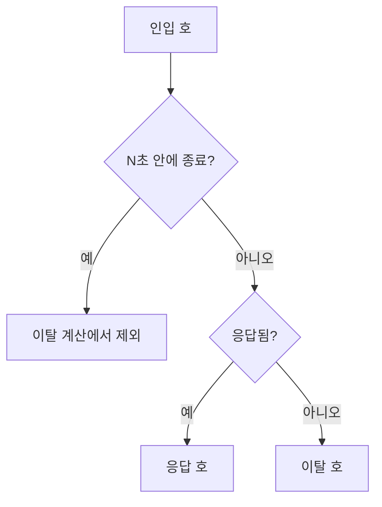
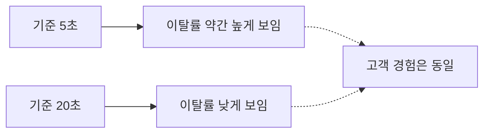

# 단기 이탈 기준

> 대기열 이탈률을 낼 때 "몇 초 안에 끊은 호는 이탈로 세지 않는다"고 정한 기준이다. 잘못 건 전화 같은 의미 없는 호를 걸러내려는 것이지만, 기준 초를 바꾸면 고객 경험은 그대로인데 숫자만 달라진다.

## 쉽게 말하면
식당 대기 명단에서 이름을 쓰자마자 지운 사람을 "기다리다 포기한 손님"으로 세면 억울하다. 그래서 "30초 안에 취소하면 센 것으로 안 친다"는 규칙을 둔다. 규칙을 한 번 정했으면 계속 같아야 월별 비교가 된다.

## 자세히
(TechTarget 답변 글은 직접 열어 확인, 나머지는 검색 결과 요약.)
- **기본 개념**: 아주 짧은 시간 안에 끊긴 호는 잘못 건 번호·오라우팅 같은 경우가 많아 진짜 이탈이 아니라고 본다(TechTarget). 일반 범위는 5~20초.
- **수정 공식(TechTarget)**: (전체 − 응답 − N초 내 종료) ÷ (전체 − N초 내 종료) × 100, 기본 N=5. 예: 전체 108, 5초 내 종료 8, 응답 95 → 이탈 5, 5 ÷ 100 = 5%.
- **30초 변형**: 장애 안내 같은 서비스 공지를 틀어 주는 센터는 공지를 들을 시간을 주려고 N을 30으로 올릴 수 있다.
- **표준은 없다**: "시간 기준도, 포함 여부에도 업계 표준이 없다"고 글이 명시한다. 센터마다 정한다.
- **다른 출처(검색 결과 요약)**: SQM Group은 5~10초를 흔한 기준으로 보고, 이런 짧은 호가 호 량의 최대 2%일 수 있다고 한다(Retell AI 용어집 인용, 2차). Geckoboard는 기본 10초이며 제외하면 보고 수치가 낮아진다고 한다. HiveDesk는 5~20초를 제시하고 숫자를 좋게 만들려고 기준을 바꾸지 말라고 경고한다.
- **운영 원칙**: 기준을 고정하고 문서화·공개하며, 바꿀 때는 변경 이력에 남기고 과거 수치를 새 기준으로 다시 계산한다.
- **AI 이관과의 연결**: 이관 호는 이미 AI와 대화한 뒤라 "아주 짧은 호"의 의미가 다를 수 있다(제안). 정면 인입과 이관 호의 기준을 같게 할지 정해야 한다. 분모 영향은 [이탈률 분모](#abandon-rate-denominator) 참고.

## 그림으로 보기

## 예시
- 보고서 각주: "5초 이하 종료 호 제외(전체의 7.4%). 기준 변경 없음(2025-01~)."
- 정전 공지를 30초 동안 방송하는 날에는 N=30 별도 보고서를 만들어 평소 수치와 섞지 않는다.

## 헷갈리는 것과 비교
| 개념 | 차이 |
|---|---|
| 단기 이탈 기준 | 이탈로 안 세는 초 기준 |
| [이탈률 분모](#abandon-rate-denominator) | 전체 인입으로 나눌지 정제 후 나눌지 |
| [대기열 이탈률](#queue-abandonment) | 이 기준이 들어가는 부모 지표 |
| [무응답 세션 제외](#silent-session-exclusion) | 챗봇에서의 비슷한 분모 정의 문제 |

## 더 읽을거리
- [TechTarget: 콘택트센터 포기 콜 비율 계산](https://www.techtarget.com/searchcustomerexperience/answer/How-to-calculate-abandoned-call-rate-for-a-contact-center) — 5~20초, 30초 변형, 표준 없음(직접 열어 확인).
- [Geckoboard: Call Abandonment Rate](https://www.geckoboard.com/best-practice/kpi-examples/call-abandonment-rate/) — 10초 기본값과 제외 효과(검색 결과 기준, 본문 미열람).
