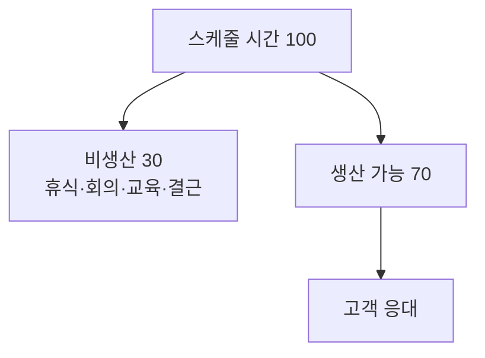
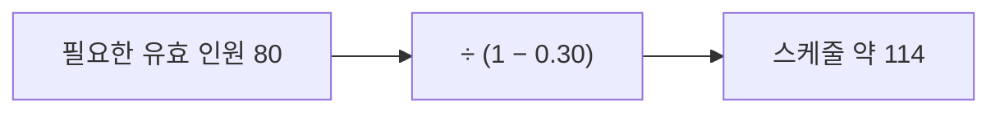

# 비생산 시간 비율 shrinkage

> 슈링키지(shrinkage)는 근무로 잡힌(스케줄된) 시간 중 휴식·회의·교육·결근 등으로 고객 응대에 쓸 수 없는 시간의 비율이다. 상담센터 인력 계획에서 쓰는 용어로, 시간당 비용의 분모(생산 시간)를 정할 때와 필요한 인원을 계산할 때 핵심이다.

## 쉽게 말하면
식당 직원 10명이 근무표에 있어도 휴게, 직원 회의, 교육, 결근으로 홀에 실제로 서 있는 사람은 7명뿐일 수 있다. "근무표 인원"과 "손님을 받을 수 있는 인원"의 차이가 슈링키지다.

## 자세히
- **공식(NICE 용어집, 열람)**: 슈링키지 % = (비생산 활동으로 잃은 시간 ÷ 총 스케줄 시간) × 100. 예: 스케줄 100시간 중 휴식·교육·결근으로 30시간을 잃으면 30%.
- **종류**: NICE는 내부(계획: 휴식·점심·교육·팀 회의·시스템 중단)와 외부(비계획: 결근)로 나눈다. Five9 글(열람)은 계획(휴식·교육·회의)과 비계획(병가·무단 결근)으로 나누며 센터마다 정의가 달라 비계획만 세는 곳도 있다고 한다. 업체 간 벤치마크는 정의가 같을 때만 비교한다.
- **일반 범위**: 업계 평균은 대략 30~35%이고 비계획 슈링키지는 5~10%라고 Five9가 소개한다. 검색 결과 중에는 25~40% 범위와 잘 운영되는 BPO의 20~25%도 있다(모두 업체 글이며 감사된 통계가 아님).
- **계획 항목의 비율 계산 예(Five9)**: 8시간 중 휴식 1시간 = 12.5%, 주 40시간 중 교육 2시간 = 5%, 매일 30분 회의(주 2.5시간) = 6.25%. 모두 더하면 계획 항목만으로 약 23.75%다(직접 합산).
- **인원 환산(NICE)**: 필요 인원 = 유효 인원 ÷ (1 − 슈링키지). 생산 80시간을 확보하려면 30%일 때 80 ÷ 0.7 ≈ 114스케줄 시간이다. 슈링키지를 10~15%로 가정하는데 실제가 30~35%면 서비스 수준을 만성적으로 못 맞춘다고 경고한다.
- **비용에 미치는 영향(직접 계산)**: 유급 2,080시간에 슈링키지 30%면 생산 시간은 1,456시간이다. 같은 총 노동비라면 시간당 비용이 [완전 부담 시간당 비용](#fully-loaded-hourly-cost)에서 1,700시간을 쓸 때보다 약 17% 더 크다(1,700÷1,456).
- **AI 도입과의 관계(해석)**: AI가 후처리나 반복 문의를 줄이면 생산 시간이 늘지만, AI 도입 교육·시스템 장애 같은 새 비생산 시간이 생기기도 한다. 도입 전후의 슈링키지를 같은 정의로 비교한다.
- **줄이는 방법(Five9)**: 비수기에 교육 배치, 휴식 시간 분산, 회의 단축 등으로 2~5%p 개선을 보수적으로 기대한다.

## 그림으로 보기

## 예시
- 상담센터 인력 계획: 피크 시간대 필요 인원이 80이고 슈링키지가 30%면 약 114명을 근무표에 올린다.
- 교육 활용: 자기 팀의 하루 시간표를 적어 계획·비계획 비비율을 직접 계산하는 실습.

## 헷갈리는 것과 비교
| 개념 | 차이 |
| --- | --- |
| [완전 부담 시간당 비용](#fully-loaded-hourly-cost) | 비용 계산. 슈링키지는 그 분모를 줄이는 요인 |
| [상담사 활용률](#agent-utilization) | 응대 가능 시간 중 실제 응대 비율. 슈링키지는 응대 가능하지 않은 시간 비율 |
| 결근율 | 슈링키지의 비계획 일부 |

## 더 읽을거리
- [NICE: What is shrinkage in workforce management?](https://www.nice.com/glossary/shrinkage) — 공식·종류·인원 환산
- [Five9: Understanding and managing shrinkage](https://www.five9.com/blog/understanding-and-managing-shrinkage-contact-centers) — 범주·평균·관리 팁
