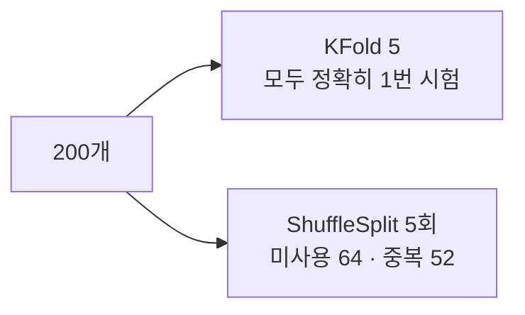
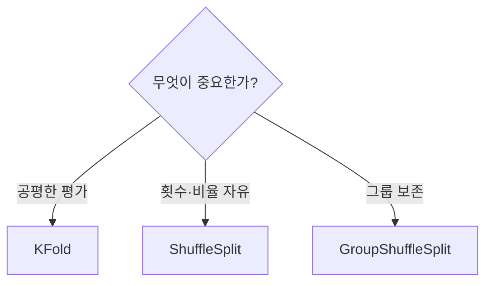

# ShuffleSplit vs KFold

> KFold는 데이터를 겹치지 않게 K조각으로 나눠 모든 표본을 정확히 한 번씩 시험에 쓰고, ShuffleSplit은 매번 독립적으로 무작위로 나눠 분할 횟수와 시험 비율을 자유롭게 정하는 대신 시험 표본이 겹치거나 한 번도 안 쓰일 수 있다.

## 쉽게 말하면
KFold는 출석부를 5조로 나눠 조마다 한 번씩 발표시키는 방식이라 모두가 정확히 한 번 발표한다. ShuffleSplit은 매번 제비뽑기로 발표자를 뽑는 방식이라 어떤 사람은 세 번 걸리고 어떤 사람은 한 번도 안 걸린다. 대신 뽑는 횟수와 인원을 마음대로 정할 수 있다.

## 자세히
- **정의(scikit-learn 문서, 열람)**: `ShuffleSplit`은 사용자가 정한 횟수만큼 독립적인 학습/시험 분할을 만든다. 표본을 먼저 섞은 뒤 나누며 `random_state`로 재현한다. 문서는 KFold의 좋은 대안으로 반복 횟수와 학습·시험 비율을 더 세밀히 조절할 수 있다고 설명한다. 문서의 예시 출력에서 시험 인덱스 2와 8이 여러 분할에 다시 나온다.
- **직접 해 본 실험(표본 200개, 시험 20%)**: KFold 5겹은 200개 전부가 시험에 정확히 1번씩 쓰였다(0번·2번 이상 모두 0). ShuffleSplit 5회는 64개가 한 번도 시험에 쓰이지 않았고 84개가 1번, 52개가 2번 이상(최대 5번)이었다. ShuffleSplit 10회는 22개가 한 번도 안 쓰이고, 50개가 1번, 128개가 2번 이상(최대 8번)이었다. 횟수를 늘릴수록 미사용은 줄지만 중복은 는다.
- **차이의 의미(해석)**: ① 시험 세트가 겹치면 분할 간 점수가 더 상관된다 ② 일부 표본이 한 번도 평가되지 않으면 그 표본의 어려움이 점수에 반영되지 않는다 ③ KFold는 K와 시험 비율이 묶여 있다(K=5면 20%). ShuffleSplit은 `test_size=0.1`, `n_splits=30`처럼 자유롭다.
- **선택 기준(해석)**: 데이터가 작고 모든 표본을 공평하게 평가하려면 KFold(반복하려면 [RepeatedKFold](#repeated-kfold)). 학습 시간이 길어 시험 비율을 따로 정하거나 분할 수를 많이 쓰고 싶으면 ShuffleSplit. 그룹이 있으면 `GroupShuffleSplit`.

## 그림으로 보기



## 예시
```python
from sklearn.model_selection import ShuffleSplit
cv = ShuffleSplit(n_splits=30, test_size=0.1, random_state=0)
```
교육 활용: 두 분할기가 각 표본을 몇 번 시험에 썼는지 `Counter`로 세어 보게 한다.

## 헷갈리는 것과 비교
| 개념 | 차이 |
| --- | --- |
| KFold | 비중첩, 모든 표본 1번 |
| ShuffleSplit | 독립 무작위, 겹침·미사용 가능 |
| [RepeatedKFold](#repeated-kfold) | KFold를 시드만 바꿔 반복 |
| [GroupShuffleSplit](#group-shuffle-split) | 그룹 단위 ShuffleSplit |

## 더 읽을거리
- [scikit-learn: Cross-validation](https://scikit-learn.org/stable/modules/cross_validation.html) — KFold, ShuffleSplit 설명과 예시
