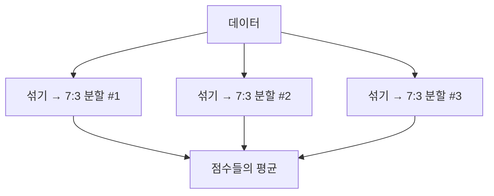
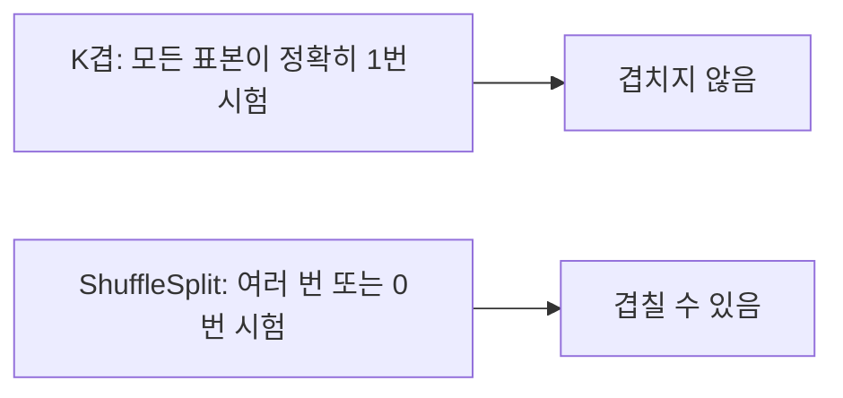

# ShuffleSplit

> ShuffleSplit은 데이터를 섞은 뒤 학습/시험으로 나누는 일을 지정한 횟수만큼 독립적으로 반복하는 분할기다. 폴드가 서로 겹치지 않는 K겹과 달리 시험 세트가 겹칠 수 있고, 반복 횟수와 시험 비율을 따로 정할 수 있다.

## 쉽게 말하면
카드를 섞어 7장은 공부용, 3장은 시험용으로 나누는 일을 여러 번 되풀이하는 것이다. 매번 새로 섞으므로 어떤 카드는 여러 번 시험용이 되고 어떤 카드는 한 번도 시험용이 안 될 수 있다.

## 자세히
- **동작(scikit-learn 교차검증 문서, 열람)**: 데이터를 섞은 뒤 n개의 독립적인 학습/시험 분할을 만든다. K겹보다 반복 횟수와 시험 비율을 세밀하게 정할 수 있다. 층화 버전은 `StratifiedShuffleSplit`, 그룹 버전은 `GroupShuffleSplit`이다. 재현하려면 정수 `random_state`를 지정한다.
- **K겹과의 차이(문서에서 따라오는 해석)**: K겹은 시험 폴드가 데이터를 완전히 나눠 모든 표본이 정확히 한 번 시험에 쓰인다. ShuffleSplit은 분할들이 서로 독립이므로 표본이 시험에 여러 번 쓰이거나 한 번도 안 쓰일 수 있다.
- **직접 계산**: 시험 비율 0.3으로 k번 분할할 때 어떤 표본이 한 번도 시험에 안 뽑힐 확률은 0.7^k다. k=3이면 34.3%, k=5면 16.8%, k=10이면 2.8%, k=20이면 0.08%다. 반복이 적으면 일부 표본이 평가에 한 번도 쓰이지 않는다.
- **선택 기준(해석)**: 표본이 독립이고 학습 시간이 길어 K겹이 부담스럽거나 시험 비율을 자유롭게 정하고 싶을 때 쓴다. 클래스가 불균형하면 `StratifiedShuffleSplit`, 그룹이 있으면 `GroupShuffleSplit`을 쓴다([그룹 누수 방지](#group-leakage-prevention)). 시간순 데이터에는 쓰지 않는다([교차검증 분할기 고르기](#cv-splitter-selection)).
- **점수 해석**: 분할이 서로 독립이어도 같은 데이터를 재사용하므로 분할별 점수의 표준편차는 신뢰구간이 아니다([층화와 지표 퍼짐](#stratification-metric-spread)).

## 그림으로 보기

## 예시
- 표본 500개 문서 분류: `ShuffleSplit(n_splits=20, test_size=0.2, random_state=0)`으로 20개 점수를 얻는다.
- 교육 활용: n=10, 시험 비율 0.3으로 직접 손으로 3번 분할해 보고 어떤 표본이 시험에 한 번도 안 뽑혔는지 센다.

## 헷갈리는 것과 비교
| 개념 | 차이 |
| --- | --- |
| [Leave-P-out](#leave-p-out) | 상위 주제. 모든 조합을 열거하는 소모적 방식 |
| ShuffleSplit | 무작위 분할을 정해진 횟수만 샘플링 |
| KFold | 시험 폴드가 겹치지 않고 모든 표본이 1번 사용 |
| GroupShuffleSplit | 그룹 단위로 섞음 |

## 더 읽을거리
- [scikit-learn: Cross-validation](https://scikit-learn.org/stable/modules/cross_validation.html) — ShuffleSplit과 변형
