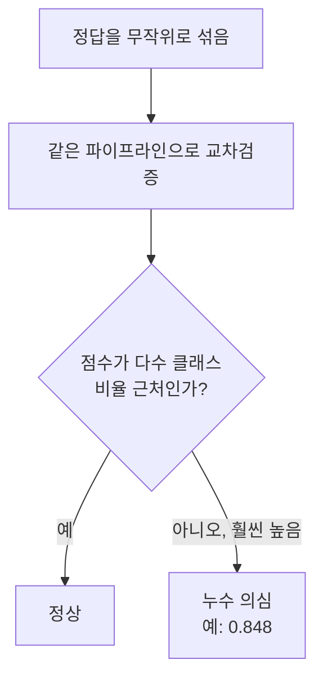
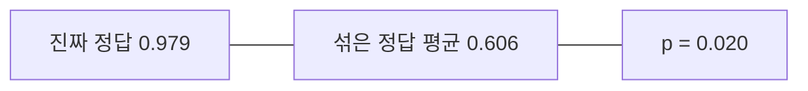

# 정답 섞기 점검

> 정답(레이블)을 무작위로 섞은 뒤 같은 파이프라인으로 교차검증을 돌려, 점수가 "찍기 수준"으로 떨어지는지 확인하는 점검이다. 섞은 정답으로도 점수가 높으면 파이프라인 어딘가에 누수가 있다.

## 쉽게 말하면
학생에게 문제와 정답을 일부러 엉뚱하게 짝지어 주고 시험을 보게 했는데도 90점이 나온다면, 학생이 실력이 아니라 정답지를 훔쳐보고 있다는 뜻이다. 정답이 쓸모없게 만들었는데 점수가 높으면 시험 방식이 잘못됐다.

## 자세히
- **공식 도구(scikit-learn 교차검증 문서의 permutation test score, 열람)**: `permutation_test_score`는 진짜 정답으로 교차검증 점수를 구하고, 정답을 `n_permutations`번 섞어 만든 귀무 분포와 비교해 p-값(섞은 점수가 진짜 점수 이상인 비율)을 준다. 귀무가설은 "추정기가 특성과 정답의 통계적 의존성을 쓰지 못한다"이다. 문서는 `n_permutations`를 100보다 크게, `cv`를 3~10으로 권하고, 모델을 `(n_permutations+1)×cv`번 학습하므로 학습이 빠를 때만 실용적이라고 한다. 표본이 몇백 개 미만이고 특성이 많은 데이터에서 특히 유용하다.
- **직접 해 본 실험 1(유방암 데이터, 표준화+로지스틱 회귀, 5겹, 순열 50회)**: 진짜 점수 0.979, 섞은 정답 점수의 평균 0.606, 최대 0.627, p-값 0.020(순열 50회라 최솟값이 약 0.02). 섞은 점수가 0.5가 아닌 0.6인 것은 양성 클래스가 약 63%라 항상 다수 클래스를 찍어도 0.63 정도가 나오기 때문이다. "찍기 수준"은 0.5가 아니라 다수 클래스 비율이다.
- **직접 해 본 실험 2(누수 파이프라인, 무작위 특성 2,000개·표본 100개)**: 특성 선택을 교차검증 밖에서 전체 데이터에 적용한 채로 정답을 섞어도 평균 정확도가 0.848이었다. 섞은 정답인데 0.85면 누수의 결정적 증거다([Pipeline으로 누수 막기](#sklearn-pipeline-leakage-guard)).
- **판독(해석)**: 섞은 정답 점수가 다수 클래스 비율 근처면 정상, 그보다 확실히 높으면 누수 의심. 진짜 점수가 섞은 분포보다 못하면 모델이 신호를 못 쓰는 것이다.
- **주의(문서)**: 낮은 p-값은 신호가 있다는 뜻일 뿐 구조가 강하다는 뜻이 아니다. 모델이 약해서 p-값이 높게 나올 수도 있다.

## 그림으로 보기



## 예시
```python
from sklearn.model_selection import permutation_test_score
score, perm, p = permutation_test_score(pipe, X, y, cv=cv, n_permutations=100)
```
교육 활용: 누수 있는 파이프라인과 없는 파이프라인에 같은 점검을 돌려 결과 차이를 비교한다.

## 헷갈리는 것과 비교
| 개념 | 차이 |
| --- | --- |
| 정답 섞기 점검 | 누수·우연 점수 진단 |
| 순열 중요도 | 특성별 의존도 측정(다른 도구) |
| [Pipeline으로 누수 막기](#sklearn-pipeline-leakage-guard) | 누수 예방 |
| [최종 테스트 세트 확인](#final-test-set-confirmation) | 올바른 최종 평가 |

## 더 읽을거리
- [scikit-learn: Cross-validation — Permutation test score](https://scikit-learn.org/stable/modules/cross_validation.html) — 귀무가설, p-값, 권장 설정
