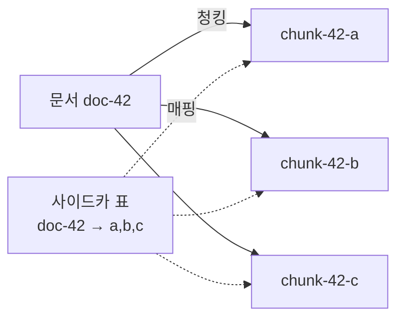
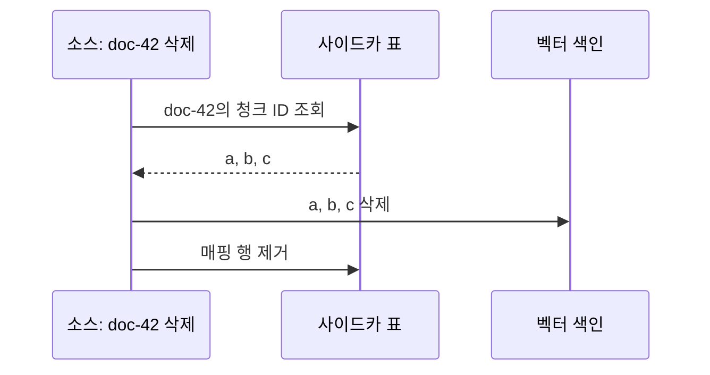

# 사이드카 청크 매핑

> 문서 하나가 여러 청크(조각)로 쪼개져 각각 벡터로 저장되므로, **"문서 ID → 청크 ID 목록"을 별도 표(사이드카)로 따로 관리**해 두고 문서를 삭제·수정할 때 그 정확한 청크 ID들을 벡터 색인에서 지우는 방법이다.

## 쉽게 말하면
책 한 권을 낱장으로 찢어 서랍 여러 곳에 나눠 넣었다고 하자. 책을 폐기하려면 "이 책의 낱장은 3번 서랍 2장, 7번 서랍 5장…"이라는 목록이 있어야 한다. 목록이 없으면 어디에 남았는지 몰라 낱장이 서랍에 계속 남는다. 그 목록이 사이드카 매핑 표다.

## 자세히
(tianpan.co 블로그 「Retrieval Cascade Failure: How Document Deletion Poisons Your RAG Pipeline」(2026-05-09)를 WebFetch로 직접 확인. 개인 블로그 글이므로 실무 사례로 읽고, 수치는 글의 제안이다.)
- **왜 필요한가(글)**: 한 문서가 N개 청크가 되고 각 청크가 자기 벡터를 갖는다. 삭제가 놓친 청크는 **유령(ghost)**으로 남아 높은 순위에 오를 수 있다. 청크 ID가 불안정하거나 청크 경계가 바뀌면 문서의 청크를 다 찾기 어렵다. 파이프라인은 문서 단위로 추적하고 색인은 청크 단위로 저장하므로 둘을 잇는 표가 필요하다.
- **설계(글)**: 수집 시 **안정적인 문서 ID·청크 ID**를 부여해 모든 벡터의 메타데이터로 저장하고, **직접 관리하는 표**에 문서→청크 매핑을 둔다. 삭제 시 표에서 청크 ID를 찾아 **그 ID들을 벡터 저장소에서 정확히 삭제**한다. 글이 필수라고 명시한 필드는 이 ID들뿐이다.
- **엣지 케이스(글)**: **재청킹**으로 ID가 새로 생기거나 경계가 달라지면 옛 청크를 열거할 수 없어 고아가 남는다. **수정** 시 옛 청크를 식별 못 하면 옛 버전과 새 버전이 함께 살아 어느 쪽이 검색될지 알 수 없다. → [안정적 청킹 알고리즘](#stable-chunking-algorithm)
- **감사 절차(글)**: 지난주 삭제된 문서 **약 50개**를 표본으로 뽑아 각 문서의 청크가 그럴듯한 질의의 **상위 50 결과**에 나오는지 확인한다. 자주 나오면 유령 임베딩 문제다.
- **동기화 방식(글)**: 야간 배치(읽기·해시·차분·푸시)는 삭제 문서가 **최대 24시간** 유령 결과를 낼 수 있고, CDC(Postgres 논리 복제, MongoDB change stream, Kafka)는 **몇 초 안에** 반응하고 순서를 보존한다. 대신 정확히 한 번 의미론·데드레터 큐·리플레이 도구를 직접 운영해야 한다. 고위험 코퍼스는 CDC, 저위험은 배치를 권한다. → [CDC 동기화](#change-data-capture-sync)
- **검색 시점 방어(글)**: 모델에 넘기기 전 각 청크의 문서 ID를 원본에 확인, 청크에 `last_verified_at`을 두고 오래된 것 제외, 신선도 가중 점수는 최신 편향 위험이 있어 오프라인 평가로 검증.
- **한계**: 글은 키워드 색인·캐시 같은 다른 검색 경로의 삭제는 상세히 다루지 않는다. 벡터 ID만 지우면 다른 경로에 남을 수 있다(검색 요약에서 한 출처가 지적, 직접 확인은 못 함).

## 그림으로 보기

## 예시
- 사내 위키 문서를 삭제하면 사이드카 표(Postgres)에서 청크 ID 12개를 찾아 벡터 DB에서 정확히 삭제.
- 교육 활동: 문서 3개·청크 9개 예시 표를 만들고 한 문서를 삭제하는 순서를 손으로 따라가기.

## 헷갈리는 것과 비교
| 개념 | 차이 |
|---|---|
| 사이드카 매핑 | 문서→청크 ID 목록 표 |
| 메타데이터 필터 삭제 | 벡터 메타데이터의 doc_id로 필터해 삭제(엔진 지원 필요) |
| [Tombstone 삭제](#tombstone-deletion) | 삭제 표시 방식 |
| [좀비 문서](#zombie-documents) | 이 표가 없을 때 생기는 문제 |

## 더 읽을거리
- [Retrieval Cascade Failure (tianpan.co)](https://tianpan.co/blog/2026/05/09/retrieval-cascade-failure-document-deletion-rag) — 청크 팬아웃, 사이드카 표, 감사 절차, CDC 대 배치(직접 확인, 개인 블로그).
