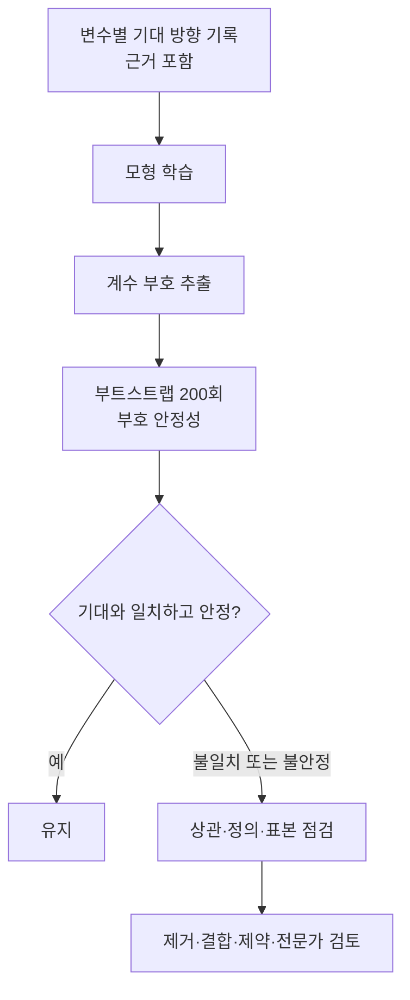

# 계수 부호 점검표

> 모델의 변수마다 **"도메인 상식상 기대 방향"과 "학습된 계수의 부호"를 나란히 적고, 부트스트랩에서 부호가 얼마나 안정적인지까지 기록**한 표. 한 줄 한 줄 읽으며 어긋난 변수를 찾아내는 신용 모형 점검의 기본 도구다.

## 쉽게 말하면
시험 채점표에 "정답"과 "내 답"을 나란히 적는 것과 같다. 어긋난 줄이 바로 보이고, 같은 문제를 여러 번 풀어도 답이 흔들리는지(안정성)까지 적어 두면 더 믿을 수 있다.

## 자세히
출처: [잘못된 부호 진단](#wrong-sign-diagnostic)과 [다중공선성](#multicollinearity) 노드의 원리, 그리고 **직접 실행한 합성 데이터 실험**(scikit-learn 로지스틱 회귀, 2026-11-18). 아래 수치는 설명용 가상 데이터에서 나온 값이다.
- **표의 열(제안)**: 변수 / 기대 방향(+·−) / 근거 / 계수(표준화) / 부호 일치 여부 / 부트스트랩 부호 안정성 / 상관이 높은 변수 / 조치.
- **실험 설정**: 3,000명. 소득과 카드 한도는 상관 0.95. 참 모형에서 소득은 강한 위험 감소(−0.8), 한도는 약한 감소(−0.1), 사용률(+0.6)·연체 횟수(+0.9)는 증가. 표준화 후 거의 규제 없는 로지스틱 회귀.
- **직접 계산한 점검표**:

| 변수 | 기대 | 계수 | 일치 | 부호 안정성(−인 비율, 200회) | 비고 |
|---|---|---|---|---|---|
| 소득 | − | −0.887 | 일치 | 1.00 | 한도와 상관 0.95 |
| 카드 한도 | − | −0.068 | 일치 | **0.67** | 불안정 |
| 사용률 | + | 0.607 | 일치 | 0.00(항상 +) | 안정 |
| 연체 횟수 | + | 0.624 | 일치 | 0.00(항상 +) | 안정 |

- **읽는 법**: 겉으로는 모두 "일치"지만 **카드 한도는 재표본의 약 3분의 1에서 부호가 뒤집힌다**. 단일 적합의 일치 여부만으론 부족하고 안정성 열이 필요하다는 예다. 한도를 빼면 소득 계수는 −0.887 → −0.952로 바뀌어 한도와 소득이 정보를 나눠 갖고 있음을 보여 준다.
- **조치 선택지**: 상관 변수 제거·결합, 구간화, 제약 적용, 도메인 전문가 검토([도메인 전문가 검토](#domain-expert-review)), 데이터 정의 재확인.
- **한계**: 합성 데이터라 실제 신용 데이터의 빈도와 다를 수 있다. 부호가 맞아도 크기가 비현실적일 수 있어 크기 점검도 필요하다.

## 그림으로 보기


## 예시
```python
import numpy as np, pandas as pd
from sklearn.linear_model import LogisticRegression
from sklearn.preprocessing import StandardScaler
Z = StandardScaler().fit_transform(X)
coef = LogisticRegression(C=1e6, max_iter=1000).fit(Z, y).coef_[0]
neg = np.zeros(X.shape[1])
for _ in range(200):
    i = np.random.randint(0, len(y), len(y))
    neg += LogisticRegression(C=1e6, max_iter=1000).fit(Z[i], y[i]).coef_[0] < 0
table = pd.DataFrame({"변수": X.columns, "계수": coef.round(3), "음수 비율": neg / 200})
```
교육 활용: 신용·보험 모형 검토 교육에서 "일치" 열만 보고 승인하지 않고 안정성 열을 요구하는 습관을 연습.

## 헷갈리는 것과 비교
| 개념 | 차이 |
|---|---|
| 계수 부호 점검표 | 기대 대 실제 + 안정성을 한 표로 |
| [잘못된 부호 진단](#wrong-sign-diagnostic) | 원인 후보와 대응 절차 전체 |
| [다중공선성](#multicollinearity) | 부호 불안정의 주요 원인 |
| [부분 의존 곡선 점검](#partial-dependence-check) | 비선형 모델의 방향 점검 |

## 더 읽을거리
- [scikit-learn: 선형 모델 계수 해석](https://scikit-learn.org/stable/auto_examples/inspection/plot_linear_model_coefficient_interpretation.html) — 상관 변수에서 계수가 불안정해지는 예
- [잘못된 부호 진단](#wrong-sign-diagnostic) — 이 지도의 상위 노드
