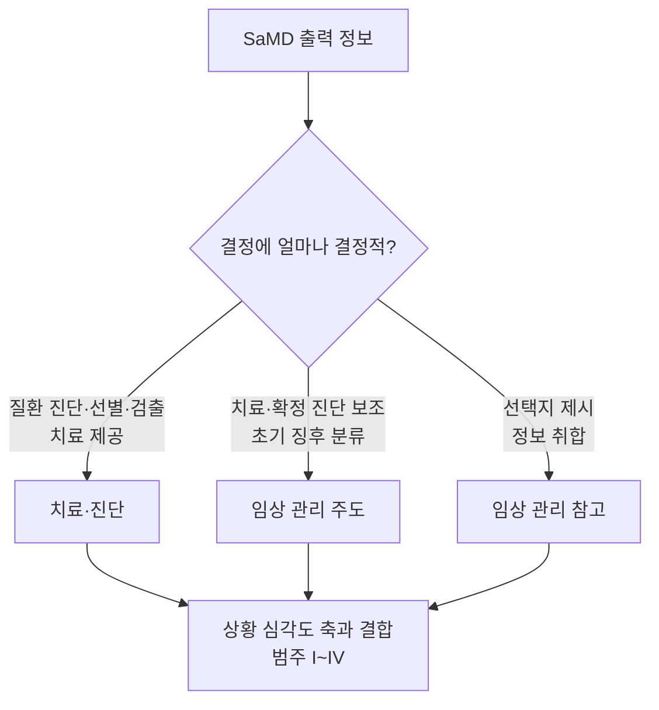

# 정보의 중요도 축

> IMDRF의 SaMD 위험 분류에서 두 축 중 하나. 소프트웨어가 내놓는 정보가 의료 결정에 **얼마나 결정적인가**를 세 단계, 즉 치료·진단 / 임상 관리 주도 / 임상 관리 참고로 나눈다.

## 쉽게 말하면
같은 날씨 앱이라도 "오늘 비 올 확률 참고"와 "지금 우산을 펴라"는 영향이 다르다. 소프트웨어의 말이 결정을 직접 대신하는가, 이끄는가, 그저 참고가 되는가를 가르는 축이다.

## 자세히
출처: FDA 2019 토론 문서 "Proposed Regulatory Framework for Modifications to AI/ML-Based SaMD"(PDF를 내려받아 읽음)가 IMDRF 위험 분류 틀을 요약하고 Figure 1 표를 재현한다. IMDRF 원문(N12, 2014)은 서버 오류로 열지 못했다. 세부 정의(아래 세 항목의 괄호 설명)는 검색 도구가 IMDRF 발표 자료를 요약한 것으로 이 문서 원문과는 대조하지 못했다. FDA CDS 지침(2026-01-29, 원문 확인)도 위험 분류와 고려사항은 이 IMDRF 문서를 참조하라고 안내한다.
- **FDA 문서의 요약(직접 확인)**: 정보의 중요도는 SaMD가 제공하는 정보가 의료 결정에 갖는 의미, 즉 **치료·진단 / 임상 관리 주도 / 임상 관리 참고**의 의도된 사용을 나타내는 요인이다. 다른 요인은 상황의 상태(위급·중증·비중증)이고, 둘을 합쳐 SaMD를 I(낮음)~IV(높음) 네 범주로 둔다. 표는 위급: IV·III·II, 중증: III·II·I, 비중증: II·I·I(열 순서 치료·진단 / 관리 주도 / 관리 참고).
- **치료·진단(treat or diagnose)**: 치료를 제공하거나, 질환을 진단·선별·검출하는 정보(발표 자료 요약).
- **임상 관리 주도(drive clinical management)**: 치료를 돕거나, 확정 진단을 돕거나, 초기 징후를 분류(triage)하는 정보.
- **임상 관리 참고(inform clinical management)**: 선택지를 제시하거나 임상 정보를 취합해 보여 주는 정보.
- **다른 축과의 조합**: 상황 심각도(위급·중증·비중증)와 결합해 범주 I~IV가 정해진다. 검색 요약의 표에서 위급 상황은 치료·진단 IV, 관리 주도 III, 참고 II다([SaMD 위험 분류](#samd-risk-categorization)).
- **FDA CDS와의 연관(해설)**: CDS 지침의 조건 3은 판단을 대체·지시하는 출력(구체적 진단·치료 지시)과 추천 제공을 구분한다. IMDRF의 "치료·진단" 대 "참고"와 비슷한 구분이지만 같은 체계가 아니며, 이 연관은 이 지도의 해석이다.
- **주의**: 이 틀은 규제기관별로 쓰임이 다르다. 검색 요약은 EU에서 MDCG 2019-11이 IMDRF 범주를 EU 위험 등급에 대응시키는 표를 둔다고 했으나 이는 확인하지 못했다.

## 그림으로 보기

## 예시
- 영상에서 암을 검출·진단하는 AI → 치료·진단.
- 중환자의 악화 초기 징후를 분류해 우선순위를 알리는 도구 → 관리 주도.
- 환자의 검사 이력을 한 화면에 모아 보여 주는 도구 → 참고.

## 헷갈리는 것과 비교
| 개념 | 차이 |
|---|---|
| 정보 중요도 축 | 출력이 결정에 미치는 무게 |
| [상황 심각도 축](#healthcare-situation-axis) | 환자 상태가 위급·중증·비중증인가 |
| [SaMD 위험 분류](#samd-risk-categorization) | 두 축을 합친 범주 표 |
| [조건 3: 의료진 추천](#cds-criterion-3) | FDA CDS의 비슷한 구분, 다른 체계 |

## 더 읽을거리
- [FDA CDS 지침 PDF (2026-01-29)](https://www.fda.gov/media/109618/download) — IMDRF 위험 분류 문서 참조 안내(내려받아 확인)
- [IMDRF: SaMD Possible Framework for Risk Categorization (N12)](https://www.imdrf.org/sites/default/files/docs/imdrf/final/technical/imdrf-tech-140918-samd-framework-risk-categorization-141013.pdf) — 원문(이번에는 서버 503으로 열지 못함)
