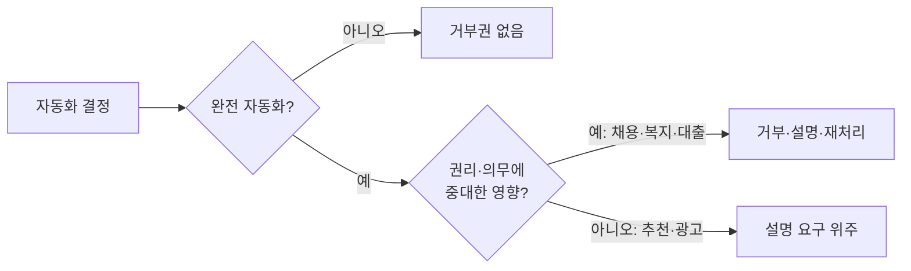

# 중대한 영향

> 개인정보 보호법 제37조의2에서 자동화 결정에 대한 **거부권**이 생기는 두 번째 문턱. 결정이 정보주체의 권리·의무에 "중대한 영향"을 미쳐야 한다. (법률 자문 아님)

## 쉽게 말하면
식당 추천 앱이 AI로 메뉴를 골라 주는 것과, AI가 내 대출·취업·복지 수급을 정하는 것은 무게가 다르다. 앞의 것은 싫으면 안 따르면 그만이지만, 뒤의 것은 삶이 걸린다. 법은 "삶이 크게 걸린 결정"에만 거부라는 강한 권리를 준다.

## 자세히
출처: 뉴시스 2023-11-22 보도(본문 확인), 법률신문 해설(본문 확인), 검색 요약(고시 제정안). 조문·고시 원문은 확인하지 못했다.
- **위치**: 제37조의2 거부권은 ①완전 자동화 ②권리·의무에 중대한 영향, 두 조건이 모두 필요하다. 설명 요구는 그 밖의 자동화 결정에도 가능하다는 해설이 있다(검색 요약).
- **정의(제정안, 주장 수준)**: 개인정보위 고시 제정안은 권리·의무에 법적 영향을 주고 그 본질적 내용을 제한하는 경우로 정의했다고 전해진다. 최종 확정 문구는 확인하지 못했다.
- **판단 힌트**: 개인정보위 담당 과장은 2023-11 "생명·재산·신체에 중대한 영향을 미치는 경우로 유추할 수 있다"고 설명했고, 구체적 예시는 시행령이 아니라 안내서로 주겠다고 했다.
- **보도된 예**: 채용 면접·서류 심사, 복지수급자 선정. 금융 대출 신용평가도 거론되었다.
- **미확정**: 기사 시점에 시행령안은 구체 범위를 정하지 않았다. 현재 안내서 예시 목록은 확인하지 못했으니 위원회 자료실을 봐야 한다.

## 그림으로 보기

## 예시
- 복지급여 대상 선정을 알고리즘이 확정 → 중대한 영향 가능성이 높다.
- 쇼핑 앱 상품 추천 → 대체로 낮다(해석).
- 직원이 쓰는 사내 번역 도구의 번역 결과 → 권리·의무와 무관.
- 교육 활용: 직무별 AI 도입 시 "이 결정이 사람의 권리에 얼마나 닿는가"를 체크리스트 첫 질문으로 쓴다.

## 헷갈리는 것과 비교
| 개념 | 차이 |
|---|---|
| [완전 자동화 결정](#fully-automated) | 사람 개입 여부 문턱 |
| 중대한 영향 | 결정의 파급력 문턱 |
| [인적 개입 재처리](#human-reprocessing) | 거부 후 조치 |
| 고위험 AI(EU AI Act) | 별도 법의 분류, 기준이 다름 |

## 더 읽을거리
- [뉴시스: 취준생 당락 가르는 AI 면접관, 이젠 소명 요구할 수 있다](https://www.newsis.com/view/NISX20231122_0002531002) — 채용·복지 예시와 개인정보위 설명
- [법률신문 해설](https://www.lawtimes.co.kr/news/articleView.html?idxno=194236) — 중대한 영향 범위는 안내서를 기다려야 한다는 서술
