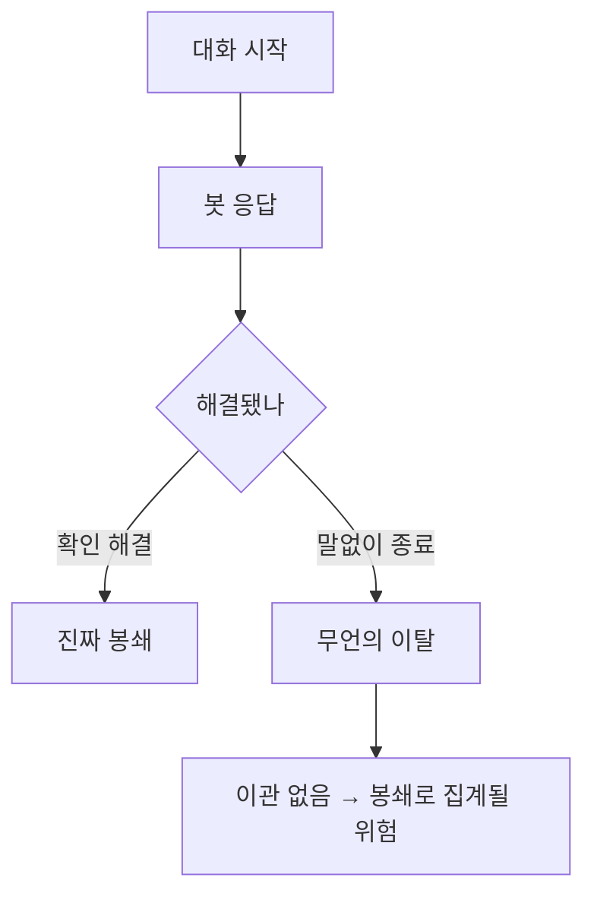
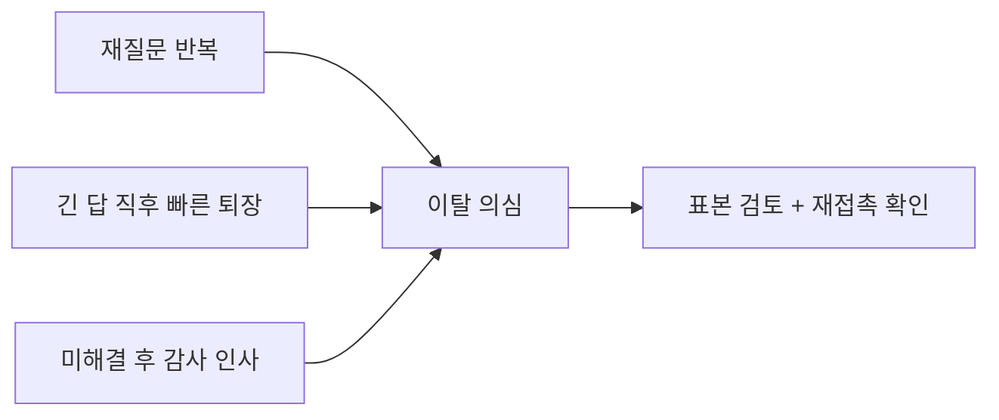

# 무언의 이탈

> 고객이 불만이나 신호 없이 대화 도중 조용히 떠나는 것이다. 사람 이관이 없으므로 "봉쇄"로 잡히기 쉬워서, 성과 지표에는 좋은 숫자로 나타나는 것이 문제다.

## 쉽게 말하면
식당에서 손님이 아무 말 없이 계산도 안 하고 조용히 나갔다. 직원은 "불만 접수 0건"이라 생각한다. 그러나 사실은 음식이 마음에 안 들어서 떠난 것일 수 있다. 말없이 떠나는 손님은 기록에 흔적이 거의 안 남는다.

## 자세히
(벤더 블로그 기반이라 업계 표준 정의는 아니다.)
- **작업 정의(Agnost AI 글 확인)**: 목표가 충족되기 전에 대화가 끝나고, 마무리 확인도 후속 행동도 없는 경우. 질문 하나에 답하고 끝난 한 턴 대화는 해당하지 않는다.
- **이탈 시점 분류(InsertChat 용어집 요약, 검색 결과 기준)**: 봇 첫 응답 전 / 대화 중 / 상담원 대기 중 / 답을 받은 뒤. 각각 원인이 다르다.
- **감지 신호(Agnost AI)**: ① 조용한 재질문 — 같은 요청을 말만 바꿔 반복(예: 한 대화에서 3회, 의미 유사도로 비교) ② 긴 답변 직후 짧은 시간(예: 30초) 내 이탈 — 다만 성공적인 빠른 이탈도 있으니 표본을 읽을 것 ③ 해결 안 된 답 뒤의 "고마워요"·"ok" — 맥락으로 판단, 하루~이틀 내 같은 목표로 재방문했는지 확인 ④ 몇 주에 걸쳐 요청이 짧고 단순해지는 조용한 다운그레이드.
- **타임아웃 방식**: 응답이 없는 시간이 설정값을 넘으면 이탈로 표시하는 플랫폼이 있다(검색 결과 기준).
- **공식**: 이탈 대화 ÷ 시작된 전체 대화 × 100(검색 결과 요약). 업계 벤치마크는 신뢰할 만한 것이 없다고 Agnost 글도 말한다(한 용어집은 20~35%를 일반적이라 했으나 벤더 수치).
- **턴별 분석**: 많은 사용자가 같은 턴에서 떠나면 거기서 무언가 고장 난 것이다.
- **개선 방향**: 모호한 요청엔 되묻기(프롬프트), 빠진 도구·검색·이관 경로 보강(하네스), 지원 안 되는 기능 반복 요청은 제품 신호로.
- **한계**: 이탈 CSAT 설문은 응답자 편향이 있을 수 있으나 이 부분은 출처를 찾지 못했다.

## 그림으로 보기

## 예시
- 로그에서 "같은 뜻 질문 3회 이상 + 이관 없음 + 5분 내 종료" 세션을 뽑아 사람이 20건 읽어 본다.
- 이탈이 많은 턴 번호별 히스토그램을 보고 그 턴의 도구 호출 오류를 점검.

## 헷갈리는 것과 비교
| 개념 | 차이 |
|---|---|
| 무언의 이탈 | 대화 중 말없이 떠남 |
| [무응답 세션 제외](#silent-session-exclusion) | 처음부터 말이 없던 세션 처리 |
| 이관 | 사람에게 넘김(신호 있음) |
| [봉쇄율의 함정](#containment-rate-trap) | 이탈이 봉쇄로 둔갑하는 문제 |

## 더 읽을거리
- [Agnost AI: 사용자가 AI 제품을 조용히 포기하는 이유](https://agnost.ai/blog/silently-give-up-ai-products) — 감지 신호와 개선 방향(직접 열어 확인, 벤더 글).
- [Hamming: 음성 에이전트 이탈 분석](https://hamming.ai/resources/voice-agent-drop-off-analysis-abandonment-framework) — 이탈 측정 틀(검색 결과 기준, 본문 미열람).
