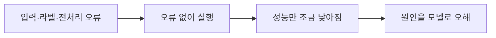
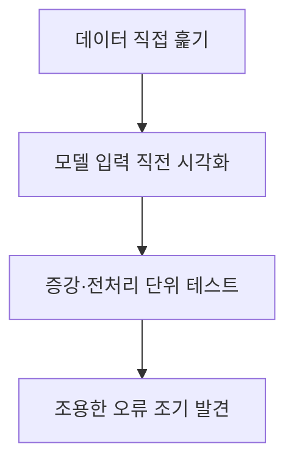

# 조용한 데이터 버그

> 예외나 경고 없이 실행되지만 **입력 데이터·라벨·전처리가 틀려서 모델 성능을 조용히 깎는 오류**다. 신경망은 틀린 입력에도 "그럭저럭" 학습해 버려서 버그가 드러나지 않는다.

## 쉽게 말하면
오븐 온도 표시가 10도 어긋나 있어도 빵은 구워진다. 다만 조금 덜 부풀 뿐이다. "빵이 나왔으니 정상"이라고 믿으면 계속 어긋난 채로 굽는다.

## 자세히
- Andrej Karpathy의 "A Recipe for Training Neural Networks"(2019-04-25)는 신경망 실패가 **조용하다(fail silently)**고 강조한다. 틀리게 설정해도 "훈련은 되고 조금 더 나쁘게 작동"한다. 글이 든 예:
  - 이미지를 좌우 뒤집으면서 **라벨은 뒤집지 않음** — 네트워크가 자기 예측을 뒤집는 법을 배워 꽤 괜찮게 동작할 수 있다.
  - 자기회귀 모델에서 한 칸 어긋나(off-by-one) 정답값이 입력으로 들어감.
  - 기울기를 자르려다 손실을 잘라 이상치 예제가 무시됨.
  - 사전학습 가중치를 쓰면서 원래의 평균 정규화를 쓰지 않음.
  - 정규화 강도·학습률·감쇠율·모델 크기 오설정.
- 물체 탐지에서의 사례([박스 좌표 형식](#bbox-coordinate-formats)): 박스 형식을 잘못 지정해도 예외 없이 증강이 돌고 박스만 어긋난다(이 지도 실험에서 IoU 약 0.53까지 어긋남).
- 처방(Karpathy 글): ① **데이터와 하나가 되기** — 모델 코드를 건드리기 전에 많은 예제를 훑고, 중복·손상된 이미지·라벨, 클래스 불균형, 이상치를 찾는다. 라벨 종류·박스 크기·이상치를 정렬·플롯하는 간단한 코드를 쓴다 ② **네트워크 바로 앞에서 시각화** — 모델에 들어가는 입력이 유일한 "진실의 원천"이므로 그 직전에서 그려 본다(글에 따르면 숨은 전처리·증강 문제가 반복해서 드러났다).
- 추가(제안): 증강 파이프라인에 단위 테스트(뒤집기 후 박스·라벨 일치)와 범위 검사를 넣는다. 전체를 오버피팅 가능한 작은 표본에 학습시켜 보면 손실이 0 근처로 안 가는 이유를 찾기 쉽다.

## 그림으로 보기

## 예시
- 수평 뒤집기 증강에서 "왼쪽 팔" 같은 방향 의존 라벨을 안 바꿈 → 정확도가 조금 낮은 채 계속 학습.
- 교육: "모델이 안 좋을 때 모델부터 바꾸지 말고 데이터부터 본다"는 원칙 사례.

## 헷갈리는 것과 비교
| 개념 | 차이 |
|---|---|
| 조용한 데이터 버그 | 에러 없이 성능만 저하 |
| 크래시(예외) | 실행이 멈춰서 바로 발견 |
| 데이터 드리프트 | 운영 중 데이터 분포 변화 |
| [박스 그려 보기 점검](#draw-bbox-sanity-check) | 이 버그를 잡는 구체적 습관 |

## 더 읽을거리
- [A Recipe for Training Neural Networks — Andrej Karpathy](https://karpathy.github.io/2019/04/25/recipe/) — 조용한 실패·데이터 먼저 보기(읽음).
