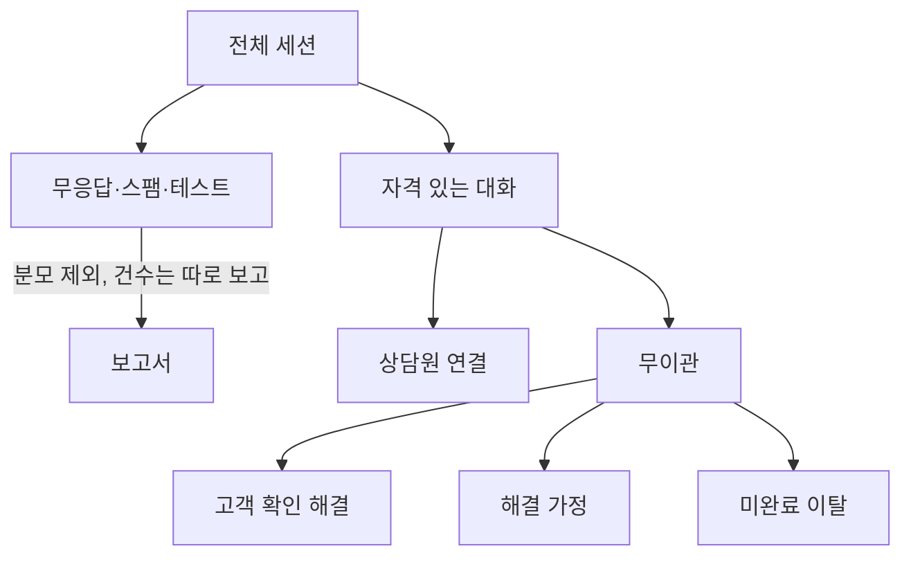
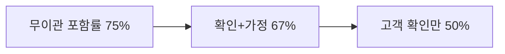

# 무응답 세션 제외

> 봉쇄율을 계산할 때 고객이 한 마디도 안 한 세션(위젯만 열고 닫음 등)을 분모에서 뺄지 말지 정하는 일이다. 분모 정의에 따라 같은 데이터에서 율이 크게 달라지므로 보고서에 규칙을 문서로 박아 둬야 한다.

## 쉽게 말하면
가게 문만 열어 보고 간 사람을 "손님 수"에 넣을지의 문제다. 넣으면 "주문 전환율"이 낮아 보이고, 빼면 높아 보인다. 어느 쪽이든 정해 두고 계속 같은 방식으로 세야 달력의 달과 달을 비교할 수 있다.

## 자세히
- **정해진 표준은 없다**: 검색 결과 어느 곳도 무응답 세션 제외를 표준으로 말하지 않았고 플랫폼마다 다르다(벤더 글 기준).
- **Featurebase 분모 규칙(직접 열어 확인)**: 분모는 "자격 있는 챗봇 대화". 고객이 메시지를 보내 봇이 응답에 참여한 실제 지원 대화는 포함, 내부 테스트·스팸·질문 없이 위젯만 연 방문은 제외, 세션 경계·진행 중 대화·보고 기간도 문서로 정한다. 진행 중 세션은 "포함"으로 분류하지 않는다.
- **같은 데이터, 다른 정의(Featurebase 가상 데이터)**: 자격 대화 1,200 중 상담원 연결 300, 무이관 900(고객 확인 해결 600 + 해결 가정 200 + 미완료 이탈 100).
  - 무이관 포함률 75.0% · 확인+가정 66.7% · 고객 확인만 50.0% · 이탈을 분모에서 제외 72.7%(원문 데이터로 계산) · 이탈을 실패로 처리 66.7%.
  - 정의만 바꿔도 50%~75%까지 달라진다.
- **구분**: 무응답 세션(처음부터 말이 없음)은 분모에서 빼는 것이 일반적인 선택지이고, [무언의 이탈](#silent-abandonment)(대화 중 떠남)은 별도 이탈률로 추적한다. 두 가지를 섞으면 율이 왜곡된다.
- **권장 보고**: 무이관 포함률(참고), 확인 해결률(엄격), 이탈률, 재문의율, 미결 대화 수를 이름과 공식을 붙여 따로 낸다.

## 그림으로 보기

## 예시
- 월간 보고: "봉쇄율 75% → 72.7%" 변화가 실제 성과 변화인지, 분모 규칙을 바꾼 탓인지 먼저 대시보드 정의 변경 이력을 확인.
- 규칙 문서 한 줄 예: "분모=메시지 1건 이상 보낸 대화. 위젯만 연 세션은 제외하고 별도 건수 표기."

## 헷갈리는 것과 비교
| 개념 | 차이 |
|---|---|
| 무응답 세션 제외 | 분모에서 빼는 결정(말이 없던 세션) |
| [무언의 이탈](#silent-abandonment) | 대화 중 말없이 떠난 경우 |
| [지연 재접촉](#deferred-contact) | 며칠 뒤 다른 채널로 재접촉 |
| [봉쇄율의 함정](#containment-rate-trap) | 이 노드의 부모 개념 |

## 더 읽을거리
- [Featurebase: 챗봇 봉쇄율 공식과 개선](https://www.featurebase.app/blog/chatbot-containment-rate) — 분모 정의와 정의별 수치 비교(직접 열어 확인, 벤더 글).
- [Helpfeel: Containment Rate](https://en.helpfeel.com/glossary/containment-rate) — 해결 기반 정의(검색 결과 기준, 본문 미열람).
