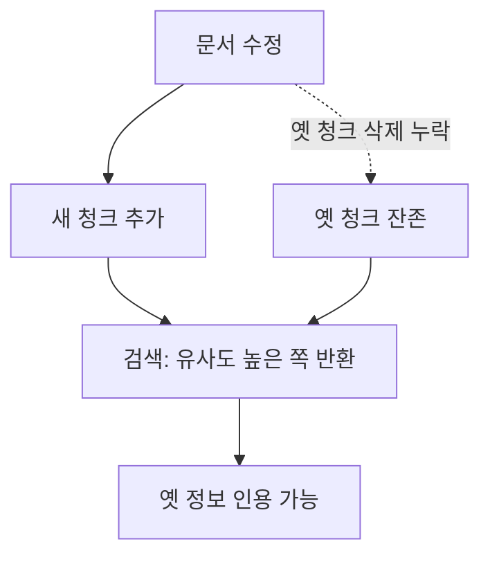
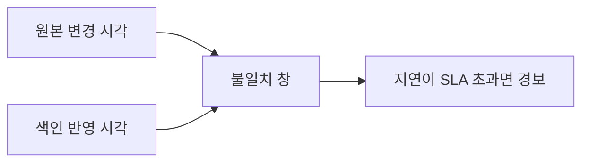

# 조용한 버전 드리프트

> 문서를 수정했더니 **새 버전 청크가 옛 버전 청크를 대체하지 않고 나란히 색인에 쌓여**, 검색이 어느 쪽이 최신인지 모른 채 점수 높은 쪽을 돌려주는 현상이다. 오류 없이 낡은 정보가 나오므로 조용하다.

## 쉽게 말하면
요금표를 새로 만들어 게시판에 붙이면서 옛 요금표를 떼지 않았다. 둘 다 붙어 있어 손님이 먼저 눈에 띄는 쪽을 읽는다. 어느 쪽이 현재 요금인지 표에는 날짜도 없다.

## 자세히
(아래는 블로그 글 두 편의 설명이며 독립 연구 결과가 아니다. 수치는 해당 글이 인용한 것으로 직접 검증하지 못했다.)
- **현상(tianpan.co, 직접 확인)**: 수정된 문서가 대체본과 함께 색인에 남고 검색은 유사도가 더 높은 쪽을 반환해 어느 쪽이 최신인지 신호가 없다. 임베딩은 의미를 담지 시간을 담지 않으므로 현재와 낡은 내용을 구별 못 한다. 충실도·근거성 같은 표준 지표는 통과해 눈에 안 띈다.
- **일관성 문제로 보는 관점(PostSyntax 글, 직접 확인)**: RAG는 원본 문서 저장소와 벡터 색인이 수집 파이프라인으로 연결된 두 저장소이고, 변경 후 검색 가능해지기까지의 간격이 **불일치 창(inconsistency window)**이다. 실패 유형: 낡은 읽기(stale), 유령 읽기(삭제 문서 잔존, [좀비 문서](#zombie-documents)), 더러운 읽기(메타데이터와 임베딩이 다른 버전), 반복 불가 읽기(에이전트가 단계마다 다른 버전을 읽음), 옛·새 값이 같이 상위에 오르는 충돌 사실(예: 마이그레이션 전후 포트 번호). 지연·에러율·유사도는 정상으로 보여 모니터링이 놓친다.
- **탐지(tianpan)**: 수집 시 **콘텐츠 해시**를 저장해 원본과 주기 비교, 문서별 임베딩 모델 버전 추적, 검색 시 청크 나이를 로그로 남겨 분포 이동 감시. 경보 예로 "결과의 20% 이상이 180일보다 오래됨".
- **고치기**: 수집 시 `indexed_at`, `source_last_modified`, `ttl_days`, `content_hash`, `embedding_model_version` 메타데이터, **안정적인 ID**로 수정 시 정확한 청크 교체, 버전 관리와 tombstone, CDC·웹훅·정기 대조로 전파, 위험 콘텐츠(가격·보안 공지·컴플라이언스)는 시간 인식 점수나 날짜 창 사전 필터. 코퍼스를 변경 빈도·낡음 비용으로 분류해 신선도 SLA를 다르게 정하고(예시 TTL: 가격 약 7일, API 문서 약 2주, 정책 약 6개월 — 해당 글의 예), 주간 top-k 겹침이 85~95%면 건강하고 약 70% 아래면 품질 저하 신호라는 글쓴이의 경험칙이 있다(일반 기준 아님).
- **일관성 수준(PostSyntax)**: 최종 일관성(싸지만 신선도 약함) → 제한적 낡음(최대 지연을 정해 경보) → 자기 쓰기 읽기 → 강한 일관성(쓰기 지연 증가). 벡터 색인은 복제본이 아니라 **비동기로 갱신되는 투영**으로 보라고 한다.

## 그림으로 보기

## 예시
- 환불 정책이 30일에서 14일로 바뀌었는데 챗봇이 두 버전을 섞어 답함: 청크 메타데이터의 `indexed_at`·해시로 옛 청크를 찾아 정리.
- 교육 소재: 같은 질문의 답이 문서 두 버전 사이에서 흔들리는 사례를 보고 "AI는 날짜를 모른다"를 설명.

## 헷갈리는 것과 비교
| 개념 | 차이 |
|---|---|
| 조용한 버전 드리프트 | 새·옛 버전이 공존 |
| [좀비 문서](#zombie-documents) | 삭제했는데 남음 |
| [임베딩 모델 불일치](#embedding-model-mismatch) | 모델이 달라 벡터 공간이 다름 |
| [RAG 인덱스 버전](#rag-index-versioning) | 색인 생성 조건 기록 |

## 더 읽을거리
- [Stale retrieval and RAG data quality (tianpan.co)](https://tianpan.co/blog/2026/04/15/stale-retrieval-rag-data-quality) — 공존 버전·탐지·수정(직접 확인, 개인 블로그).
- [Most RAG pipelines have no consistency model (PostSyntax)](https://postsyntax.substack.com/p/most-rag-pipelines-have-no-consistency) — 불일치 창·일관성 수준(직접 확인).
