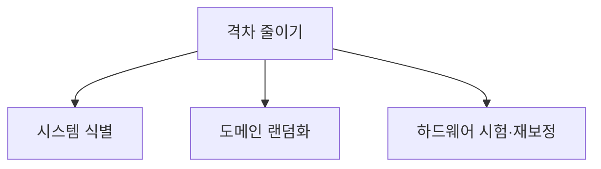

# 시뮬-현실 격차

> **시뮬레이션에서는 잘되던 정책이 실제 로봇에서는 실패하는** 차이. 시뮬레이터가 현실을 완벽히 재현하지 못해 생긴다.

## 쉽게 말하면
비행 시뮬레이터에서 만점이어도 실제 바람과 기체 떨림에서는 조종이 달라지는 것과 같다. 연습장과 실전의 차이다.

## 자세히
(검색 요약과 Tobin 논문 초록 기준.)
- 원인: 현실에는 **비강성, 기어 백래시, 마모, 유체 역학** 같은 효과가 있는데 현재 시뮬레이터가 이를 담지 못한다(검색 요약, 2022·2026 논문 인용).
- 줄이는 두 방법: [시스템 식별](#system-identification)은 시뮬레이터 파라미터를 실측으로 보정하되 시간이 많이 들고 오류가 나기 쉽다. [도메인 랜덤화](#domain-randomization)는 조건을 다양화해 학습한다(Tobin 외 2017: 시뮬 RGB만으로 학습한 검출기가 실제 물체를 약 1.5cm로 위치 추정).
- 결합(2026 sim-to-sim 진자 연구 요약, 범위 좁음): 소수의 식별 롤아웃이 전이 격차 대부분을 줄이고, 실데이터가 있으면 넓힌 랜덤화보다 추정 파라미터 주변에서 훈련하는 편이 좋았다.
- NVIDIA Isaac Lab 문서: 추정으로 모델을 개선하고 그 주변을 랜덤화, 극단이 아닌 그럴듯한 범위를 쓰라고 권한다. 하드웨어 시험으로 전이를 확인해야 한다.
- 대안: 시뮬 대신 [사람 시연](#imitation-learning)으로 학습하면 격차 문제를 피하지만 시연 수집 비용이 든다(해석).
- 한계: 수치는 연구마다 설정이 달라 직접 비교할 수 없다.

## 그림으로 보기

## 예시
- 시뮬에서 걷는 휴머노이드가 실제 바닥 마찰 차이로 미끄러짐.
- 교육: 같은 정책을 마찰값을 바꿔 시뮬에서 돌려 성능 변화를 관찰.

## 헷갈리는 것과 비교
| 개념 | 차이 |
|---|---|
| 시뮬-현실 격차 | 문제 자체 |
| 도메인 랜덤화 | 해결책 중 하나 |
| [분포 이동](#distribution-shift) | 일반적인 학습-배포 분포 차이 |

## 더 읽을거리
- [Domain Randomization 논문](https://arxiv.org/abs/1703.06907) — 시뮬만으로 학습한 전이(초록 읽음).
- [NVIDIA Isaac Lab: Simulation to Reality](https://docs.nvidia.com/learning/physical-ai/getting-started-with-isaac-lab/latest/robot-learning-fundamentals/08-simulation-to-reality.html) — 실무 가이드(검색 결과 확인).
