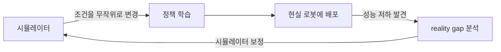

# Sim-to-real

> Sim-to-real은 시뮬레이션에서 학습한 로봇 정책을 **현실 로봇에 옮겨 쓰는 것**, 그리고 그때 생기는 시뮬레이션과 현실의 차이(reality gap)를 줄이는 기술이다.

## 쉽게 말하면
게임 속 운전 연습만 하고 실제 도로에 나가면 노면 마찰, 바람, 센서 잡음이 달라 당황한다. 시뮬레이터에서 날씨와 노면을 일부러 매번 바꿔 가며 연습시키면 현실의 낯선 조건에도 덜 놀란다.

## 자세히
- **왜 시뮬레이션인가**: 현실 로봇 학습은 느리고 위험하고 비싸다. 시뮬레이터는 병렬로 수천 번 빠르게 시도할 수 있다.
- **reality gap**: 물리 모델 오차, 렌더링 차이, 센서·지연 차이 때문에 정책 성능이 현실에서 떨어진다(Zhao 등 2020 서베이).
- **도메인 랜덤화**: 시뮬레이터의 색·조명·카메라 위치·물리 파라미터·관측·행동에 잡음을 섞어 한 시뮬레이션에 과적합하지 않게 하는 정규화 기법(Muratore 등 2022 리뷰). OpenAI의 로봇 손 조작(2020)이 대표 사례.
- **그 밖의 방법**: 도메인 적응, 시스템 식별(현실 데이터로 시뮬레이터 보정), 모방학습, 메타학습, 지식 증류.
- 한계: 랜덤화 범위가 너무 넓으면 학습이 어렵고, 좁으면 현실을 못 덮는다.

## 그림으로 보기

## 예시
- 시뮬레이터에서 물체 질량·마찰·조명을 매번 바꿔 가며 잡기 학습 → 실제 로봇에서 처음 보는 물체도 잡는다.
- 사족보행 로봇이 시뮬레이션 지형 수천 종으로 걷기를 배우고 실제 계단을 오른다.

## 헷갈리는 것과 비교
| 개념 | 차이 |
|---|---|
| Sim-to-real | 가상→현실 이식 |
| [강화학습](#reinforcement-learning) | 시뮬에서 정책을 배우는 학습 방식 |
| [VLA 모델](#vla-model) | 실제 시연 데이터로 학습하는 경우가 많음 |
| [월드 모델](#world-model) | 학습된 시뮬레이터 역할도 가능 |

## 더 읽을거리
- [Robot Learning from Randomized Simulations (Frontiers, 2022)](https://www.frontiersin.org/journals/robotics-and-ai/articles/10.3389/frobt.2022.799893/full) — 도메인 랜덤화 분류 리뷰
- [Sim-to-Real Transfer in Deep RL for Robotics: a Survey](https://deeplearn.org/arxiv/158817/sim-to-real-transfer-in-deep-reinforcement-learning-for-robotics:-a-survey) — 2020 서베이
