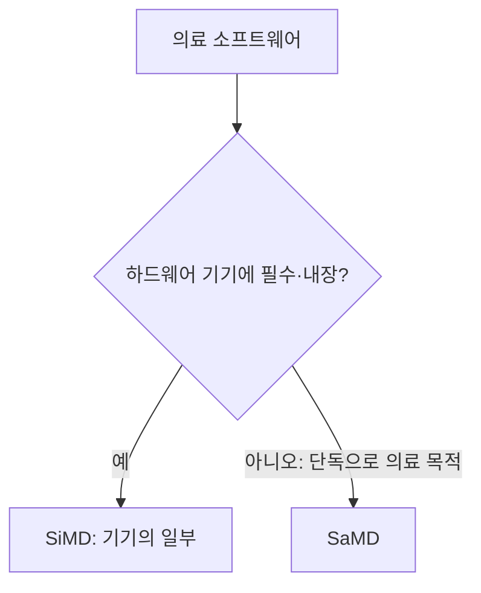

# SiMD

> Software in a Medical Device. 의료기기 하드웨어 안에 내장되거나 그 기기를 작동시키는 데 필요한 소프트웨어. 단독으로 의료 기능을 하는 SaMD와 대비된다.

## 쉽게 말하면
자동차의 엔진 제어 소프트웨어(SiMD)와, 스마트폰에서 따로 돌아가 운전 중 의사를 돕는 앱(SaMD)의 차이다. 앞의 것은 기기의 일부, 뒤의 것은 그 자체로 기기다.

## 자세히
출처: 규제 해설 사이트 검색 요약(법적 정의 문서 직접 확인 안 함).
- **정의 경향**: 하드웨어 의료기기 안에 내장됐거나 그 작동에 필요한 소프트웨어(예: 주입 펌프의 펌웨어). 해설 중 하나는 SiMD가 구속력 있는 법적 정의가 없는 설명용 용어라고 한다. FDA 2022년 기기 소프트웨어 기능 정책 문서가 두 용어를 모두 쓴다고 인용한다(미확인).
- **판별 질문**: 이 소프트웨어가 의료 기능을 단독으로 수행하나(SaMD), 하드웨어 기기를 운영하기 위해 존재하나(SiMD)?
- **AI 사례**: 초음파 기기에 들어간 영상 개선 AI는 기기 일부(SiMD 성격), 별도 서버·앱으로 영상을 분석하는 AI는 SaMD 성격일 수 있다. 실제 분류는 의도 용도와 FDA 판단에 따른다.
- 규제 경로는 소프트웨어 이름이 아니라 기기 등급·위험([의료기기 등급](#device-risk-classes))이 정한다.

## 그림으로 보기

## 예시
- 인공호흡기 제어 펌웨어: SiMD. 폐 CT 영상을 클라우드에서 분석하는 AI 서비스: SaMD.

## 헷갈리는 것과 비교
| 개념 | 차이 |
|---|---|
| SiMD | 기기 안·필수 |
| [SaMD](#samd) | 단독 의료 소프트웨어 |
| [IMDRF](#imdrf) | SaMD 용어 제정 포럼 |

## 더 읽을거리
- [SaMD vs SiMD (PURE Global)](https://www.pureglobal.com/blog-posts/samd-software-as-a-medical-device-fda-eu-mdr-guide) — 비교 해설(검색 결과로만 확인)
