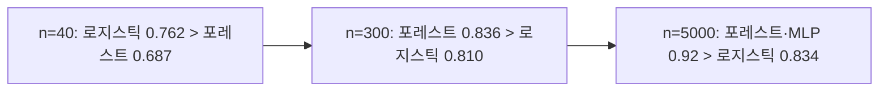
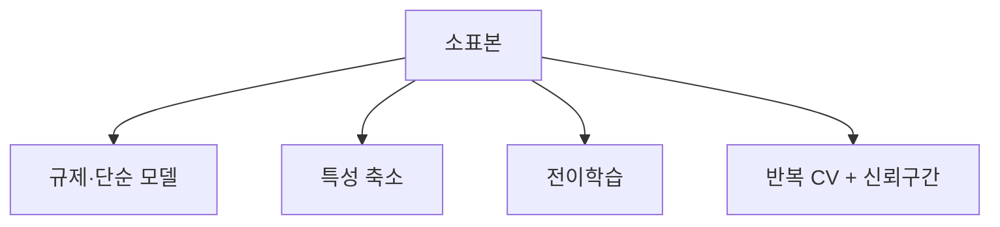

# 소표본엔 단순 모델

> 학습 데이터가 적을 때는 **규제된 단순 모델이 복잡한 모델보다 낫거나 비슷한 경우가 많고**, 데이터가 늘수록 복잡한 모델이 역전한다. 소표본에서는 모델을 키우는 것보다 단순화·규제·사전지식(전이학습)이 효과적이다.

## 쉽게 말하면
외울 문제가 40개뿐인데 수백 개 규칙을 만들어 외우면 시험에서 헛다리를 짚는다. 문제가 5천 개쯤 되면 복잡한 규칙도 쓸모가 있다. 자료 양에 맞는 도구를 골라야 한다.

## 자세히
(scikit-learn 1.9.1, 합성 이진 분류: 특성 30개 중 정보 특성 6개, 학습 크기별로 모델을 학습하고 **같은 1만 개 시험 세트**로 정확도 측정, 작은 n은 8회 평균, 5,000은 3회 평균, 직접 실행)
| 학습 n | 로지스틱(L2, C=0.1) | 트리(제한 없음) | 랜덤 포레스트 | MLP(64,64) |
|---|---|---|---|---|
| 40 | **0.762** | 0.594 | 0.687 | 0.711 |
| 100 | **0.797** | 0.698 | 0.780 | 0.768 |
| 300 | 0.810 | 0.762 | **0.836** | 0.812 |
| 1,000 | 0.826 | 0.824 | **0.882** | 0.855 |
| 5,000 | 0.834 | 0.877 | 0.920 | **0.922** |
- **해석**: n=40~100에서는 규제된 선형 모델이 가장 좋았다(0.762, 0.797). 결정트리는 0.594~0.698로 크게 떨어졌다(암기). n=300을 넘으면 포레스트가 앞서고 n=5,000에서는 MLP와 포레스트가 선형 모델을 10%p 가까이 앞선다. **교차점은 데이터와 문제에 따라 다르다**(이 설정에서는 대략 n≈200~300). 선형 문제에 가까워 선형 모델이 유리한 실험이므로 일반 법칙으로 쓰지 않는다.
- **근거 문헌(Raschka, arXiv 1811.12808 초록 확인)**: 작은 데이터셋에서는 홀드아웃 평가를 권장하지 않고, 부트스트랩과 교차검증·중첩 교차검증·5x2 CV F-검정으로 알고리즘을 비교할 것을 권한다.
- **소표본 전략(제안)**
  1. **규제**: L2·L1, 깊이 제한, 조기 종료, 드롭아웃. 모델 용량을 데이터 양에 맞춘다.
  2. **특성 수 줄이기**: 도메인 지식으로 특성 선택(단, 전체 데이터로 선택하면 [누수](#late-split-error)).
  3. **사전학습·전이학습**: 이미 큰 데이터로 학습된 모델을 가져와 마지막 층만 학습.
  4. **데이터 증강·합성**: 학습 세트에만 적용([시험셋 무증강](#test-set-no-augmentation)).
  5. **평가**: 반복 교차검증과 신뢰구간(분할이 불안정)([부트스트랩](#bootstrap-confidence-interval), [반복 CV](#repeated-cross-validation)). 하이퍼파라미터 탐색 시 [중첩 교차검증](#nested-cross-validation).
  6. **단순 기준선 먼저**: 로지스틱·나이브 베이즈 같은 기준선을 이기지 못하면 복잡한 모델은 필요 없다.
- **주의**: 작은 데이터에서는 어떤 모델이든 점수 변동이 크다(n=40의 시험 점수는 시드마다 크게 달라진다). 모델 순위를 결정하기 전에 불확실성을 본다([점수 차이와 노이즈](#cv-score-difference-vs-noise)).

## 그림으로 보기

## 예시
- 환자 80명의 임상 데이터: L2 로지스틱 회귀를 기준선으로 하고 포레스트가 반복 CV에서 의미 있게 앞서는지 확인.
- 교육: "모델을 키우기 전에 데이터를 늘릴 수 있는가"를 먼저 묻는 습관.

## 헷갈리는 것과 비교
| 개념 | 차이 |
|---|---|
| 단순 모델 | 용량 낮음, 소표본에 안정적 |
| 복잡 모델 | 데이터가 충분할 때 유리 |
| 규제 | 복잡한 모델의 용량을 제한하는 도구 |
| [모델 용량과 노이즈](#model-capacity-vs-noise) | 라벨 노이즈에서의 용량 영향 |

## 더 읽을거리
- [Raschka: Model Evaluation, Model Selection, and Algorithm Selection in ML (arXiv 1811.12808)](https://arxiv.org/abs/1811.12808) — 작은 데이터에서의 평가·선택 권고(초록 확인).
- [scikit-learn 학습 곡선 가이드](https://scikit-learn.org/stable/modules/learning_curve.html) — 데이터 양에 따른 성능 변화 진단.
