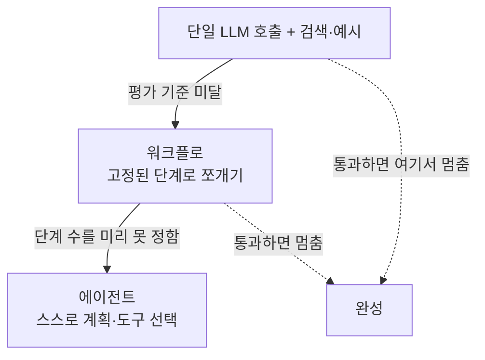
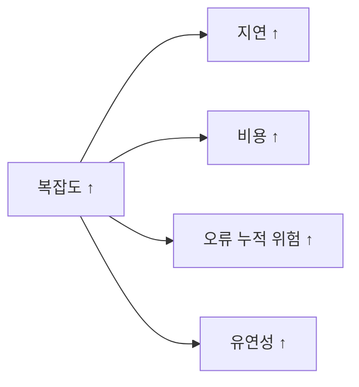

# 가장 단순한 해법부터

> LLM 시스템은 "가장 단순하게 되는 방법"을 먼저 찾고, 그것으로 부족할 때만 복잡도를 올린다는 설계 원칙. 에이전트가 필요 없는 경우도 많다.

## 쉽게 말하면
못 하나 박는데 굴착기를 부르지 않는다. 망치로 되는지 먼저 본다. AI 자동화도 똑같다. 질문 하나에 프롬프트 한 번이면 끝날 일을, 여러 에이전트가 서로 회의하게 만들면 느리고 비싸고 고장 나기 쉽다.

## 자세히
Anthropic 엔지니어링 글 "Building effective agents"의 핵심 조언이다.
- **사다리**: ① 단일 LLM 호출(검색·예시 추가로 최적화) → ② **워크플로**(미리 정한 코드 경로로 LLM과 도구를 엮음) → ③ **에이전트**(LLM이 스스로 과정과 도구를 결정). 위로 갈수록 유연하지만 지연·비용이 늘고 오류가 누적될 위험이 커진다.
- **워크플로 5패턴**: 프롬프트 체이닝, 라우팅, 병렬화(분할·투표), 오케스트레이터-워커, 평가자-최적화 루프.
- **에이전트가 맞는 때**: 필요한 단계 수를 미리 알 수 없는 열린 문제. 이때도 샌드박스 테스트와 가드레일이 필요하다.
- **워크플로가 맞는 때**: 작업이 명확하고 예측 가능성이 중요할 때.
- **프레임워크 주의**: 추상화 층이 프롬프트와 응답을 가려 디버깅을 어렵게 하므로 처음엔 API를 직접 쓰길 권한다.
- **실무 체크리스트**: 한 번 호출로 평가 기준을 통과하는가? 안 되면 프롬프트·예시·검색부터 손본다. 그래도 안 되면 고정 단계로 쪼갠다. 단계 수가 입력에 따라 달라질 때만 에이전트를 쓴다.

## 그림으로 보기

## 예시
- 회의록 요약: 단일 호출로 충분. 형식 예시 두 개와 "액션 아이템 먼저" 지시만 넣는다.
- 고객 문의 분류 후 답변: 라우팅 워크플로(분류 → 유형별 프롬프트). 에이전트까지는 불필요.
- 버그 수정 자동화: 수정해야 할 파일 수를 미리 모르니 에이전트가 적합.

## 헷갈리는 것과 비교
| 개념 | 차이 |
|---|---|
| [워크플로 vs 에이전트](#workflow-vs-agent) | 코드가 흐름을 정함 vs 모델이 흐름을 정함 |
| [에이전트 비용·지연](#agent-cost-latency) | 단순함 원칙이 지키려는 대가 |
| 과소 설계 | 단순함이 목표이지 평가 없이 대충 하는 것이 아니다. 기준 통과 여부로 판단 |

## 더 읽을거리
- [Building effective agents (Anthropic)](https://www.anthropic.com/engineering/building-effective-agents) — 단순함 원칙과 5가지 워크플로 패턴
