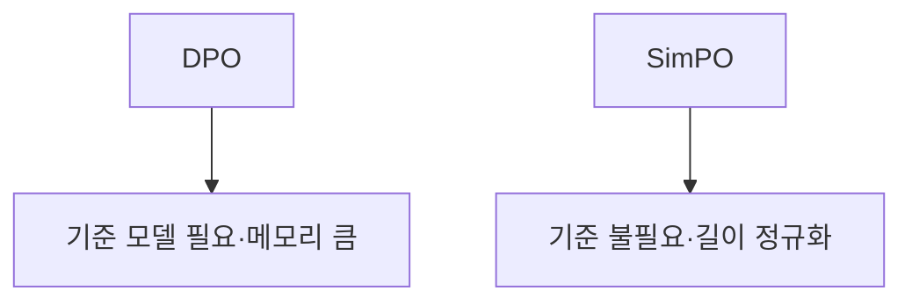

# SimPO

> DPO처럼 선호 쌍으로 학습하되 **기준(reference) 모델 없이**, 시퀀스의 **평균 로그 확률**을 암묵적 보상으로 쓰고 **목표 보상 마진**을 더한 방법(Meng·Xia·Chen, NeurIPS 2024).

## 쉽게 말하면
DPO는 "원래 모델보다 얼마나 나아졌나"를 비교하려고 원래 모델(기준)을 계속 옆에 두는데, SimPO는 그 기준 없이 "이 답이 평균적으로 얼마나 그럴듯한가"만으로 좋은 답과 나쁜 답의 간격을 벌린다.

## 자세히
(arXiv 2405.14734 초록 읽음.)
- **기준 모델 불필요**: 시퀀스의 평균 로그 확률을 암묵적 보상으로 사용. 저자는 이것이 모델의 생성 방식과 더 잘 맞고 **계산·메모리 효율**이 높다고 말한다. 평균을 쓰므로 길이 정규화 효과가 있다.
- **목표 보상 마진**: Bradley-Terry 목적에 마진 항을 추가해 선호 답과 비선호 답의 격차를 벌린다.
- 결과(저자 보고): DPO보다 AlpacaEval 2에서 **최대 6.4점**, Arena-Hard에서 **최대 7.5점** 높았다. Gemma-2-9B-it 기반 최고 모델은 AlpacaEval 2 길이 보정 승률 **72.4%**, Arena-Hard 승률 **59.1%**.
- 주의: 이 벤치마크는 LLM 심판 기반이므로 [심판 편향](#position-bias)의 영향을 받을 수 있다. 위 수치는 초록 기준 저자 보고이며 독립 재현은 확인하지 못했다.

## 그림으로 보기

## 예시
- 같은 선호 데이터로 DPO와 SimPO를 학습해 AlpacaEval 점수와 학습 메모리를 비교.
- 교육: 보상의 정의(원 대비 개선 vs 평균 확률)를 비유로 설명.

## 헷갈리는 것과 비교
| 개념 | 차이 |
|---|---|
| SimPO | 기준 모델 없음, 평균 로그 확률, 마진 |
| [DPO](#dpo) | 기준 모델 대비 로그 비율 |
| [KTO](#kto) | 쌍 대신 이진 라벨 |

## 더 읽을거리
- [SimPO 논문](https://arxiv.org/abs/2405.14734) — 기준 없는 선호 최적화(초록 읽음).
- [DPO 논문](https://arxiv.org/abs/2305.18290) — 비교 대상(초록 읽음).
