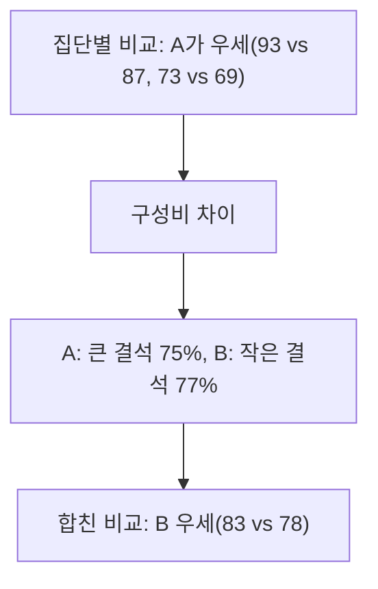
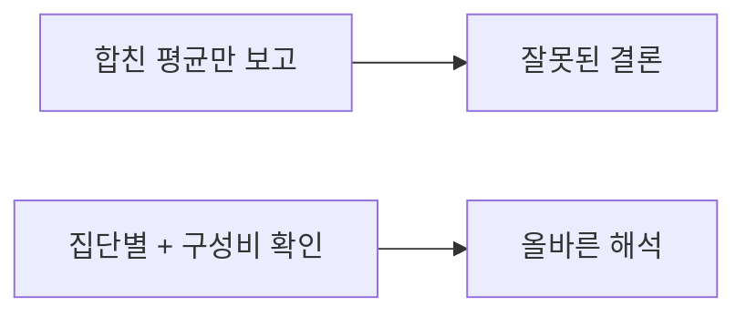

# 평균의 함정(심프슨 역설)

> 전체(합친) 데이터에서의 결론이 **집단(층)으로 나눠 보면 정반대**가 되는 현상. 집단마다 비중이 다를 때(교란 변수가 있을 때) 평균은 방향을 뒤집을 수 있다. 모델 평가에서도 전체 정확도와 슬라이스별 결론이 어긋날 수 있다.

## 쉽게 말하면
의사 A는 쉬운 환자(작은 결석) 대신 어려운 환자(큰 결석)를 많이 맡는다. 각 환자군에서는 A가 더 잘 치료하는데, 모든 환자를 합쳐 보면 쉬운 환자를 많이 맡은 B가 더 좋아 보인다. 평균이 환자 구성을 숨긴 것이다.

## 자세히
(Wikipedia "Simpson's paradox" 본문 확인)
- **신장 결석 치료 예(성공/전체)**
  | 집단 | 치료 A | 치료 B |
  |---|---|---|
  | 작은 결석 | 81/87 = **93%** | 234/270 = 87% |
  | 큰 결석 | 192/263 = **73%** | 55/80 = 69% |
  | **합친 전체** | 273/350 = 78% | 289/350 = **83%** |
  각 집단에서는 **A가 더 낫지만** 합치면 **B가 더 낫다.** 원인은 **집단 구성비 차이**다(직접 계산): 치료 A의 환자 중 작은 결석 비중은 87/350 = **24.9%**, 치료 B는 270/350 = **77.1%**. 쉬운 사례(작은 결석)를 B가 훨씬 많이 맡았다.
- **UC 버클리 입학(1973년 가을)**: 전체 지원자 12,763명, 합격률 41%. **남성 8,442명 44%, 여성 4,321명 35%** 로 여성에게 불리해 보였다. 가장 큰 6개 학과에서는 지원자 4,526명 합격률 39%(남성 2,691명 45%, 여성 1,835명 30%)였지만, 학과별 합격률은 6%~64%로 편차가 컸고 **여성이 경쟁이 심한 학과에 더 많이 지원**했다. 학과를 조정한 자료에서는 오히려 여성에게 작지만 통계적으로 유의한 유리함이 있었다고 문서는 설명한다.
- **모델 평가·데이터 품질에서의 의미**
  1. 모델 A·B의 전체 정확도 비교가 **슬라이스별 비교와 반대**일 수 있다(평가 세트 구성이 서로 다르면).
  2. 데이터 수집 전략(예: 더 많이 모은 쉬운 사례)이 평균을 부풀릴 수 있다([평균이 약한 집단을 가리는 문제](#average-masking-weak-groups)).
  3. 학습 곡선을 집단별로 그리지 않으면 전체 곡선의 개선이 특정 집단의 악화를 가린다([집단별 학습 곡선](#per-slice-learning-curve)).
- **대응**
  1. 결론을 내기 전에 **층(집단) 구성비**를 확인한다.
  2. **같은 구성**의 평가 세트(또는 표준화/가중)로 비교한다.
  3. 인과 판단이 필요하면 어느 변수가 교란인지 도메인 지식으로 판단(합칠지 나눌지는 통계만으로 결정되지 않는다 — 이 글에서 인과 모형을 다루지 않음).
  4. 보고서에 전체 수치와 집단별 수치를 함께 쓴다.

## 그림으로 보기



## 예시
```python
import pandas as pd
d = pd.DataFrame({"trt":["A","A","B","B"],"size":["small","large"]*2,
                  "ok":[81,192,234,55],"n":[87,263,270,80]})
print(d.assign(rate=d.ok/d.n))                       # 집단별
print(d.groupby("trt").apply(lambda g: g.ok.sum()/g.n.sum()))   # 합친 값: A 0.78, B 0.83
```
- 두 챗봇 버전을 서로 다른 질문 난이도 분포로 평가하면 전체 정확도 순위가 뒤집힐 수 있으므로 난이도별로 비교.

## 헷갈리는 것과 비교
| 개념 | 설명 |
|---|---|
| 심프슨 역설 | 합침 vs 층별 결론 반전 |
| 교란 변수 | 구성비 차이를 만드는 변수 |
| 평균 마스킹 | 소수 집단 실패가 평균에 묻힘 |
| 표준화 | 같은 구성비로 맞춰 비교 |

## 더 읽을거리
- [Wikipedia: Simpson's paradox](https://en.wikipedia.org/wiki/Simpson%27s_paradox) — 신장 결석·버클리 예시(본문 열어 확인).
