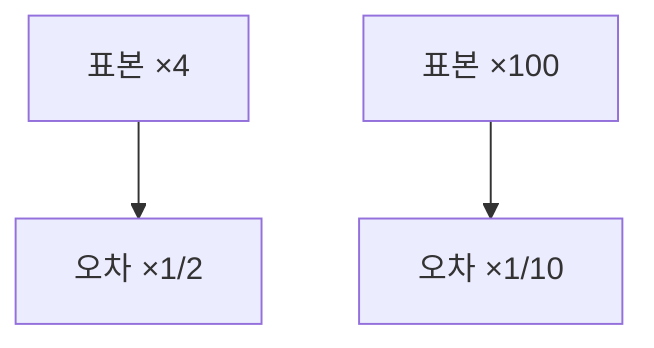

# 시뮬레이션 표본 수

> 몬테카를로 시뮬레이션에서 표본(시행) 수를 늘리면 추정 오차가 줄지만 속도가 느리다. 오차는 표본 수의 제곱근에 반비례해서, 표본을 4배로 늘려야 오차가 절반이 된다.

## 쉽게 말하면
여론조사에서 응답자를 1,000명에서 4,000명으로 늘리면 오차 범위가 대략 절반이 된다. 100명에서 1,000명으로 늘린 만큼의 효과를 보려면 훨씬 많은 사람이 필요하다. 시뮬레이션 횟수도 같은 원리다.

## 자세히
- **수렴 속도(Wikipedia Monte Carlo method·integration, 열람)**: 중심극한정리에 따라 "표본을 4배로 늘리면 오차가 절반"이고 차원 수와 무관하다. 문서는 이를 "1/N"이라고 적었지만 설명(4배→절반)은 1/√N과 맞는다. 표준오차는 V·σ_N/√N이다. 이 오차 추정은 엄밀한 상한이 아니며 중요한 구조를 표본이 놓치면 오차가 과소추정될 수 있다고 문서가 경고한다.
- **필요한 표본 수 계산(같은 문서)**: 평균 오차를 ε 안으로 신뢰수준 z에서 맞추려면 n ≥ s²z²/ε²이다. s²는 소규모 시험 실행으로 구한 분산 추정이다. 결과가 [a,b] 안에 있다면 Hoeffding형 한계 n ≥ 2(b−a)²·ln(2/(1−δ/100))/ε²도 쓴다. 둘 다 1/ε²에 비례한다.
- **가상 예시(직접 계산)**: 앞선 [입력 간 상관](#input-correlation-roi) 모델에서 표준편차가 22.06(백만 원)일 때 평균 순효과를 95% 신뢰로 ±1, ±0.5, ±0.25백만 원 안에 맞추려면 각각 약 1,870 · 7,480 · 29,900회가 필요하다(s²z²/ε²). 오차 절반에 4배다.
- **확률 추정은 더 까다롭다**: 손실 확률 같은 비율은 표준오차가 √(p(1−p)/N)이다([손익분기 미달 확률](#breakeven-probability)). 희귀 사건은 훨씬 많은 표본이나 중요도 샘플링이 필요하다고 Wikipedia가 설명한다.
- **실무 방법(해석)**: ① 먼저 1,000회로 시험 실행해 분산을 얻고 ② 목표 오차에서 필요한 N을 계산하고 ③ 시드를 고정해 결과를 재현 가능하게 하고 ④ N을 두 배로 늘려도 결과가 안 변하는지 확인한다.
- **주의**: 표본 수가 아무리 많아도 입력 분포·상관 가정이 틀렸다면 정확하게 틀린 답이 나온다. 표본 수는 계산 오차만 줄인다.

## 그림으로 보기

## 예시
- 연 순효과 평균을 ±0.5백만 원으로 알고 싶으면 약 7,500회, ±0.25백만 원이면 약 30,000회를 돌린다. 스프레드시트는 느려질 수 있으므로 파이썬으로 넘어간다.
- 교육 활용: 같은 모델을 100회·1,000회·1만 회 돌려 평균이 어떻게 안정되는지 그래프로 확인하는 실습.

## 헷갈리는 것과 비교
| 개념 | 차이 |
| --- | --- |
| [몬테카를로 ROI](#monte-carlo-roi) | 방법. 표본 수는 그 정밀도 설정 |
| 입력 분포 가정 | 정확도의 다른 원인. 표본을 늘려도 틀린 가정은 고쳐지지 않음 |
| 분산 감소 기법 | 같은 N에서 오차를 줄이는 기술(중요도 샘플링 등) |

## 더 읽을거리
- [Wikipedia: Monte Carlo method](https://en.wikipedia.org/wiki/Monte_Carlo_method) — 수렴과 표본 수 공식
- [Wikipedia: Monte Carlo integration](https://en.wikipedia.org/wiki/Monte_Carlo_integration) — 표준오차 V·σ/√N
