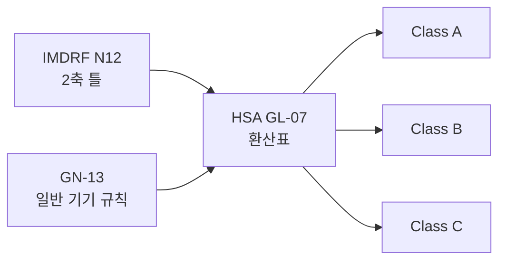
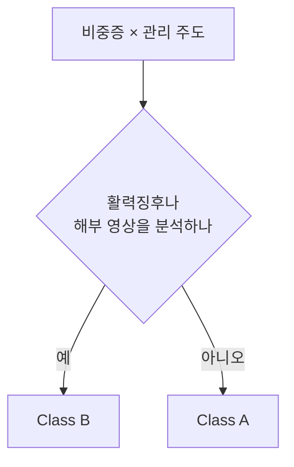

# 싱가포르 HSA SaMD 지침

> 싱가포르 보건과학청(HSA)이 IMDRF의 두 축 틀을 빌려 SaMD를 Class A~C로 나누는 지침(GL-07, 2022년 4월 첫 발간, 2025년 7월 21일 Revision 2). IMDRF 범주 I~IV가 아니라 자국 의료기기 등급으로 바로 번역한다는 점이 포인트다.

## 쉽게 말하면
IMDRF의 표는 국제 공통 "채점표"이고, 각 나라는 이 채점표를 자기 나라 규제 등급으로 환산해야 한다. 싱가포르는 환산 결과를 한 장의 표로 못 박고, 그 아래에 실제 제품 예시 8가지를 붙여 둬서 개발자가 "내 소프트웨어는 어느 칸인가"를 직접 맞춰 볼 수 있게 했다.

## 자세히
출처: HSA GL-07 Revision 2(2025-07, 직접 열어 읽음).
- **세 가지를 같이 본다**: ① 정보의 중요도(치료·진단 / 임상 관리 주도 / 임상 관리 참고), ② 환자 상황의 심각도(위급·중증·비중증), ③ 일반 의료기기 위험 분류 지침 GN-13의 규칙. 앞의 둘은 IMDRF N12(2014-09-18)를 인용한다.
- **비 IVD(체외진단 아님) SaMD 표** — 행=상황, 열=(치료·진단 | 관리 주도 | 관리 참고):
  - 위급: C | C | B
  - 중증: C | B | A
  - 비중증: B | A* | A
- **별표(R2에서 추가)**: 비중증 × 관리 주도 칸(A)이라도 (i) 활력징후(심박수·혈압·호흡수·체온) 같은 생리 과정, (ii) 뼈 X-ray·초음파 같은 해부 구조 영상을 분석·측정·모니터링해 임상 관리를 이끌면 **Class B**. GN-13 규칙 10(i)와 맞춘 것이다.
- IVD(체외진단) SaMD는 GN-14를 따로 본다.
- IMDRF 표와 달리 4단계가 아니라 **A·B·C 3단계**다. 가장 높은 D는 이 표에 나오지 않는다(표에 없다는 뜻이지 D 등급이 없다는 뜻은 아니다 — 일반 기기는 A~D).
- 같은 문서가 **임상 의사결정 지원 소프트웨어(CDSS)** 가 의료기기인지 판별하는 기준도 준다. 의학 정보를 단순 표시·인쇄만 하는 소프트웨어는 의료기기가 아니다.
- 문서 스스로 "새 규제를 만드는 게 아니라 현재 정책과 실무를 반영한 것"이라고 밝힌다.

## 그림으로 보기

## 예시
HSA가 문서에 실은 사례(전부 의도된 사용 기준):
- 의료진용 편두통 발병 위험 예측(식단·수면 입력): 비중증 + 관리 주도 → **A**
- 경증 수면무호흡 초기 징후 탐지(생리 신호 모니터링): 비중증 + 관리 주도지만 별표 때문에 → **B**
- 이명 완화 소리 치료: 비중증 + 치료 → **B**
- 일반인이 찍은 점 사진으로 흑색종 위험 신호 표시: 중증 + 관리 주도 → **B**
- 심전도로 부정맥 진단 보조(의료진): 중증 + 관리 주도 → **B**
- 응급실에서 활력징후로 심근경색(MACE) 위험 분류: 위급 + 관리 주도 → **C**
- 눈 사진으로 당뇨망막병증 진단: 중증 + 진단 → **C**

## 헷갈리는 것과 비교
| 개념 | 차이 |
|---|---|
| HSA GL-07 | 싱가포르 규제 등급 A·B·C. IMDRF 표를 환산 |
| [SaMD 위험 분류](#samd-risk-categorization) | 국제 포럼의 I~IV 범주 |
| [IMDRF](#imdrf) | 틀을 만든 기관. 규제 권한은 없음 |
| [의료기기 등급](#device-risk-classes) | 일반 기기의 나라별 등급 |
| [상황 심각도 축](#healthcare-situation-axis) | 이 표의 세로축 |

## 더 읽을거리
- [HSA GL-07 Rev.2 (PDF, 2025-07)](https://isomer-user-content.by.gov.sg/409/ae814059-a3ff-4ce3-8192-4534a43ddc6f/gl-07-r2-guidelines-risk-classification-samd-cdss-(2025-jul)-pub.pdf) — 이 글의 표·예시 출처
- [HSA 의료기기 안내](https://www.hsa.gov.sg/medical-devices/) — 관련 지침 목록(검색 결과로 확인, 직접 열진 않음)
