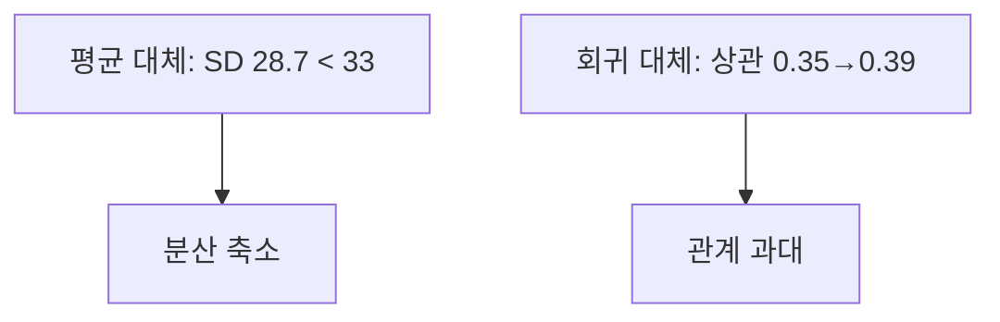

# 단일 대체의 불확실성 과소평가

> 결측을 평균·회귀예측 등으로 한 번만 채우면 채운 값을 진짜처럼 취급하게 되어 분산과 표준오차가 실제보다 작게 나온다.

## 쉽게 말하면
빈칸을 "대충 이 정도겠지" 하고 한 번 채운 뒤 그 숫자를 확실한 값처럼 계산하면, 결과가 실제보다 자신 있어 보인다. 실제 불확실성이 지워진다.

## 자세히
(van Buuren FIMD 1.3절을 하위 에이전트가 웹 요약으로 읽은 노트. sklearn 문서의 다중 대체 절과 같은 취지.)
- **평균 대체(1.3.3)**: 분산을 **과소추정**한다. 예: 대체 후 표준편차 28.7 대 관측 33, 상관 0.35 → 0.30으로 약해짐.
- **회귀 대체(1.3.4)**: 대체값이 회귀선 위에만 놓여 변동이 사라진다. 변동 과소추정, 상관이 **과대**(0.35 → 0.39).
- **표준오차(1.3.8)**: 단일 대체 후 표준오차가 너무 작아 가설검정이 과도하게 유의해진다.
- **해결**: 다중 대체로 여러 완성본을 만들고 [Rubin 규칙](#rubin-rules)으로 합쳐 대체 간 분산 B를 반영.
- **예측 목적이면(제안)**: 분포 추정보다 예측 정확도가 목표라면 단일 대체도 실용적일 수 있다. 목적에 따라 다르다([예측 목적의 결측 처리](#imputation-for-prediction)).

## 그림으로 보기

## 예시
- 설문 소득 결측 30%를 평균으로 채운 뒤 소득-만족도 회귀를 하면 p값이 과도하게 작아짐.
- 교육 활용: 같은 데이터로 단일·다중 대체 신뢰구간 폭을 비교.

## 헷갈리는 것과 비교
| 개념 | 차이 |
|---|---|
| 단일 대체 | 한 번 채움, 불확실성 누락 |
| [다중 대체](#multiple-imputation) | 여러 번 채우고 합쳐 반영 |
| 삭제(complete case) | 행 제거(다른 편향) |

## 더 읽을거리
- [FIMD 1.3절](https://stefvanbuuren.name/fimd/sec-simplesolutions.html) — 단순 해법의 한계.
- [sklearn Imputation 문서](https://scikit-learn.org/stable/modules/impute.html) — 단일 vs 다중 대체.
