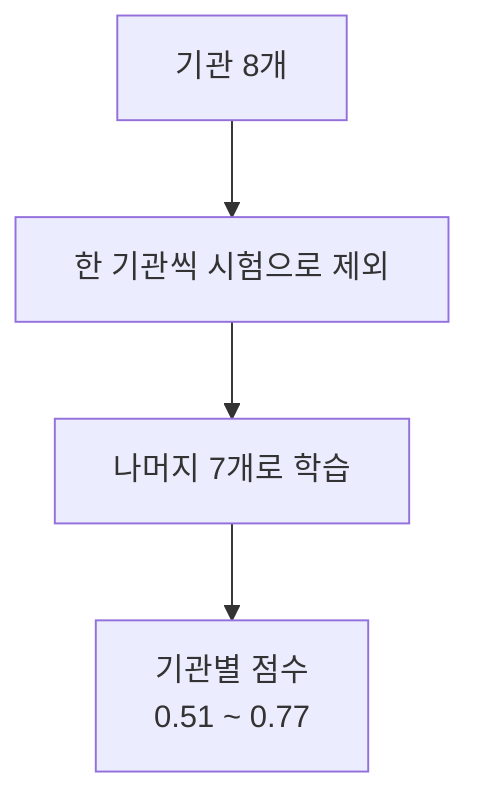
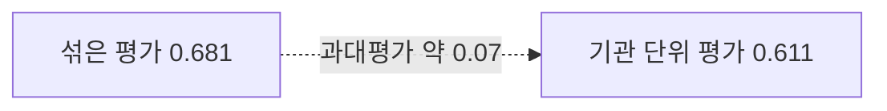

# 기관 일반화 평가

> 기관(병원·지점·기기·지역) 일반화 평가는 한 기관 데이터를 통째로 시험 세트로 빼고 나머지 기관으로 학습해, 새로운 기관에서도 성능이 유지되는지 따로 재는 설계다. 데이터를 섞어서 나눈 평가보다 현실적이고 기관별 편차도 보인다.

## 쉽게 말하면
서울 지점 직원에게 맞춰 만든 교육 자료가 부산 지점에서도 통하는지 알려면 부산 직원만 따로 시험을 쳐야 한다. 모든 지점 직원을 섞어서 시험 보면 이미 모든 지점의 특성을 맛본 상태라 점수가 좋게 나온다.

## 자세히
- **방법**: 기관 ID를 그룹으로 `LeaveOneGroupOut`을 쓰면 기관 하나씩 시험으로 빼고 나머지로 학습한다([샘플 단위 vs 그룹 단위 분할](#sample-vs-group-split)). 점수를 기관별로 보고한다.
- **직접 해 본 실험(합성 데이터: 기관 8개, 기관당 150개, 기관마다 특징 값이 다르게 치우치고(촬영 장비 차이 비슷) 라벨 규칙도 조금씩 다름, 로지스틱 회귀)**: 데이터를 무작위로 섞은 5겹 정확도는 0.681이었고, 기관 하나씩 빼는 평가의 평균은 0.611, 최저 0.507, 최고 0.773이었다. 기관별 점수는 0.52, 0.59, 0.77, 0.64, 0.63, 0.53, 0.51, 0.69로 기관마다 크게 달랐다. 섞은 평가는 새 기관에서의 성능을 약 0.07 높게 보여 줬고, 어떤 기관은 거의 동전 던지기 수준이었다. 위 데이터는 일부러 기관 차이를 크게 만든 가상 사례다.
- **해석**: 평균만 보고하면 일부 기관의 실패가 가려진다([최악 그룹 성능](#worst-group-performance)). 기관별 점수와 최저 기관, 표본 수를 함께 적는다([작은 그룹의 점수 노이즈](#small-group-noise)).
- **원인 진단(해석)**: 나쁜 기관은 입력 분포가 다른지([그룹 간 분포 이동](#distribution-shift-between-groups)) 라벨 기준이 다른지 구분한다. 입력 이동이면 기관 정규화나 해당 기관 데이터 추가, 라벨 기준 차이면 라벨 가이드 통일이 필요하다.
- **주의**: 기관 수가 적으면(예: 3개) 평가의 불확실성이 크다. 기관 안에 환자가 여러 번 나오면 환자도 그룹이므로 [연결 성분 그룹핑](#connected-components-grouping)을 쓴다. 최종 배포 전에는 한 번도 보지 않은 기관으로 외부 검증을 한다.

## 그림으로 보기

## 예시
- 병원 5곳의 영상으로 학습한 진단 모델을 병원 하나씩 빼며 평가하고, 병원별 정확도 표와 최저 병원을 보고한다. 신규 병원 도입 때는 소량 데이터로 보정을 검토한다.
- 교육 활용: 기관 수·기관 간 차이를 바꿔 가며 섞은 평가와 기관 단위 평가의 격차를 비교한다.

## 헷갈리는 것과 비교
| 개념 | 차이 |
| --- | --- |
| 섞은 교차검증 | 모든 기관이 학습에 포함 |
| 기관 일반화 평가 | 새 기관에서의 성능 |
| [외부 검증](#external-validation) | 완전히 새 데이터로 확인 |
| [분포 이동](#distribution-shift-between-groups) | 기관 간 차이의 원인 진단 |

## 더 읽을거리
- [scikit-learn: LeaveOneGroupOut](https://scikit-learn.org/stable/modules/cross_validation.html) — 그룹을 하나씩 시험으로 빼는 분할기
