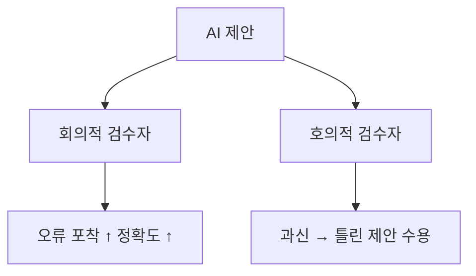
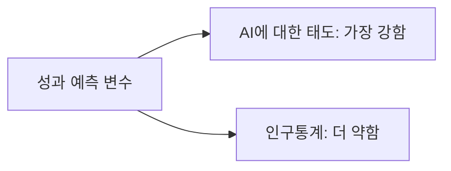

# 회의적 검수자 효과

> AI의 제안을 검수할 때, AI에 회의적인 사람이 호의적인 사람보다 AI의 오류를 더 잘 잡아내 더 정확한 결과를 낸다는 관찰이다. 검수자의 AI에 대한 태도가 인구통계보다 성과를 더 잘 예측했다.

## 쉽게 말하면
내비게이션이 알려 준 길을 "기계가 맞겠지" 하며 믿고 따르는 운전자는 막다른 길에 들어서도 늦게 알아챈다. "길이 이상한데?" 하고 의심하며 보는 운전자는 일찍 잘못을 발견한다. 검수자에게 필요한 것은 AI에 대한 건강한 의심이다.

## 자세히
(Beck 등 「Bias in the Loop」 arXiv 2509.08514 초록을 직접 열어 확인.)
- **설계**: 통제된 주석 과제에서 **2,784명** 무작위 실험. 처음 3개 사례의 AI 제안 품질, 요구되는 수정 부담, 성과 기반 금전 보상을 달리했다. 정확도, 수정 활동, 과잉·과소 수정과 함께 인구통계, AI에 대한 태도, 행동을 측정.
- **주요 결과(초록)**
  - **AI에 대한 태도가 성과의 가장 강한 예측 변수**였고 인구통계보다 강했다.
  - **AI에 회의적인 참가자**가 오류를 더 일관되게 잡았고 정확도가 높았다.
  - **자동화에 호의적인 참가자**는 알고리즘 제안에 **과신(overreliance)** 을 보였다.
  - **플래그된 AI 오류를 반드시 고치게 하는 요구**는 참여를 줄이고 틀린 제안을 받아들이는 비율을 높였다 — "인지적 지름길이 협업 결과에 영향을 준다".
- **저자 권고**: 다양한 평가자 표본을 모으고, 평가자의 AI 태도를 측정하고, 인지 편향을 상쇄하는 검수 워크플로를 설계한다.
- **해석(제안)**: 이 연구 하나의 결과이고 과제·참가자 집단에 따라 달라질 수 있다. 회의적인 성향 자체보다 "제안을 독립적으로 검증하는 습관"이 중요할 수 있다.
- **운영에 쓰기(제안)**: ① 신규 검수자 선발 시 소규모 시험(일부러 틀린 AI 제안 포함)으로 오류 포착률 측정 ② 호의적인 검수자에게는 제안을 숨기고 독립 라벨링 ③ 검수자 구성을 다양화 ④ 오류를 반드시 고치라는 강제 대신 확인 체크리스트 ⑤ 정기적으로 일부러 틀린 제안(함정)을 넣어 경계심 유지. 관련: [제안 비노출 대조 표본](#suggestion-hidden-control-sample), [주석 자동화 편향](#automation-bias-annotation).

## 그림으로 보기

## 예시
- 라벨 검수팀 구성: 입사 시 "AI 제안 20개 중 5개가 일부러 틀림" 테스트로 오류 포착률을 재고, 낮은 사람은 제안을 가린 상태로 라벨링하도록 배정(제안).
- 교육 활용: AI 활용 교육에서 "AI 결과를 어떻게 검증하는가" 연습 — 일부러 틀린 AI 답을 찾아내는 훈련.

## 헷갈리는 것과 비교
| 개념 | 차이 |
|---|---|
| 회의적 검수자 효과 | AI에 회의적일수록 오류 포착이 우수 |
| [주석 자동화 편향](#automation-bias-annotation) | 자동 제안을 그대로 수용하는 경향 |
| [모델 보조 사전 라벨링](#model-assisted-prelabeling) | 모델 초벌+사람 검수 방식 전체 |
| 앵커링 | 먼저 본 값에 판단이 끌림(이 연구는 "인지적 지름길"로 표현) |

## 더 읽을거리
- [Bias in the Loop: How Humans Evaluate AI-Generated Suggestions (arXiv 2509.08514)](https://arxiv.org/abs/2509.08514) — 2,784명 실험(초록 확인).
