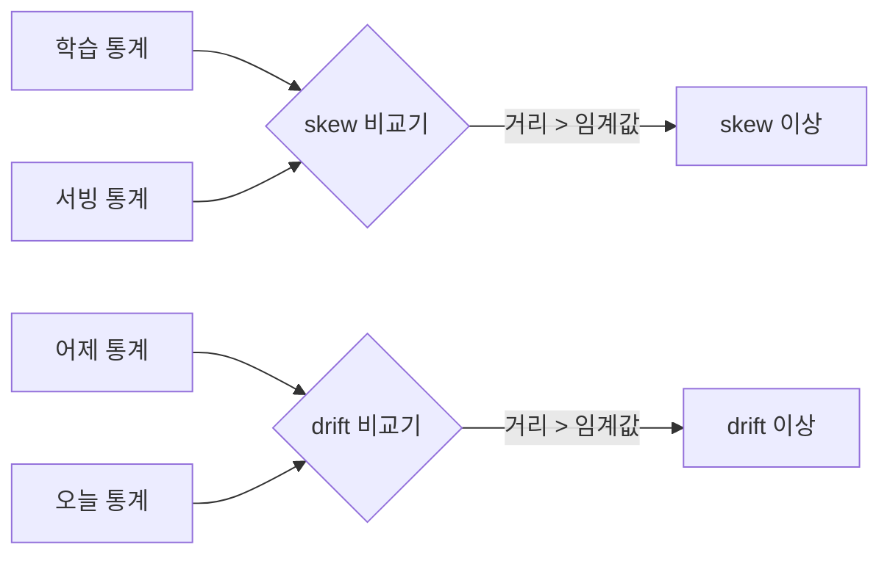
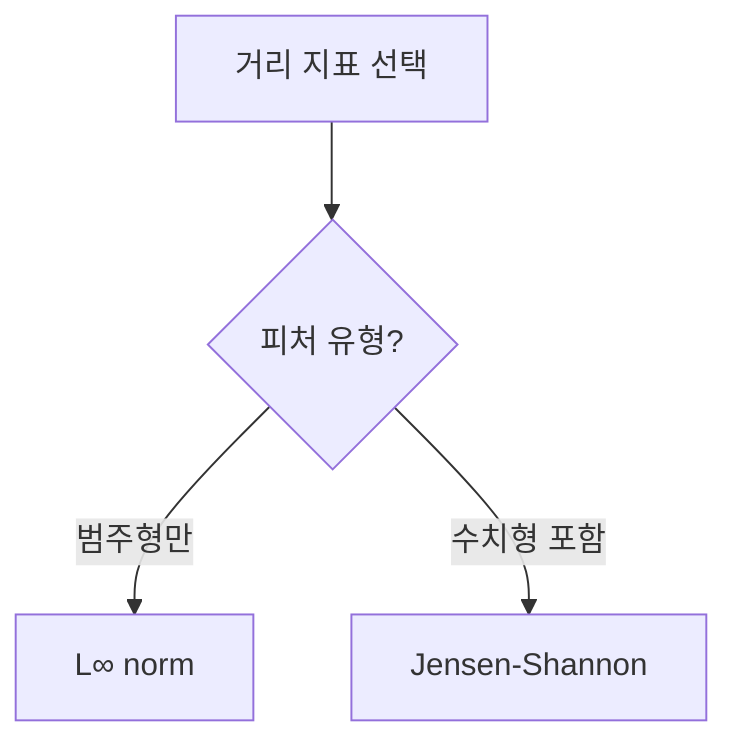

# skew·drift 비교기

> 두 데이터셋의 **통계 분포를 비교해 임계값을 넘으면 이상으로 알리는** TFDV 스키마 설정이다. skew는 학습 vs 서빙, drift는 연속한 날(스팬)끼리 비교한다.

## 쉽게 말하면
어제 가게에 온 손님 구성과 오늘 구성을 비교해 "갑자기 현금 결제 손님이 많아졌네?"를 알아채는 점장이다. 비교 기준(임계값)을 미리 정해 두면 그보다 크게 달라질 때만 알림이 온다.

## 자세히
- **skew**: 학습 데이터와 서빙 데이터의 차이. `skew_comparator`를 피처에 설정하고 `validate_statistics(statistics=train_stats, schema=schema, serving_statistics=serving_stats)`로 검증.
- **drift**: 이전 날 학습 데이터와 오늘 학습 데이터의 차이. `drift_comparator`를 설정하고 `previous_statistics=train_day1_stats`를 넘긴다.
- **거리 지표 2종(공식 문서)**:
  - `infinity_norm.threshold`(L∞): **범주형 피처만** 탐지. 문서 예 임계값 0.01, 결과 `0.0435984 > 0.01`, 가장 많이 달라진 값은 `Cash`로 표시.
  - `jensen_shannon_divergence.threshold`: **범주형·수치형 모두** 탐지.
- 결과는 `COMPARATOR_L_INFTY_HIGH` 등의 [이상 유형](#tfdv-anomaly-types)으로 나온다. 정규화된 절대 차이(`COMPARATOR_NORMALIZED_ABSOLUTE_DIFFERENCE_HIGH`)도 있다.
- 문서 지침: skew 이상이 진짜면 모델 성능에 직접 영향이 있을 수 있으니 조사가 필요하다.
- 임계값(0.01)은 문서 예시일 뿐이다. 피처별로 정상 변동폭을 관찰해 정한다.

## 그림으로 보기

## 예시
- `payment_type`에서 서빙에 `Cash`가 훨씬 많아져 L∞가 임계값을 넘으면 알림.
- 일별 학습 데이터에서 `age` 분포가 갑자기 바뀌면 JS 발산으로 drift 감지 → 재학습 전에 원인 점검.

## 헷갈리는 것과 비교
| 개념 | 차이 |
|---|---|
| skew | 학습 ↔ 서빙(같은 시점 다른 환경) |
| drift | 날짜 ↔ 날짜(시간 흐름) |
| [데이터 드리프트](#data-drift) | 일반 개념. 비교기는 TFDV의 구현 |
| [스키마 환경](#schema-environments) | 분포가 아니라 *필수 피처 유무* 차이 |

## 더 읽을거리
- [TFDV 시작하기 — Checking data skew and drift](https://www.tensorflow.org/tfx/data_validation/get_started) — 비교기 설정 코드·지표 설명.
