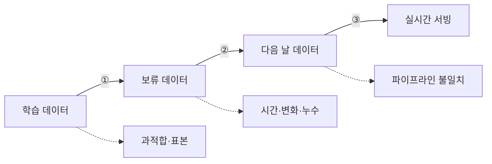
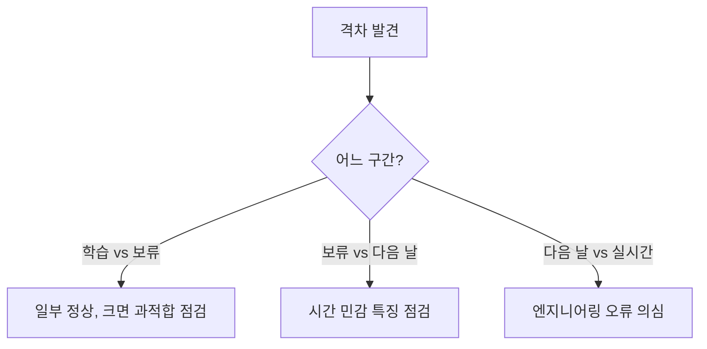

# 편향 측정 3단계

> 훈련-서빙 편향이 어디서 생기는지 가르려면 **같은 모델의 성능을 세 지점**에서 비교한다: ① 학습 데이터 vs 보류(holdout) ② 보류 vs 다음 날 데이터 ③ 다음 날 데이터 vs 실시간(live). 각 간격이 서로 다른 원인을 가리킨다.

## 쉽게 말하면
체중이 늘었을 때 "식단 때문인지, 체중계 고장인지"를 구분하려면 집 체중계, 병원 체중계, 다음 날 병원 체중계를 차례로 비교한다. 어느 구간에서 차이가 생겼는지로 원인을 좁힌다.

## 자세히
(Google "Rules of Machine Learning" 규칙 37과 규칙 33, 직접 확인.)
- **① 학습 vs 보류(holdout)**: 모델이 학습에 쓴 데이터와 학습에 쓰지 않은 같은 시기 데이터의 성능 차이. 문서는 "어느 정도 격차는 정상이며 반드시 문제는 아니다"라고 말한다(과적합 정도를 보는 지표).
- **② 보류 vs 다음 날 데이터**: 학습·보류 기간 이후의 새 데이터와 비교. **큰 하락**은 시간에 민감한 특징이 모델을 약화시키고 있음을 시사할 수 있다. 규칙 33의 **시간 기반 분할**(과거로 학습하고 이후 데이터로 시험)과 같은 발상이며, 새 데이터에서 성능이 낮아져도 "극적으로 낮지는 않아야" 한다고 한다.
- **③ 다음 날 vs 실시간(live)**: 같은 예시에 대해 두 경로가 **같은 점수**를 내야 한다. 여기서 불일치가 나오면 "엔지니어링 오류일 가능성이 높다"고 문서가 말한다(예: 학습 파이프라인과 서빙 파이프라인의 특징 계산 차이).
- **해석 지침(이 글의 정리)**: 간격마다 의심할 원인이 다르다. ①은 과적합·표본 문제, ②는 시간에 따른 변화·누수([분포 변화의 종류](#distribution-shift-types)), ③은 파이프라인·코드 불일치([서빙 특징 로깅](#log-serving-features), [조인 테이블 스냅샷](#table-join-snapshot)). 로깅한 서빙 특징이 있으면 ③ 비교가 쉬워진다.
- **한계**: 문서는 허용 격차 크기를 수치로 제시하지 않는다. 기준은 서비스별 지표와 위험에 따라 정해야 한다.

## 그림으로 보기

## 예시
- 신용 모델: 학습 AUC 0.84, 보류 0.82, 다음 날 0.81, 실시간 로그 재채점과 서빙 점수가 불일치 → 서빙 특징 계산 코드를 점검.
- 교육 소재: 세 구간의 점수 표를 주고 "어디부터 이상한가"를 찾는 문제.

## 헷갈리는 것과 비교
| 개념 | 차이 |
|---|---|
| 편향 측정 3단계 | 세 지점 비교로 원인 구간 파악 |
| [분포 변화의 종류](#distribution-shift-types) | 변화의 이름 |
| [도메인 통째로 떼기](#held-out-domain-split) | 평가 분할 설계 |
| [서빙 특징 로깅](#log-serving-features) | 비교에 필요한 로그 확보 |

## 더 읽을거리
- [Rules of Machine Learning (Google)](https://developers.google.com/machine-learning/guides/rules-of-ml) — 규칙 33·37(직접 확인).
