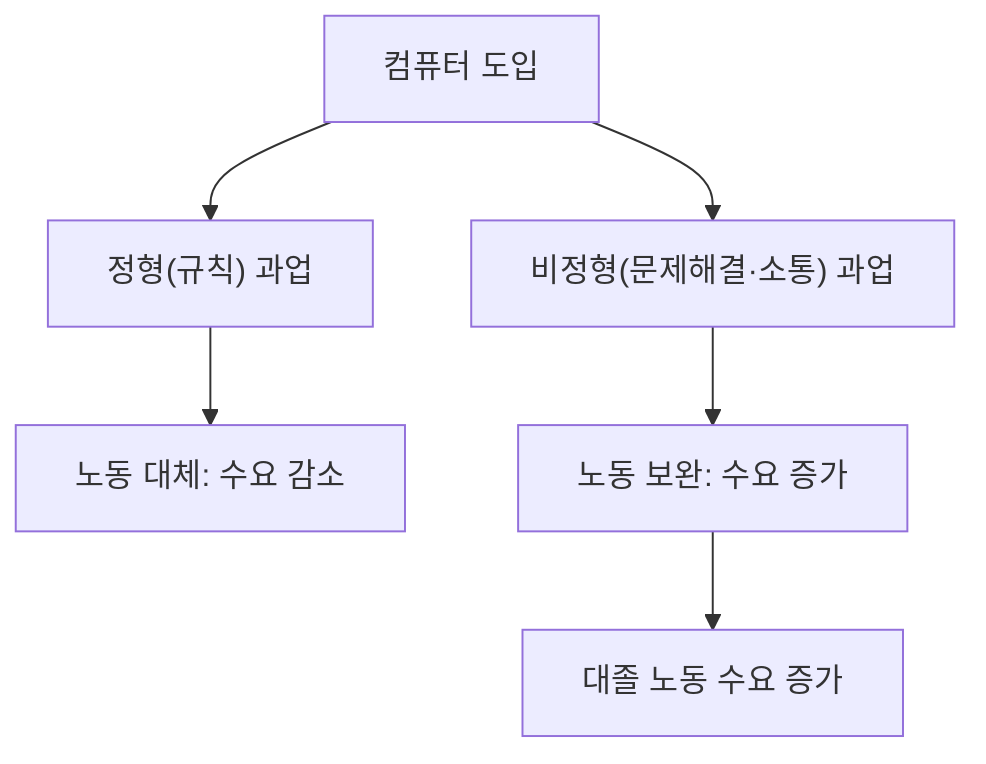

# 숙련 편향적 기술 변화

> 새 기술이 고학력·고숙련 노동자에게 더 유리하게 작용해 격차를 벌린다는 경제학 가설(SBTC). 컴퓨터 보급기에 대학 졸업자 수요가 늘어난 현상을 설명하는 데 쓰였다. AI 도움이 하위 직원에게 더 큰 이득을 주는 결과는 이 통념과 대비되어 주목받았다.

## 쉽게 말하면
컴퓨터가 처음 사무실에 들어왔을 때 "컴퓨터를 잘 다루는 고학력자만 더 잘나간다"는 이야기가 나왔다. 이것이 숙련 편향적 기술 변화다. 하지만 경제학자들은 곧 "학력이 아니라 **하는 일의 종류**가 갈린다"고 다시 설명했다. 규칙대로 반복하는 일은 컴퓨터가 가져가고, 문제를 풀거나 사람과 복잡하게 소통하는 일은 컴퓨터가 도와준다는 것이다. 생성형 AI는 이 구분을 또 흔든다. 글쓰기·요약처럼 사무직의 "비정형" 일을 건드리기 때문이다.

## 자세히
출처: Autor, Levy, Murnane "The Skill Content of Recent Technological Change", QJE 118(4), 2003(MIT 게재 PDF를 직접 읽음), NBER 초록. 1960~1998년 미국 자료 연구이며 생성형 AI 이전 시대의 이야기다.
- **통념**: 컴퓨터 기반 기술의 도입과 대졸 노동 사용 증가가 같은 산업·기업·공장 안에서 함께 관찰된다. 이 상관관계를 흔히 숙련 편향적 기술 변화로 해석한다. 논문의 비판: 그렇게 해석하는 것은 "상관관계에 이름을 붙일 뿐 왜 그런지는 설명하지 못한다."
- **ALM 모델(과업 기반)**: 컴퓨터 자본은 ① **명시적 규칙을 따르는** 인지·육체 과업(경리, 출납, 전화 교환 등)에서 노동을 **대체**하고, ② 문제 해결·복잡한 의사소통 같은 **비정형** 과업은 **보완**한다. 두 과업이 불완전 대체재라는 가정이 필요하다.
- **네 가지 증거(논문)**: ① 1970년대부터 정형 인지·육체 과업 투입은 줄고 비정형 분석·상호작용 과업 투입은 늘었다. ② 이 이동은 컴퓨터화가 빠른 산업에 집중되고, 컴퓨터 이전의 1960년대에는 작았다. ③ 학력 상승만으로는 설명되지 않고 모든 학력 수준에서 일어난다. ④ 같은 직업명 안에서도 과업 구성이 바뀌었다.
- **수치**: 논문 QJE 판 초록은 이 모델이 1970~1998년 대졸 노동 상대 수요 이동의 **60%** 를 설명한다고 쓴다(같은 직업 내 과업 변화가 그 효과의 거의 절반). NBER 초록 요약에서는 산업·직업 내 과업 변화가 같은 기간 이동의 30~40%를 설명하는 것으로 읽힌다 — 판본에 따라 숫자가 다르므로 인용 전 원문 대조 필요.
- **한계 문장(2003년 시점)**: 비정형 인지 과업은 "(아직) 컴퓨터화되지 않는다"고 썼다. 생성형 AI는 바로 이 가정을 시험한다.
- **AI와의 연결**: 고객지원 현장 연구(NBER 31161)는 AI가 하위·신입의 성과를 더 올리고 최상위에는 효과가 거의 없다고 보고하며, 일반적 숙련 편향 패턴과 대비된다고 논문이 말한다([숙련도 격차 축소](#skill-gap-compression)). 반면 다른 과업·직무에서는 반대 패턴도 가능하다(일반론).

## 그림으로 보기

## 예시
- 은행 창구: 출납(정형)은 ATM이 대체, 상담(비정형)은 늘었다. 같은 '은행원' 직업 안에서 하는 일의 구성이 바뀐다.
- 마케터: 보고서 초안 작성(비교적 정형)은 AI가 가져가고, 전략·협상은 사람에게 남는다는 시나리오(교육 설명용, 실증된 것은 아님).

## 헷갈리는 것과 비교
| 개념 | 차이 |
|---|---|
| 숙련 편향적 기술 변화 | 기술이 고숙련에 유리. 학력 기준 설명 |
| 과업 기반(ALM) 접근 | 정형 vs 비정형 과업 기준 설명. 같은 직업 안 변화까지 포착 |
| [숙련도 격차 축소](#skill-gap-compression) | AI 보조가 하위에 더 유리한 관측 사례 |
| [경험 곡선 단축](#experience-curve-ai) | 신입이 더 빨리 숙련에 도달 |

## 더 읽을거리
- [The Skill Content of Recent Technological Change (MIT PDF)](https://economics.mit.edu/sites/default/files/publications/the%20skill%20content%202003.pdf) — 본문(직접 읽음)
- [NBER Working Paper w8337](https://www.nber.org/papers/w8337) — 초록(직접 읽음)
