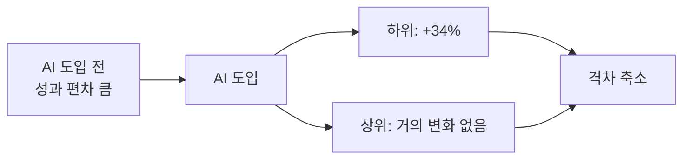

# 숙련도 격차 축소

> AI 도움이 하위·초보 직원의 성과를 크게 올리고 상위 숙련자에게는 거의 효과가 없어, 사람 간 성과 격차가 줄어드는 현상.

## 쉽게 말하면
맞춤법 검사기가 글쓰기 초보에게는 큰 도움이 되지만 베테랑 작가에겐 별 차이가 없는 것과 같다. 평균은 올라가고 편차는 줄어든다.

## 자세히
출처: NBER 31161 본문 및 arXiv 초록(직접 확인).
- **상담 연구 결과**: 평균 생산성(시간당 해결 건수) 약 14~15% 증가(버전별 14% 또는 15%로 표기). 덜 숙련·경험 적은 직원은 속도와 품질이 모두 크게 향상, 해결 건수 34% 증가. 가장 숙련된 직원은 속도 소폭 상승, 품질은 소폭 하락(QJE 초록). 숙련자 대화 품질이 낮아질 수 있다는 증거도 언급.
- **다른 결과**: 고객이 더 공손하고 매니저 연결 요청이 줄었다. 영어 능숙도가 낮은 해외 상담사와 드문 문제에서 이득이 컸다.
- **해석**: 일반 "숙련 편향적 기술 변화"(고숙련에 유리)와 대비되는 사례라고 논문이 말한다. 같은 일반화는 직무마다 다를 수 있다.
- **함의**: 하위 성과자 교육 필요가 줄고 평가 기준(상대 평가·보너스)이 흔들린다. 상위 성과자의 지식이 AI에 학습되는 데 보상이 없는 문제는 [숙련자 기여 보상](#knowledge-capture-credit).
- 다른 연구에서 반대 패턴(고숙련에 이득이 큰 경우)이 나올 수 있어 직무별로 측정해야 한다(일반론, 이 글에서 별도 출처 확인 안 함).

## 그림으로 보기

## 예시
- 영업 팀: 신입의 제안서 작성 품질이 상급 수준에 가까워지자 평가 지표를 "절대 건수"에서 "복잡한 건 해결"로 바꾸는 논의.
- 성과 보너스가 상대평가면 상위자 보상이 줄어드는 부작용을 점검.

## 헷갈리는 것과 비교
| 개념 | 차이 |
|---|---|
| 격차 축소 | 하위가 더 개선 |
| 숙련 편향적 변화 | 고숙련이 더 이득 |
| [경험 곡선 단축](#experience-curve-ai) | 신입 도달 시간 단축 |

## 더 읽을거리
- [Generative AI at Work](https://arxiv.org/abs/2304.11771) — 초록
- [NBER 31161](https://www.nber.org/system/files/working_papers/w31161/w31161.pdf) — 본문
