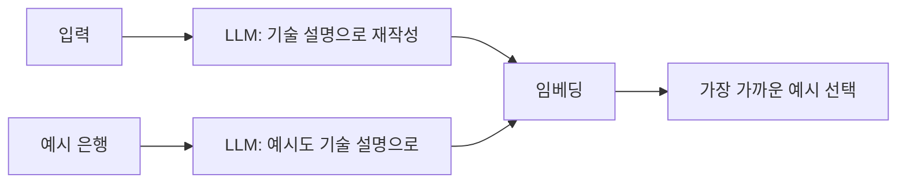

# Skill-KNN

> few-shot 예시를 고를 때 **입력 문장을 그대로 임베딩하지 않고, 먼저 LLM으로 "이 문제에 필요한 기술 설명"으로 다시 쓴 뒤** 가까운 예시를 찾는 방법이다. 학습·미세조정이 필요 없다.

## 쉽게 말하면
"서울에서 5개 이상 학교가 있는 지역 수는?"과 비슷한 예시를 찾을 때, 단어(서울·학교)가 같은 문장 대신 "개수를 세고 '5보다 크다'는 조건을 쓰는 문제"처럼 *풀이에 필요한 기술*이 같은 예시를 찾는 것이다.

## 자세히
(An 외, "Skill-Based Few-Shot Selection for In-Context Learning"(EMNLP 2023, arXiv 2305.14210) PDF의 초록·서론을 직접 읽었다.)
- **문제(논문)**: 사전학습 임베딩 기반 선택은 과제와 무관한 **표면 언어 특징**에 끌린다. 의미 파싱에서는 같은 개체를 가진 예시만 고르지만 좋은 예시는 필요한 **실행 연산(기술)**을 담아야 한다.
- **방법(논문)**: ① 소수의 사람이 쓴 시연으로 프롬프트된 *고정된 LLM*이 입력과 후보 예시 각각의 **기술 기반 설명**을 생성(rewrite) ② 이 설명을 기성 임베딩 모델에 넣어 가장 유사한 예시를 선택(retrieve). 시연 순서에 민감하므로 시연을 섞어 후보 설명을 여러 개 만들고 **일관성(consistency)** 또는 **변별성(distinctiveness)** 기준으로 고르는 변형 2가지를 둔다.
- **장점(논문)**: 임베딩 모델을 **미세조정하지 않아** 예시 은행이 자주 바뀌는 상황에 맞다. 미세조정 방식은 과제별로 임베딩 모델을 훈련·저장해야 해 번거롭다.
- **실험(논문)**: 의미 파싱 5개 데이터셋(Spider, Dr. Spider, KaggleDBQA, BIRD, COGS), 6개 모델(text-chat-davinci-002, code-davinci-002, text-davinci-003, code-cushman-002, gpt-35-turbo, gpt-4). 오라클이 아닌 방법 중 일관되게 최고. 예: text-chat-davinci-002에서 **Spider 실행 정확도 78.3%**, 가장 나은 원 입력 기반 선택은 74.6%, 정답을 쓰는 Target-KNN은 78.6%.
- **한계**: 과제는 의미 파싱·SQL 중심이다. 다른 과제 일반화는 이 글에서 확인하지 못했다.

## 그림으로 보기

## 예시
- 사내 SQL 생성 도우미: 질문마다 "집계·조건 필터·조인 필요"를 먼저 쓰고 그 설명으로 비슷한 예시를 고른다(제안).

## 헷갈리는 것과 비교
| 방법 | 차이 |
|---|---|
| [kNN 예시 검색](#knn-example-retrieval) | 입력 원문을 임베딩 |
| Skill-KNN | 기술 설명으로 바꿔 임베딩 |
| [MMR](#mmr-diversity) | 다양성까지 고려 |

## 더 읽을거리
- [An et al. (2023) — Skill-Based Few-Shot Selection](https://arxiv.org/abs/2305.14210) — 직접 읽음(초록·서론).
