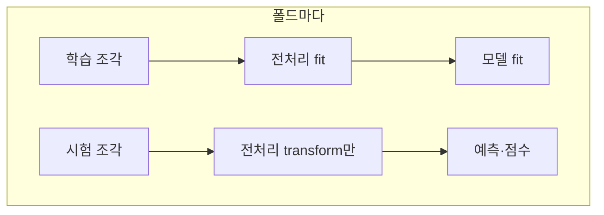
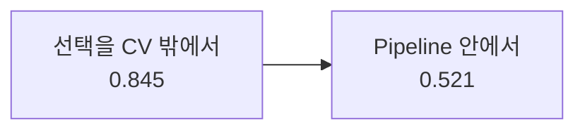

# Pipeline으로 누수 막기

> scikit-learn의 `Pipeline`은 전처리와 모델을 한 덩어리로 묶어, 교차검증의 폴드마다 학습 조각에서만 전처리를 학습하게 만든다. 시험 조각의 정보가 전처리로 새어 점수가 부풀려지는 누수를 구조적으로 막는다.

## 쉽게 말하면
시험 범위를 정하려고 시험지를 미리 훑어본 뒤 공부하면 그 시험은 무효다. Pipeline은 "시험지는 마지막까지 봉투에 넣어 둔다"는 규칙을 코드로 강제한다. 평균 계산, 특성 고르기 같은 준비 단계도 공부용 자료에서만 하게 한다.

## 자세히
- **원칙(scikit-learn 공통 함정 문서, 열람)**: 전처리는 학습 데이터에서만 파라미터를 배워야 한다. 평균으로 나눈다면 평균이 전체 데이터가 아니라 학습 조각에서 나와야 한다. 먼저 분할하고, 시험 데이터에 `fit`·`fit_transform`을 부르지 않고, `Pipeline`을 쓰라고 권한다. `StandardScaler`, `SimpleImputer`, `PCA` 등 거의 모든 변환기에 같은 위험이 있다.
- **문서의 예(무작위 특성 10,000개, 표본 200개, 무작위 라벨)**: 전체 데이터에서 `SelectKBest(k=25)`를 먼저 적용하면 정확도 0.76(우연보다 훨씬 높음), 분할 후 학습 조각에만 적용하면 0.5였고, 파이프라인으로 묶으면 `cross_val_score`로 0.43±0.05였다.
- **직접 확인(특성 2,000개, 표본 100개, 모두 무작위, `SelectKBest(k=20)`+로지스틱 회귀, 5겹, 30번 반복)**: 선택을 CV 바깥에서 전체 데이터에 하면 정확도 0.845, 파이프라인 안에서 하면 0.521이었다. 신호가 전혀 없는 데이터에서 0.845는 순전히 누수의 결과다.
- **방법**: `pipe = make_pipeline(StandardScaler(), SelectKBest(k=20), LogisticRegression())` 한 객체를 `cross_val_score(pipe, X, y, cv=cv)`에 넣는다. 격자 탐색도 `GridSearchCV(pipe, {"logisticregression__C": [...]})`처럼 파이프라인 전체에 건다.
- **누수는 전처리만이 아니다(해석)**: 그룹 구조·시간 순서·타깃에서 파생한 특성은 Pipeline으로 못 막는다([샘플 단위 vs 그룹 단위 분할](#sample-vs-group-split)). 점검에는 [정답 섞기 점검](#shuffled-label-sanity-check)이 유용하다.

## 그림으로 보기



## 예시
```python
from sklearn.pipeline import make_pipeline
from sklearn.feature_selection import SelectKBest
from sklearn.linear_model import LogisticRegression
pipe = make_pipeline(SelectKBest(k=20), LogisticRegression(max_iter=500))
cross_val_score(pipe, X, y, cv=5)
```
교육 활용: 무작위 데이터에서 누수 있는 방식과 없는 방식의 점수를 나란히 보여 준다.

## 헷갈리는 것과 비교
| 개념 | 차이 |
| --- | --- |
| 전처리 후 분할 | 누수 위험 |
| 분할 후 전처리 | 안전하지만 폴드마다 수작업 |
| Pipeline | 폴드마다 자동으로 안전하게 |
| [정답 섞기 점검](#shuffled-label-sanity-check) | 누수 여부를 점검하는 시험 |

## 더 읽을거리
- [scikit-learn: Common pitfalls — Data leakage](https://scikit-learn.org/stable/common_pitfalls.html) — 전처리 누수와 Pipeline, 특성 선택 예
