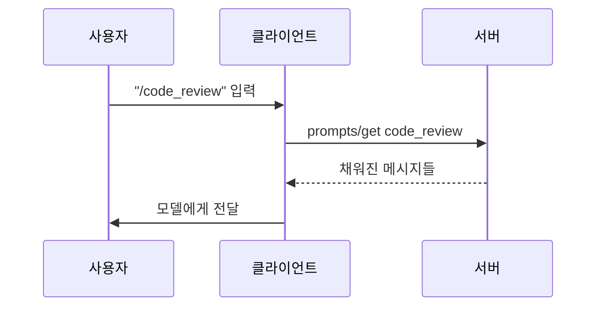
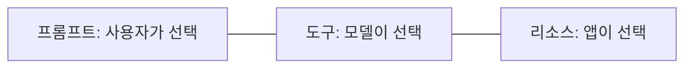

# 슬래시 명령 UI

> 슬래시 명령(`/review` 같은 입력)은 MCP 프롬프트를 사용자가 직접 골라 실행하도록 노출하는 대표적 UI 방식이다. MCP 프롬프트는 "사용자 주도"로 설계되었다.

## 쉽게 말하면
식당 메뉴판이다. 손님(사용자)이 메뉴(프롬프트)를 보고 직접 고른다. 주방(모델)이 알아서 메뉴를 고르는 것이 아니다. 슬래시 명령은 그 메뉴판을 여는 단축키다.

## 자세히
MCP 명세 2025-06-18 Prompts 문서 기준:
- 프롬프트는 서버가 클라이언트에 내놓는 **프롬프트 템플릿**이고, **사용자가 명시적으로 선택**하도록 의도된다(user-controlled). 문서의 예시가 **슬래시 명령**이다. 다만 프로토콜은 특정 UI를 강제하지 않는다.
- 서버는 `prompts` capability를 선언한다(`listChanged` 선택). `prompts/list`로 목록(`name`, `title`, `description`, `arguments`), `prompts/get`으로 인자를 채운 메시지(`role`+`content`)를 받는다. 인자는 [completion](#mcp-completion)으로 자동완성 가능.
- 메시지 내용은 text·image·audio·embedded resource. 목록이 바뀌면 `notifications/prompts/list_changed`.
- 도구(모델 주도), 리소스(앱 주도), 프롬프트(사용자 주도)로 **누가 호출을 결정하는가**가 다르다.
- 보안: 서버·클라이언트는 프롬프트 입력·출력을 검증해 주입 공격과 무단 접근을 막아야 한다(MUST). 잘못된 이름·필수 인자 누락은 `-32602`.

## 그림으로 보기



## 예시
```json
{"method": "prompts/get", "params": {"name": "code_review", "arguments": {"code": "def hello():\n    print('world')"}}}
```
팀이 `/weekly-report`, `/code-review`를 서버로 공유하면 누구나 같은 품질의 지시문을 한 번에 쓴다.

## 헷갈리는 것과 비교
| 개념 | 차이 |
|---|---|
| 프롬프트 | 사용자가 고르는 템플릿 |
| [도구](#mcp-tools) | 모델이 자동 호출하는 동작 |
| [리소스](#mcp-resources) | 앱이 컨텍스트로 넣는 데이터 |
| 슬래시 명령 | 프롬프트를 노출하는 UI 한 가지 |

## 더 읽을거리
- [MCP Prompts 명세 (2025-06-18)](https://modelcontextprotocol.io/specification/2025-06-18/server/prompts) — user-controlled 모델, 슬래시 명령 예시, 메시지 형식.
