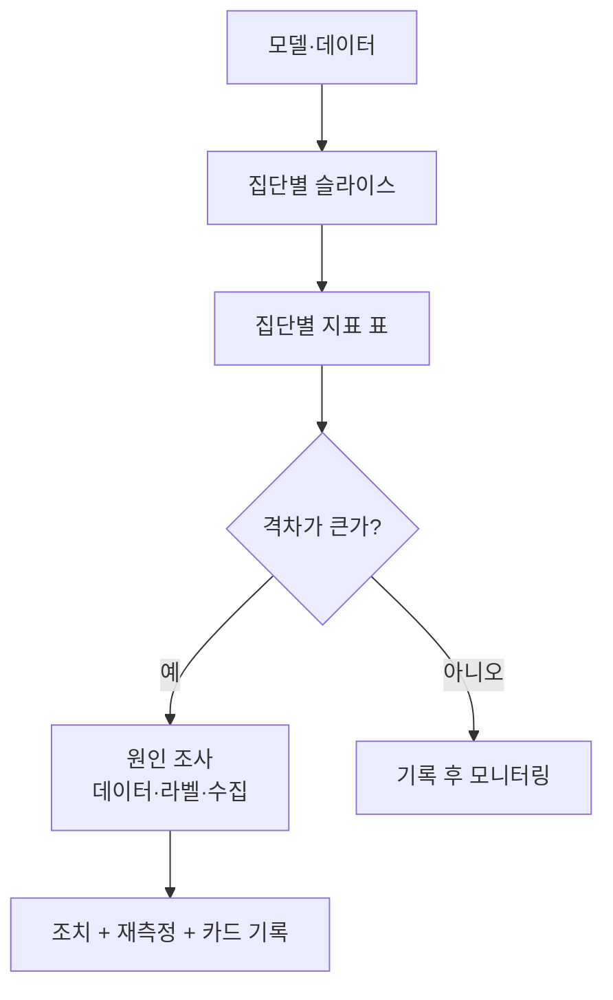
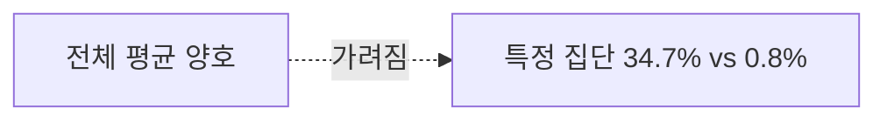

# 슬라이스 기반 공정성 점검

> 데이터·모델 성능을 **집단(슬라이스)별로 따로 계산해 집단 간 차이**를 편향의 단서로 삼는 점검이다. 전체 평균은 좋아도 특정 집단에서 크게 나쁘면 공정성 문제를 의심한다.

## 쉽게 말하면
학교 전체 평균 점수가 높아도 특정 반만 점수가 낮다면 그 반에 문제가 있는지 살펴봐야 한다. 평균은 "전체가 괜찮다"고 말해 주지만 "모두에게 괜찮다"고 말해 주지는 않는다. 집단별 표를 만들어 격차를 보는 것이 시작이다.

## 자세히
(Gender Shades 논문 초록, Google ML 강좌의 편향 유형 글, TFDV 슬라이싱 문서를 앞서 직접 읽은 내용과, 이 지도의 시뮬레이션 계산을 합쳐 정리했다. 격차가 곧 불공정이라는 결론을 내려 주는 자료는 읽은 범위에 없다.)
- **격차 사례(Gender Shades 초록, 앞서 읽음)**: 상용 성별 분류 시스템 세 개를 피부색×성별 네 집단으로 나눠 평가하니 오류율이 **어두운 피부 여성 최대 34.7%**, **밝은 피부 남성 최대 0.8%**였다. 평균만으로는 보이지 않는 집단 간 격차다. 기존 벤치마크의 밝은 피부 비율이 79.6%·86.2%로 편중돼 있었다는 점도 함께 지적됐다([교차 조합 커버리지](#intersectional-coverage)).
- **슬라이싱 도구(TFDV 문서)**: 특징 값별·교차·지정 값 슬라이스로 조각별 통계를 따로 계산한다([교차 슬라이싱](#cross-feature-slicing)). 이 통계로 데이터의 집단별 분포·결측률을 비교할 수 있다.
- **가상 시뮬레이션(앞선 글)**: 국가×기기 교차에서 한 칸(KR×mobile) 오류율이 20.7%인데 평균은 6.45%였다. 같은 방법으로 집단별 오류율 격차를 표로 만든다.
- **점검 절차(제안, 일반 원칙)**
  1. **집단 정의**: 법·정책·서비스에서 보호해야 할 속성(연령대·성별·지역·언어·장애 등)과 사용 맥락 집단을 정한다. 속성 수집·사용 자체에 법적 제약이 있을 수 있다.
  2. **지표 선택**: 정확도만이 아니라 오탐·미탐(위양성·위음성)율을 집단별로 본다. 어떤 격차가 문제인지는 도메인 판단이다.
  3. **표본 확인**: 집단별 표본 수가 충분한지 확인한다. 작으면 격차가 우연일 수 있다.
  4. **격차 해석**: 데이터 부족, 라벨 편향, 수집 방식([커버리지·무응답·표집 편향](#coverage-bias))에서 오는지 원인을 조사한다.
  5. **조치와 기록**: 데이터 보강·가중·임계값 조정·사용 제한 후 재측정하고 카드에 한계로 기록한다([데이터 카드](#considerations-section-gap)).
- **한계(해석)**: 슬라이스 통계는 **단서**이지 판결이 아니다. 어떤 공정성 정의(동등한 오류율, 동등한 선택률 등)를 택할지에 따라 결론이 달라지고, 정의 선택은 기술이 아닌 가치 판단이다. 이 글은 공정성 지표 정의들을 다루지 않았다.

## 그림으로 보기

## 예시
| 집단 | 표본 | 미탐률 |
|---|---|---|
| A | 4,000 | 3% |
| B | 150 | 12% |
(가상 예시: B는 표본이 작아 신뢰구간이 넓다. 격차가 크더라도 표본을 늘려 재측정한다.)
- 교육 소재: "전체 정확도 95%"를 집단별로 쪼개 읽는 토론.

## 헷갈리는 것과 비교
| 개념 | 차이 |
|---|---|
| 슬라이스 기반 공정성 점검 | 집단별 지표 격차로 편향 단서 찾기 |
| [교차 슬라이싱](#cross-feature-slicing) | 슬라이스를 만드는 방법 |
| [교차 조합 커버리지](#intersectional-coverage) | 조합별 데이터·성능 충분성 |
| 공정성 정의(동등 오류율 등) | 어떤 격차를 문제로 볼지의 기준 |

## 더 읽을거리
- [Gender Shades (PMLR v81)](https://proceedings.mlr.press/v81/buolamwini18a.html) — 교차 집단별 오류율 격차(초록 직접 읽음).
- [Types of bias (Google ML Crash Course)](https://developers.google.com/machine-learning/crash-course/fairness/types-of-bias) — 선택 편향 등 원인(직접 읽음).
- [Get started with TensorFlow Data Validation — slices](https://www.tensorflow.org/tfx/data_validation/get_started) — 슬라이스 통계(직접 읽음).
