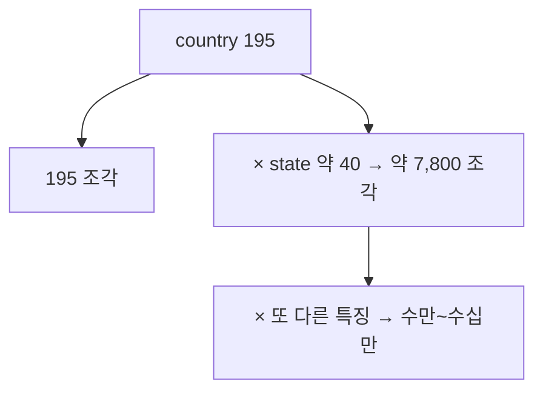

# 슬라이스 개수와 비용

> 데이터를 특징 값별로 잘라(slice) 통계를 따로 계산하면 숨은 집단 문제를 찾을 수 있지만, **값 종류가 많은 특징이나 여러 특징의 교차로 자르면 조각 수가 폭증**해 계산·저장·검토 비용이 커진다.

## 쉽게 말하면
반 성적을 "학년별"로 보면 조각이 6개지만, "학년 × 반 × 성별 × 출신 학교"로 나누면 조각이 수천 개가 되고 한 조각에 학생이 한두 명뿐이라 의미 있는 평균을 낼 수 없다. 자르는 기준이 많을수록 조각은 곱셈으로 늘어난다.

## 자세히
(TFDV 공식 시작 가이드의 "Computing statistics over slices of data" 절을 직접 읽었다. 조각 수 계산은 이 지도에서 직접 한 산술이며 수치는 가상 예시다.)
- **슬라이싱 방식(문서)**: TFDV는 슬라이싱 함수를 `tfdv.StatsOptions`로 받아 데이터 조각별 통계를 만든다. 슬라이싱 함수는 Arrow `RecordBatch`를 받아 `(슬라이스 키, 레코드 배치)` 튜플의 열을 내놓는다. 슬라이싱이 켜지면 출력 `DatasetFeatureStatisticsList`에 **조각마다 하나씩 여러 `DatasetFeatureStatistics`** 가 들어 있고, 각 조각은 고유한 이름으로 식별된다. **기본적으로 전체 데이터셋 통계도 함께** 계산된다.
- **문서가 보여 주는 세 가지 슬라이서(코드 예)**
  - 특징의 **모든 고유 값**으로: `get_feature_value_slicer(features={'country': None})`
  - 두 특징의 **교차**(모든 고유 값 쌍)로: `features={'country': None, 'state': None}`
  - **지정한 값**으로: `features={'age': [10, 50, 70]}`
- **조각 수는 어떻게 늘어나나(직접 계산, 가상 수치)**: 국가 195개라면 `country` 슬라이서는 약 195조각. 국가별로 평균 40개 주가 있다고 가정하면 `country × state` 교차는 약 **7,800조각**. 값 종류가 각각 200·50·12개인 세 특징을 모두 교차하면 이론상 최대 **120,000조각**이다. 실제로는 데이터에 존재하는 조합만 생기지만 상한은 곱으로 커진다. 반대로 `age: [10, 50, 70]`처럼 값을 지정하면 조각 수는 지정한 개수로 고정된다.
- **비용(해석, 문서가 수치를 주진 않음)**: ① 조각마다 통계를 계산·저장하므로 시간과 저장이 조각 수에 비례해 늘고 ② 사람이 검토해야 할 통계표가 폭증하며 ③ 조각이 작아질수록 통계가 불안정해 의미를 잃는다(소표본 문제).
- **관리 방법(일반 원칙, 제안)**: ① 위험·공정성에 관련된 특징부터 고른다 ② 카디널리티가 높은 특징은 **구간화·상위 N개 값·"기타" 묶기**로 줄인다 ③ **지정 값 슬라이서**로 관심 집단만 본다 ④ 조각별 **최소 표본 수 하한**을 두고 그 아래는 보고하지 않는다 ⑤ 교차는 필요한 쌍만 만든다.
- **한계**: 문서는 조각 수의 실제 한도나 성능 수치를 제시하지 않으므로 규모가 큰 데이터에서는 시험해 봐야 한다.

## 그림으로 보기



## 예시
```python
from tensorflow_data_validation.utils import slicing_util
slice_fn1 = slicing_util.get_feature_value_slicer(features={'country': None})
slice_fn2 = slicing_util.get_feature_value_slicer(features={'country': None, 'state': None})
slice_fn3 = slicing_util.get_feature_value_slicer(features={'age': [10, 50, 70]})
stats_options = tfdv.StatsOptions(slice_functions=[slice_fn1, slice_fn2, slice_fn3])
```
- 교육 소재: 기준을 하나씩 더할 때 조각 수가 어떻게 곱해지는지 표로 계산해 보기.

## 헷갈리는 것과 비교
| 개념 | 차이 |
|---|---|
| 슬라이싱 | 특징 값별로 통계를 따로 계산 |
| 교차 슬라이스 | 여러 특징 값 쌍으로 조각을 만듦(조각 수 곱셈) |
| 지정 값 슬라이스 | 관심 값만 골라 조각 수를 고정 |
| [교차 조합 커버리지](#intersectional-coverage) | 조합별 데이터·성능 점검(같은 조합 폭발 문제) |

## 더 읽을거리
- [Get started with TensorFlow Data Validation — slices](https://www.tensorflow.org/tfx/data_validation/get_started) — 슬라이싱 함수 세 가지와 출력 구조(직접 읽음).
