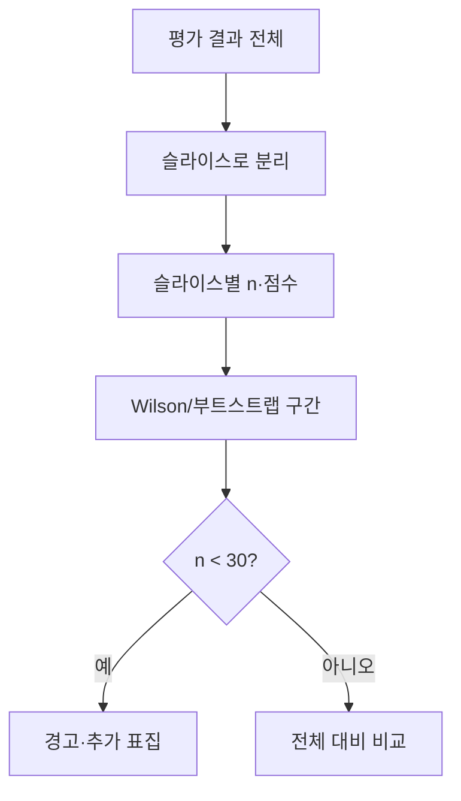
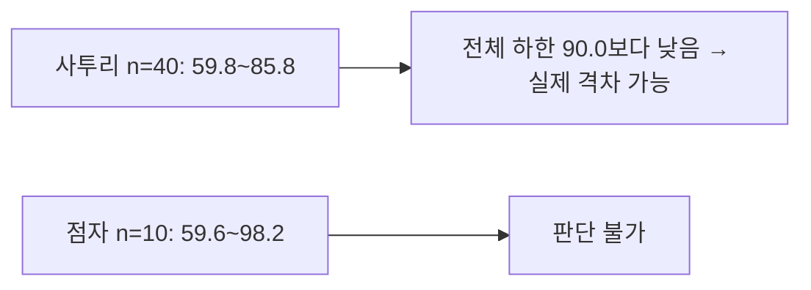

# 슬라이스 신뢰구간 표

> 데이터를 집단(슬라이스)별로 쪼개 성능을 보고할 때, **슬라이스마다 표본 수 n·점수·신뢰구간을 한 표로** 적는다. 작은 슬라이스의 점수는 숫자만 보면 그럴듯해도 구간이 넓어 거의 정보가 없다.

## 쉽게 말하면
전교 평균 91.9점 옆에 "사투리 학생 75점, 한 줄 메모: 40명뿐"이라고만 적으면 판단이 어렵다. "75점(59.8~85.8), n=40"이라고 적으면 "이 집단은 확실히 낮을 수도, 평균과 같을 수도 있다"는 정직한 정보가 된다.

## 자세히
- **보고서 표준**: Model Cards 논문(Mitchell 외, arXiv 1810.03993, 초록 확인)은 인구·지역·성별 같은 **집단별 분리 성능**과 교차 집단(예: 연령×인종) 결과를 모델 카드에 싣자고 제안한다. 검색으로 확인한 본문 요지는 분리 평가에서 지표의 **신뢰구간을 이해하는 것이 특히 중요**하다는 점이다(본문 인용은 검색 요약 기준).
- **표 서식(필수 열)**: 슬라이스 정의 | n | 점수 | 95% 구간 | 전체 대비 차이 | 비고(작은 n 경고).
- **직접 계산 예(가상 평가 1,000건, Wilson 95%)**
  | 슬라이스 | n | 정확도 | 95% 구간 | 해석 |
  |---|---|---|---|---|
  | 전체 | 1,000 | 91.9% | 90.0~93.4 | 기준 |
  | 한국어 | 650 | 92.3% | 90.0~94.1 | 전체와 같음 |
  | 영어 | 300 | 93.3% | 89.9~95.6 | 전체와 같음 |
  | 사투리 | 40 | 75.0% | 59.8~85.8 | 낮아 보이나 n 작음 → **추가 표집 필요** |
  | 점자 OCR | 10 | 90.0% | 59.6~98.2 | 정보 거의 없음 |
  사투리는 구간 상한(85.8%)이 전체 구간 하한(90.0%)보다 낮아 **실제로 낮을 가능성이 높다**. 반면 점자 OCR은 구간이 너무 넓어 "문제없다"도 "문제 있다"도 말할 수 없다.
- **작은 슬라이스 처리**: `sliceval` 패키지는 슬라이스마다 구간·표본 수·전체와의 차이·유의성 검정을 붙이고 **30개 미만이면 지표가 불안정하다고 경고**한다(검색 요약). Herlihy 외(arXiv 2401.14893)는 교차 집단에서 표본이 순식간에 작아져 **관측 25개 미만 하위 집단**에서는 단순 추정이 정보가 없다고 보고 구조적 회귀로 구간을 내는 방법을 제안한다. 30·25는 각 출처의 선택이며 합의된 표준은 없다.
- **다중 비교**: 슬라이스가 많을수록 우연히 낮은 슬라이스가 생긴다. 사전에 정한 슬라이스만 보고하거나 보정한다([사후 슬라이스 위험](#slice-definition-before-looking)).
- **구간 방법**: 이항 정확도는 Wilson, 복합 지표는 부트스트랩, 같은 사용자 반복은 군집 부트스트랩([이항 구간](#independent-test-ci)·[군집](#cluster-bootstrap)).

## 그림으로 보기



## 예시
```python
from statsmodels.stats.proportion import proportion_confint
for name, k, n in slices:       # (슬라이스명, 정답 수, 개수)
    lo, hi = proportion_confint(k, n, method="wilson")
    print(f"{name:8s} n={n:5d} acc={k/n:.1%} CI=({lo:.1%},{hi:.1%})" + ("  ⚠ n<30" if n < 30 else ""))
```
- 모델 카드 평가 절에 위 표를 그대로 붙이고 "n<30 슬라이스는 참고용"이라는 각주를 단다.

## 헷갈리는 것과 비교
| 항목 | 의미 |
|---|---|
| 전체 평균 | 큰 집단이 지배 |
| 슬라이스 점수 | 집단별 성능 |
| 슬라이스 구간 | 그 점수의 불확실성(n에 의존) |
| [범주 비율 구간](#category-share-confidence-interval) | 오류 범주 비중의 불확실성 |

## 더 읽을거리
- [Model Cards for Model Reporting (arXiv 1810.03993)](https://arxiv.org/abs/1810.03993) — 집단별 평가를 보고서에 싣는 틀(초록 열어 확인).
- [A structured regression approach… intersectional subgroups (arXiv 2401.14893)](https://arxiv.org/abs/2401.14893v2) — 작은 하위 집단의 구간(검색 요약으로만 확인).
