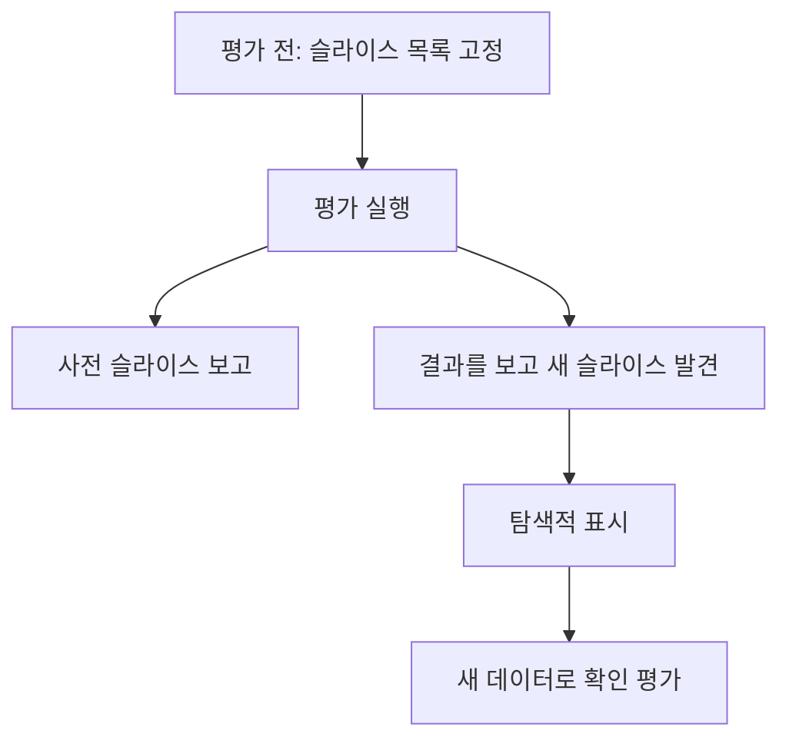
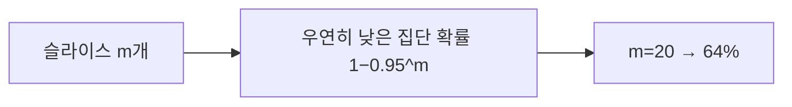

# 데이터 보기 전 슬라이스 정의

> 성능을 쪼개 볼 집단(슬라이스)은 **결과를 보기 전에 정해 문서에 남겨야** 한다. 결과를 본 뒤 "유독 낮은 집단"을 찾아 슬라이스를 만들면 우연한 하락이 발견처럼 보이는 다중 비교 문제가 생긴다.

## 쉽게 말하면
과녁에 화살을 쏜 뒤 화살이 모인 곳에 과녁을 그리면 명사수처럼 보인다. 슬라이스도 결과를 본 뒤 그리면 "문제 집단을 찾았다"는 착시가 생긴다.

## 자세히
- **다중 비교 문제(Wikipedia 확인)**: 같은 데이터에 여러 검정을 하면 하나라도 거짓 양성일 확률이 커진다. 독립 m개 검정의 FWER = 1 − (1−α)^m, 일반적 상한은 Boole 부등식으로 m×α. 문서 예: 5% 수준 100개 검정이면 거짓 기각이 평균 5개, 하나라도 나올 확률 약 99.4%. 6개 검정이면 약 26.5%.
- **직접 계산(5% 수준, 독립 가정)**
  | 슬라이스 수 m | 우연히 하나 이상 "유의" | Bonferroni 기준(α/m) |
  |---|---|---|
  | 5 | 22.6% | 1% |
  | 10 | 40.1% | 0.5% |
  | 20 | 64.2% | 0.25% |
  | 50 | 92.3% | 0.1% |
  모델이 모든 집단에서 똑같이 좋아도 슬라이스를 20개 만들면 약 64% 확률로 "어딘가 낮은 집단"이 우연히 나온다.
- **p-해킹**: 유의해질 때까지 비보정 비교를 시도하는 것. 결과에 따라 분석 방법을 바꾸면 겉보기 비교 수는 적어도 실제 시도 수는 많다.
- **사전 정의의 원칙**
  1. 평가를 돌리기 전에 슬라이스 목록과 이유(사용자 집단·언어·입력 유형·위험도)를 문서에 고정한다.
  2. 목록은 **서비스 위험**에서 출발(규제 대상 집단, 핵심 고객, 알려진 취약 입력)하고 결과에서 출발하지 않는다.
  3. 결과 후에 찾은 슬라이스는 **"탐색적(exploratory)"** 으로 표시해 가설로만 쓰고, 새 데이터로 **확인 평가**한다.
  4. 슬라이스가 많으면 Bonferroni(보수적, 가정 없음)나 Holm(검정력 더 큼, Wikipedia 확인) 같은 보정, 혹은 구간을 넓혀 보고([구간 표](#slice-confidence-interval-table)).
- **탐색 자체를 막지는 않는다**: 오류 분석에서 패턴을 찾는 건 필수다. 다만 "탐색에서 찾았다 → 새 표본으로 확인"의 2단계로 나눈다.

## 그림으로 보기

## 예시
- 프로젝트 문서에 "평가 슬라이스: 언어(ko/en/ja), 길이(짧음/긴), 도메인(법률/의료/일반), 고객 등급(VIP) — 2026-11-26 확정" 기록 후 평가.
- 평가 후 "화요일 접수 건이 낮다"를 발견했다면 "탐색적 발견: 새 주간 데이터로 검증 예정"으로 표기.

## 헷갈리는 것과 비교
| 구분 | 사전 정의 | 사후 탐색 |
|---|---|---|
| 목적 | 확인 | 가설 생성 |
| 해석 | 비교적 신뢰 | 우연 가능성 큼 |
| 보정 | 슬라이스 수 기준 | 반드시 필요/재검증 |
| 관련 | [사전 정의 슬라이스 평가](#predefined-slice-evaluation) | 오류 분석 |

## 더 읽을거리
- [Wikipedia: Multiple comparisons problem](https://en.wikipedia.org/wiki/Multiple_comparisons_problem) — FWER·Bonferroni·p-해킹(열어 확인; 슬라이스 사례는 이 글의 해석).
