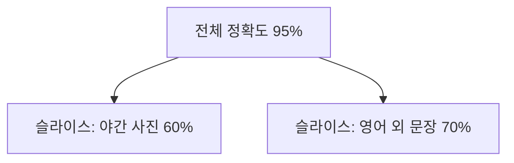

# 슬라이스 발견

> 전체 정확도는 높은데 특정 하위집단(슬라이스)에서 체계적으로 틀리는 모델의 약점을, 사전에 붙여 둔 메타데이터 없이 모델의 표현(임베딩)과 오류 패턴으로 찾아내는 기법이다.

## 쉽게 말하면
학교 전체 평균은 90점인데, 특정 문제 유형(예: 그래프 읽기)만 유독 못 푸는 학생이 있다. 유형 표시가 없는 문제지에서도 "틀린 문제들의 공통점"을 모아 보면 약점이 드러난다. 슬라이스 발견은 그 공통점 찾기를 자동화한다.

## 자세히
(Domino 논문 arXiv 2203.14960과 AttributionScanner arXiv 2401.06462 초록을 직접 열어 확인.)
- **정의(Domino 초록)**: 평균 정확도가 높은 모델도 중요한 부분집합(슬라이스)에서 체계적으로 실패한다. 슬라이스 발견 방법(SDM)은 모델이 학습한 표현으로 성능이 낮은 슬라이스를 찾는다. 유용하려면 성능이 낮고 **일관성(사람이 이해할 개념으로 묶임)** 이 있어야 한다.
- **Domino(Eyuboglu 등, ICLR 2022)**: 교차 모달 임베딩과 오류 인식 혼합 모델로 일관된 슬라이스를 찾고 **자연어로 슬라이스를 설명**한다. 평가 틀은 자연 이미지·의료 영상·시계열 세 영역의 **1,235개 슬라이스 설정**. Domino는 그중 36%를 정확히 찾아 기존 방법보다 12%p 높았고, 설명이 정확히 슬라이스를 가리킨 비율은 35%. 즉 아직 쉽지 않은 문제다.
- **메타데이터 의존 문제**: 메타데이터 기반 슬라이싱은 추가 메타데이터 비용이 크고 원인 해석이 어렵다. AttributionScanner는 사람이 개입하는 시각화 분석 시스템으로, 모델 행동이 비슷한 해석 가능한 슬라이스를 찾아 보여 주고 허위 상관·라벨 오류를 확인·주석하게 하며 정규화로 완화한다(초록).
- **한계(검색 결과 요약)**: Domino는 비전-언어 모델에 의존하므로 도메인이 크게 다르면 덜 의미 있는 슬라이스가 나올 수 있다는 지적이 있다.
- **활용**: 약한 슬라이스를 찾으면 그 부분을 겨냥한 [목표 데이터 수집](#targeted-data-collection)을 한다. 원인이 라벨 오류인지 모델 한계인지는 [오류 원인 분류](#error-cause-triage)로 가른다.

## 그림으로 보기

## 예시
- 흉부 X선 모델이 평균은 좋지만 특정 장비로 찍은 영상에서만 나쁨. 장비 정보가 메타데이터에 없어도 오류가 모이는 군집을 찾으면 단서가 된다.
- 교육 활용: "평균 점수의 함정"을 보여 주는 사례. 직무 데이터에서 하위집단별 성능을 점검하게 한다.

## 헷갈리는 것과 비교
| 개념 | 차이 |
|---|---|
| 슬라이스 발견 | 메타데이터 없이 약한 하위집단을 탐색 |
| 사전 정의 슬라이스 평가 | 성별·지역처럼 알려진 속성별 성능 비교 |
| [오류 원인 분류](#error-cause-triage) | 찾은 오류의 원인을 가름 |
| [라벨 오류 탐지](#label-error-detection) | 잘못된 라벨 샘플 찾기 |

## 더 읽을거리
- [Domino: Discovering Systematic Errors with Cross-Modal Embeddings (arXiv 2203.14960)](https://arxiv.org/abs/2203.14960) — 정의·1,235 설정·36%(초록 확인).
- [AttributionScanner (arXiv 2401.06462)](https://arxiv.org/abs/2401.06462) — 메타데이터 없는 슬라이스 찾기 시각 분석(초록 확인).
