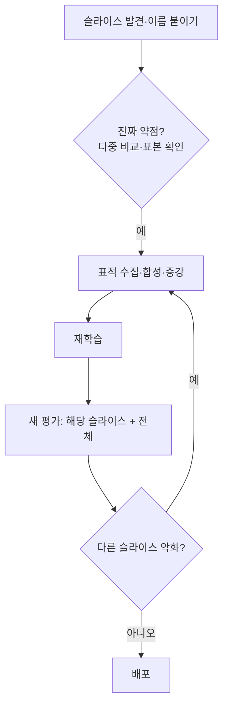
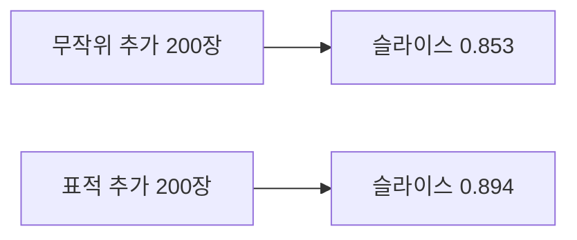

# 슬라이스 기반 데이터 보강

> 모델이 약한 슬라이스(예: "흐린 사진", "야간 촬영")를 찾아 그 슬라이스에 해당하는 데이터를 **표적으로 더 수집·생성**해 약점을 줄이는 방식이다. 같은 양의 데이터를 무작위로 더하는 것보다 약점 개선에 효율적일 수 있다.

## 쉽게 말하면
시험에서 "분수 나눗셈"만 계속 틀린다면 문제집 전체를 처음부터 다시 푸는 것보다 분수 나눗셈 문제를 집중해서 더 푸는 편이 빠르다. 어디가 약한지 알아야 어디에 연습량을 몰아줄지 정할 수 있다.

## 자세히
(Slice-based Learning(Chen 등, arXiv 1909.06349) 초록을 직접 확인하고, 데이터 보강 효과는 scikit-learn 1.9.1과 digits 데이터로 직접 실험했다.)
- **슬라이스의 중요성(논문)**: F1이나 정확도 같은 거친 지표는 중요한 부분집합(슬라이스)의 성능 저하를 가린다. 논문은 슬라이싱 함수로 슬라이스를 정의하고 모델이 슬라이스에 추가 용량을 쓰게 해 **슬라이스에서 최대 19.0 F1 포인트, 전체에서 최대 4.6 F1 포인트**까지 향상했다고 보고한다(언어 이해, 컴퓨터 비전, 산업 시스템). 이 글의 데이터 보강은 모델 구조가 아니라 **데이터** 쪽 접근이다.
- **직접 실험(digits 손글씨, MLP, 학습 데이터의 약 2%인 21장만 "흐린 이미지(밝기 0.25배+잡음)", 평가는 정상 이미지와 같은 이미지를 흐리게 한 것)**
  | 조건 | 정상 정확도 | 흐린 슬라이스 정확도 |
  |---|---|---|
  | 기준(흐린 21장 포함) | 0.974 | 0.855 |
  | **무작위로 200장** 추가(흐린 것은 약 2%) | 0.974 | **0.853**(개선 없음) |
  | **흐림 슬라이스 표적 200장** 추가 | 0.970 | **0.894** |
  무작위 추가(5회 평균)는 슬라이스 정확도를 못 올렸고, 같은 양을 표적 수집하면 흐린 슬라이스가 **+3.9%p** 올랐다. 정상 이미지 정확도는 0.974→0.970으로 거의 유지됐다. 이 실험은 슬라이스가 알려져 있고 수집 가능하다고 가정한 장난감 설정이다.
- **절차(제안)**
  1. [슬라이스 발견·이름 붙이기](#slice-naming)로 약점 슬라이스를 정의
  2. 다중 비교와 표본 크기를 점검해 진짜 약점인지 확인([슬라이스 다중 비교](#multiple-comparisons-slices))
  3. 그 슬라이스를 **수집·합성·재라벨링**할 방법 선택(예: 추가 촬영, 증강, 합성 데이터)
  4. 보강 후 **새 평가 세트**로 해당 슬라이스와 전체 성능 모두 확인(회귀 방지)
  5. 개선 후에도 다른 슬라이스가 악화되지 않았는지 점검
- **주의**: 슬라이스를 과도하게 보강하면 분포가 왜곡되어 다른 곳의 성능이 떨어질 수 있다. 약점이 **라벨 오류**나 **정의 모호성** 때문이면 데이터를 더 모아도 소용없다. 합성·증강 데이터는 실제 분포와 다를 수 있어 검증이 필요하다.

## 그림으로 보기

## 예시
- 야간 사진에서 약한 객체 인식 모델: "야간·가로등 없음" 슬라이스를 정의하고 해당 조건의 사진을 추가 촬영, 보강 후 야간 슬라이스·전체 정확도를 함께 보고.
- 교육 소재: "더 많은 데이터"가 아니라 "어떤 데이터"를 더할지 정하는 실습(데이터 중심 AI).

## 헷갈리는 것과 비교
| 개념 | 차이 |
|---|---|
| 슬라이스 기반 데이터 보강 | 약점 슬라이스에 맞춰 데이터를 추가 |
| [슬라이스 이름 붙이기](#slice-naming) | 약점의 공통 개념을 말로 설명 |
| [일관된 슬라이스](#coherent-slice) | 설명 가능한 약점의 정의 |
| 능동 학습 | 모델이 불확실한 샘플을 골라 라벨링(선택 기준이 다름) |

## 더 읽을거리
- [Slice-based Learning (arXiv 1909.06349)](https://arxiv.org/abs/1909.06349) — 슬라이스를 모델링해 성능을 높이는 접근(초록 직접 확인).
