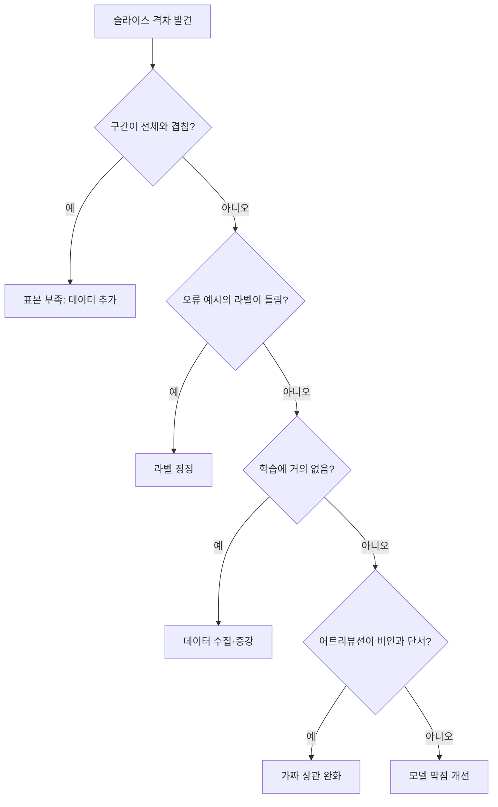

# 슬라이스 격차 원인 점검

> 어떤 집단(슬라이스)에서 성능이 낮게 나왔을 때, 그 원인이 **표본 부족(우연)**, **라벨 오류**, **데이터 분포 차이**, **가짜 상관**, **정말 모델의 약점** 중 무엇인지 순서대로 가려 처방을 고르는 점검 절차.

## 쉽게 말하면
특정 반 학생 점수가 낮다. 먼저 인원이 3명뿐이라 우연인지, 채점표가 틀렸는지, 그 반이 다른 교재로 배웠는지, 정말 가르친 방법이 안 통했는지 순서대로 따져 본 뒤에야 "수업을 고치자"고 결정한다.

## 자세히
- **점검 순서(권장 절차; 각 단계 도구는 아래 참조)**
  1. **표본 부족/우연인가?** 슬라이스의 n과 95% 구간을 본다. 구간이 전체 구간과 겹치면 격차를 단정할 수 없다 → 표본 추가([슬라이스 구간 표](#slice-confidence-interval-table)). 사후에 찾은 슬라이스면 다중 비교 가능성([사전 정의](#slice-definition-before-looking)).
  2. **라벨 오류인가?** 틀린 예시를 무작위로 50~100개 열어 본다. 라벨이 틀린 비율이 높으면 모델이 아니라 평가 데이터 문제([오류 중 라벨 오류 비중](#label-error-share-of-errors), [체계적 라벨 오류](#systematic-vs-random-label-errors)).
  3. **분포 차이인가?** 그 슬라이스 입력이 학습 데이터에 거의 없는지(학습 내 비중, 특징 분포)를 확인. 학습에 부족하면 데이터 수집·증강([성능 하락 원인 분류](#performance-drop-root-cause)의 공변량 이동과 같은 원리).
  4. **가짜 상관인가?** 모델이 비인과 단서에 의존하는지(어트리뷰션·반사실 테스트) 확인([가짜 상관](#spurious-correlation), [GradCAM](#gradcam)).
  5. **정말 모델 약점인가?** 위가 모두 아니면 모델·특징·손실 개선. 최악 집단 최적화 등([Waterbirds](#waterbirds-benchmark)).
- **슬라이스를 자동으로 찾는 연구**: Domino(Eyuboglu 외, arXiv 2203.14960, 초록 확인)는 이미지·오디오처럼 슬라이스가 라벨로 안 붙은 데이터에서 고정확도 모델이 체계적으로 실패하는 부분집합을 찾는다. 기존 방법은 일관성 없는 슬라이스를 만들곤 했고 평가 틀이 없었다. 연구진은 자연 이미지·의료 영상·시계열 1,235개 설정에서 비교했고 Domino가 슬라이스의 **36%** 를 식별(기존 대비 12%p 개선), **35%** 설정에서 슬라이스 이름을 정확히 생성, 자연어 설명을 주는 첫 방법이라고 주장한다.
- **원인별 처방**
  | 원인 | 단서 | 처방 |
  |---|---|---|
  | 표본 부족 | 구간이 넓음 | 평가 데이터 추가 |
  | 라벨 오류 | 오류 예시에서 라벨이 틀림 | 재라벨·지침 정정 |
  | 분포 차이 | 학습에 거의 없음 | 데이터 수집·증강 |
  | 가짜 상관 | 어트리뷰션이 배경 | 균형화·DRO |
  | 모델 약점 | 위 모두 아님 | 모델·특징 개선 |
- **원칙**: 처방 전에 원인을 하나로 단정하지 않는다. 여러 원인이 겹칠 수 있고, 슬라이스 격차 자체가 우연일 수 있다.

## 그림으로 보기

## 예시
- 사투리 음성 슬라이스 정확도 75%(n=40, 구간 59.8~85.8%): ① 표본 추가 수집 → 150건에서도 77%(구간 70~83%)면 우연이 아니다 ② 오류 20건 청취 시 전사 오류 2건뿐 ③ 학습 데이터 내 사투리 비중 1% → 데이터 부족 분포 차이로 결론(가상 예).
- 점검 템플릿: `slice | n | 구간 | 학습 내 비중 | 라벨 오류율(샘플) | 어트리뷰션 메모 | 결론`.

## 헷갈리는 것과 비교
| 개념 | 설명 |
|---|---|
| 슬라이스 평가 | 격차를 찾음 |
| 슬라이스 격차 원인 점검 | 격차의 이유를 가림 |
| 슬라이스 발견 | 정의되지 않은 슬라이스를 자동 탐색 |

## 더 읽을거리
- [Domino: Discovering Systematic Errors with Cross-Modal Embeddings (arXiv 2203.14960)](https://arxiv.org/abs/2203.14960) — 슬라이스 발견 방법과 평가 틀(초록 열어 확인).
