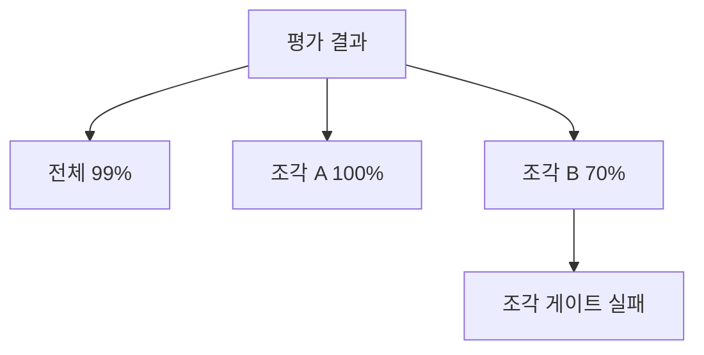

# 조각별 게이트

> 평가 점수를 **전체 평균뿐 아니라 조각(slice)별로도 따로 합격선을 걸어**, 약한 조각이 평균에 가려지지 않게 하는 방법이다.

## 쉽게 말하면
반 평균이 90점이어도 수학 점수만 50점이면 문제다. 과목별로 따로 합격선을 두면 한 과목의 붕괴를 평균이 감춰 주지 못한다.

## 자세히
(Stack Overflow Blog 글을 직접 읽었다. 조각별 합격선 수치는 글에 없다.)
- **조각 태그(SO)**: 각 케이스에 `slice`를 달고, 러너는 시스템이 운영 중 쓰는 것과 같은 속성으로 케이스를 조각에 배정한다.
- **원칙(SO)**: 전체와 조각별 **둘 다** 게이트한다. 반면교사 문구는 "전체 99%가 70% 조각을 숨길 수 있다".
- **임계값**: 글의 예는 전체 기준 `--min-pass 0.98`뿐이다. 조각별 수치는 각자 정한다(제안).
- 튜터에서 조각 예(제안): 수학·과학, 한국어·영어, 초급·고급, 우회 시도 유형 6종별.

## 그림으로 보기

## 예시
- 정답 누출률이 전체 2%라도 "감정 압박" 조각에서만 25%면 그 조각 게이트에서 실패시킨다.

## 헷갈리는 것과 비교
| 개념 | 차이 |
|---|---|
| 전체 게이트 | 평균 합격선 |
| 조각별 게이트 | 부분집합별 합격선 |
| [골든 데이터셋 버전](#golden-dataset-versioning) | 조각 태그가 붙은 문항 세트 |

## 더 읽을거리
- [Stack Overflow Blog — Evals as a deployment gate](https://stackoverflow.blog/2026/10/07/evals-as-a-deployment-gate-and-how-to-know-when-they-drift/) — 직접 읽음.
