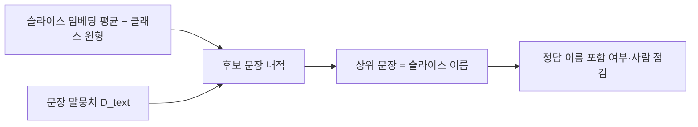
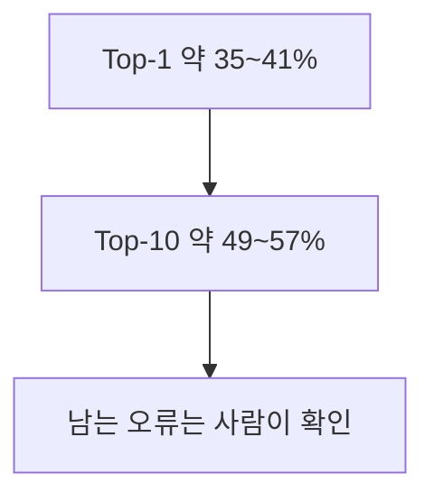

# 슬라이스 이름 검증

> 자동으로 발견한 오류 슬라이스에 붙인 설명 문장이 맞는지 확인하는 단계다. Domino는 정답 슬라이스 이름(또는 WordNet 동의어)이 생성된 상위 문장에 들어 있는지로 평가했고, 사람 검증은 별도 단계로 두는 것이 안전하다.

## 쉽게 말하면
AI가 "이 틀린 사진들은 '안경 쓴 사람'이라는 공통점이 있다"고 이름을 붙이면, 그 이름이 실제로 맞는지 사람이 사진을 보고 확인해야 한다.

## 자세히
(Domino arXiv 2203.14960 5.3·6.3·A.4.3절을 하위 에이전트가 원문으로 읽은 노트 기준. "검증"이라는 말은 이 지도에서 쓴 용어다.)
- **이름 붙이는 방법**: 후보 문장 말뭉치 D_text(데이터와 짝이 없어도 됨)를 교차 모달 텍스트 인코더로 임베딩. 슬라이스 원형(prototype) = 슬라이스 내 입력 임베딩의 가중 평균에서 **슬라이스에서 가장 흔한 클래스 원형을 뺀** 벡터. 설명 = z_text와의 **내적이 가장 큰 문장**.
- **말뭉치**: CelebA — 전문가 템플릿 약 30개("a photo of a [MASK] woman")를 BERT-base로 채워 10만 개 생성, 손실이 낮은 10,000개 유지. ImageNet — "a photo of [MASK]"에 영어 위키 최빈 단어 10,000개. MIMIC-CXR는 의사 보고서 159,830개, EEG 보고서 41,258개.
- **평가 지표**: 정답 이름(또는 WordNet 동의어)이 상위 k 문장에 있는가. **Top-1**: 희소 34.7%, 상관 41.0%, 노이즈 라벨 39.0% / **Top-10**: 57.4%, 55.4%, 48.7%. 초록: 설정의 35%에서 정확한 슬라이스 이름 생성.
- **한계**: 사람이 이름을 점검한 결과는 이번에 읽지 않았다(정성 예시 미확인). 이름이 그럴듯해도 실제 공통 개념이 아닐 수 있어 이미지 표본 확인이 필요하다(제안).

## 그림으로 보기

## 예시
- 자동 이름 상위 10개 중 3개만 실제로 맞는다면 라벨러가 대표 이미지 20장을 보고 최종 이름을 확정.
- 교육 활용: "AI가 붙인 설명 믿어도 되나?"를 순위 평가 결과로 논의.

## 헷갈리는 것과 비교
| 개념 | 차이 |
|---|---|
| 슬라이스 이름 붙이기 | 설명 문장 생성 |
| 이름 검증 | 그 문장이 맞는지 확인 |
| [슬라이스 이름 붙이기(coherent-slice)](#slice-naming) | 공유 개념을 말로 설명 |

## 더 읽을거리
- [Domino (arXiv 2203.14960)](https://arxiv.org/abs/2203.14960) — 이름 생성과 평가.
