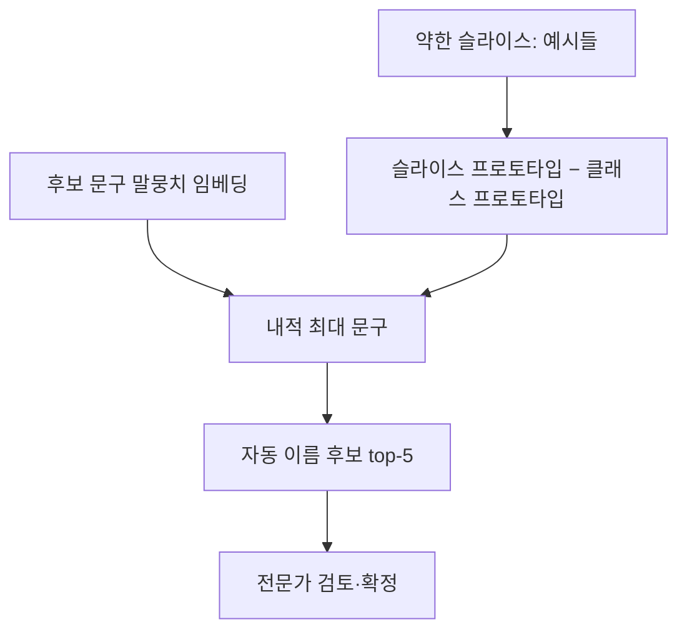
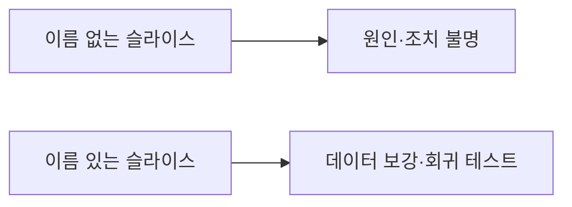

# 슬라이스 이름 붙이기

> 모델이 약한 데이터 묶음(슬라이스)을 찾은 뒤, 그 묶음의 **공통 개념을 사람이 읽을 수 있는 말로 설명하는 단계**다. "무엇이 공통인지"를 모르면 약점은 찾았어도 데이터를 어떻게 보강할지, 어떻게 고칠지 알 수 없다.

## 쉽게 말하면
틀린 문제 50개를 한 묶음으로 건네받았을 때, 묶음에 "분수 나눗셈"이라는 이름표가 붙어 있으면 바로 공부할 수 있다. 이름표가 없으면 50문제를 직접 읽으며 공통점을 추리해야 한다.

## 자세히
(Domino 논문(arXiv 2203.14960)의 방법·결과 절을 PDF로 직접 읽어 확인.)
- **왜 이름이 필요한가(논문)**: 슬라이스가 사람이 이해하는 개념과 맞아야(일관) 전문가가 원인을 이해하고 조치를 취한다. 정렬이 잘 돼도 해석하기 어려울 수 있어 이상적인 방법은 슬라이스를 **자연어로 설명**해야 한다. Domino는 이를 자동으로 해 주는 **최초의 슬라이스 발견 방법**이라고 주장하며, **1,235개 설정 중 35%에서 슬라이스의 정확한 이름을 생성**했다.
- **방법(논문 5.3절)**: ① 먼저 입력(이미지 등)과 텍스트를 **같은 임베딩 공간**에 넣는 교차 모달 모델을 쓴다(CLIP 계열) ② 후보 문구 말뭉치(예: "a photo of mosque", "a photo of banana" 같은 문구, 이미지와 짝이 없어도 되고 도메인에 맞게 생성)를 임베딩 ③ 슬라이스의 **프로토타입 임베딩**(슬라이스 원소 임베딩의 가중 평균)에서 슬라이스에서 가장 흔한 **클래스의 프로토타입을 뺀 벡터**를 만든다(클래스 이름이 설명을 독점하지 않도록) ④ 그 벡터와 각 문구 임베딩의 **내적이 가장 큰 문구**를 설명으로 반환. 결과 그림은 상위 설명 몇 개와 각 슬라이스의 대표 이미지를 막대 길이(내적 점수)와 함께 보여 준다.
- **평가 기준(논문)**: 정답 슬라이스의 이름 또는 **WordNet 동의어**가 설명 후보에 나타나면 성공으로 본다. 그림 예시는 상위 5개 설명에 정확한 이름이 포함되고 precision-at-25가 0.8을 넘는 설정들이다([슬라이스 precision-at-k](#precision-at-k-slice)).
- **한계(제안)**: 35%는 합성한 평가 설정에서의 비율이며 실제 데이터에서는 정답 이름이 없다. 후보 문구 말뭉치에 맞는 단어가 없으면 이름을 만들 수 없다. 자동 이름은 **가설**이므로 사람이 대표 예시를 보고 확인한다.
- **실무 방법(제안)**: ① 자동 이름 후보 상위 5개를 슬라이스 대표 예시 10~20개와 함께 검토 ② 전문가가 이름을 확정하고 **규칙(정의·포함·제외 기준)**을 문서화 ③ 확정된 이름으로 슬라이스를 평가 세트의 정식 항목으로 등록 ④ 이름이 붙은 슬라이스별 데이터 보강·회귀 테스트로 연결([슬라이스 기반 데이터 보강](#slice-driven-data-collection)) ⑤ 이름이 안 붙는(일관성 없는) 슬라이스는 라벨 오류·이상치인지 점검.

## 그림으로 보기

## 예시
- 흉부 X선 모델의 오류 슬라이스에 "흉관(chest tube)"이라는 자동 이름 후보가 나오면 방사선과 전문가가 대표 영상을 확인해 확정하고, 흉관 영상 추가 수집.
- 교육 소재: AI가 만든 이름 후보와 사람이 붙인 이름을 비교하는 토론.

## 헷갈리는 것과 비교
| 개념 | 차이 |
|---|---|
| 슬라이스 이름 붙이기 | 슬라이스의 공통 개념을 말로 설명 |
| [일관된 슬라이스](#coherent-slice) | 사람이 이해하는 개념에 정렬된 슬라이스 |
| [슬라이스 precision-at-k](#precision-at-k-slice) | 슬라이스가 정답과 맞는 정도 |
| 클러스터 라벨링 | 군집에 라벨을 붙이는 일반 작업 |

## 더 읽을거리
- [Domino (arXiv 2203.14960)](https://arxiv.org/abs/2203.14960) — 슬라이스 설명 생성 방법과 결과(PDF 직접 확인).
