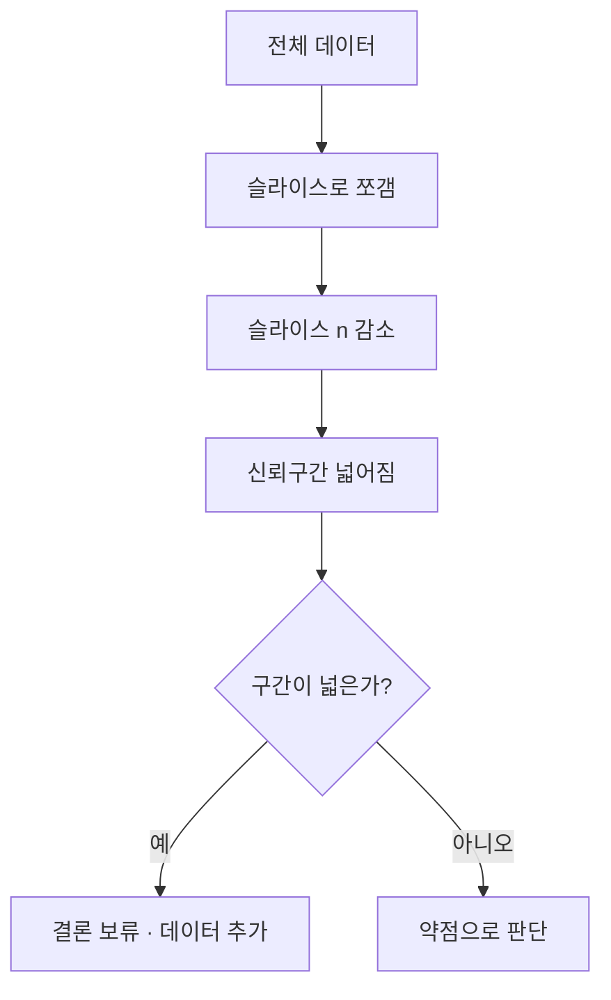
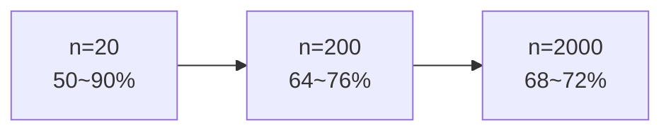

# 슬라이스 표본 크기 주의

> 데이터를 집단·슬라이스로 쪼갤수록 한 슬라이스의 예시 수가 줄어, 그 슬라이스의 정확도 같은 점수가 **우연에 크게 흔들리는 노이즈**가 된다. 숫자만 보고 "이 집단이 나쁘다"고 결론 내리면 안 되고 신뢰구간을 함께 봐야 한다.

## 쉽게 말하면
동전을 10번 던져 7번 앞면이 나왔다고 "이 동전은 앞면이 70%"라고 하긴 어렵다. 1,000번 던져 700번이면 믿을 만하다. 슬라이스도 같다. 예시가 20개뿐인 슬라이스의 70%는 사실상 "50%에서 90% 사이"라는 뜻이다.

## 자세히
- **정규 근사(Wald) 구간**: p̂ ± 1.96·√(p̂(1−p̂)/n) (95%). Wikipedia(이항 비율 신뢰구간, 직접 확인)에 따르면 표본이 작거나 비율이 0·1에 가까우면 이 근사가 "신뢰할 수 없게" 되고, 범위를 [0,1] 밖으로 넘기거나 p̂가 0·1이면 구간 폭이 0이 되어 "거짓된 확실성"을 준다.
- **대안**: Wilson 구간은 작은 표본·치우친 비율에서도 안전하게 쓸 수 있다(같은 페이지). n=10, 성공 1일 때 Wald는 약 (−0.086, 0.286)처럼 음수가 나오지만 Wilson은 약 (0.018, 0.404)다(Wikipedia 페이지가 아닌 이 글 작성 시 직접 계산).
- **표본 크기 감각(이 글의 직접 계산, 정확도 70% 가정, Wald 95%)**: n=20 → 약 50~90%, n=200 → 약 64~76%, n=2,000 → 약 68~72%. 슬라이스를 10배 키워도 구간 폭은 √10배 정도만 줄어든다.
- **평가를 실험으로 보는 관점**: Evan Miller(arXiv 2411.00640, 초록 직접 확인)는 평가를 실험으로 보고 문항을 보이지 않는 모집단에서 뽑은 표본으로 간주하며, 모델 간 차이 측정과 평가 설계에 통계 공식을 제안한다. 세부 방법(표준오차·군집 등)은 초록만 읽어 확인하지 못했다.
- **실무 규칙(해석)**: ① 슬라이스마다 n과 구간을 같이 표기 ② 많은 슬라이스를 훑을 땐 다중 비교로 우연히 나빠 보이는 것이 생김 ③ 표본이 적으면 결론을 "후속 데이터 수집 필요"로.

## 그림으로 보기

## 예시
- 슬라이스 정확도가 60%인데 n=15: 구간이 매우 넓으므로 "나쁘다"가 아니라 "불확실"이라고 보고.
- 교육 소재: 같은 70% 정확도에서 n만 바꿔 구간을 그려 보는 실습.

## 헷갈리는 것과 비교
| 개념 | 차이 |
|---|---|
| 점수 | 한 숫자 |
| 신뢰구간 | 우연 변동 범위 |
| [일관된 슬라이스](#coherent-slice) | 의미 있는 약점인지 |
| [집단별 성능 보고](#subgroup-performance-report) | 집단별 지표(표본 주의 필요) |

## 더 읽을거리
- [Binomial proportion confidence interval (Wikipedia)](https://en.wikipedia.org/wiki/Binomial_proportion_confidence_interval) — Wald·Wilson 구간(직접 확인).
- [Adding Error Bars to Evals (arXiv 2411.00640)](https://arxiv.org/abs/2411.00640) — 평가에 통계 도구 적용(초록 확인).
