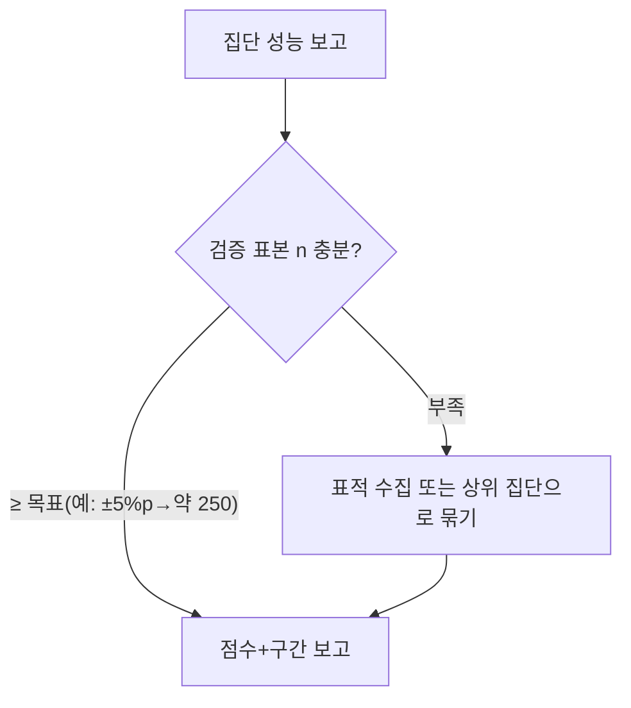
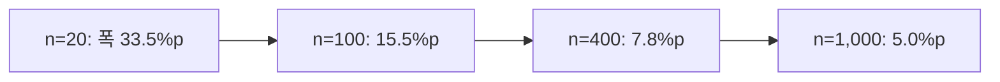

# 슬라이스 검증 표본 크기

> 집단(슬라이스)별 성능을 믿을 만하게 재려면 **집단마다 검증 표본이 충분해야 한다.** 정확도 80% 근처에서 구간 폭 ±5%p를 원하면 집단당 약 250개, ±2%p면 약 1,500개가 필요하다.

## 쉽게 말하면
반 전체 평균은 학생 30명으로 재도 되지만, 한 모둠 3명의 평균으로 그 모둠 실력을 말하기는 어렵다. 집단이 작을수록 더 많은 표본을 모아야 같은 정밀도가 나온다.

## 자세히
- **구간 폭(직접 계산, 정확도 80%, Wilson 95%)**
  | 집단 검증 표본 n | 정확도 80%의 95% 구간 | 폭 |
  |---|---|---|
  | 20 | 58.4~91.9% | 33.5%p |
  | 50 | 67.0~88.8% | 21.8%p |
  | 100 | 71.1~86.7% | 15.5%p |
  | 200 | 73.9~85.0% | 11.0%p |
  | 400 | 75.8~83.6% | 7.8%p |
  | 1,000 | 77.4~82.4% | 5.0%p |
  폭은 대략 1/√n로 줄어 **폭을 절반으로 만들려면 표본을 4배** 모은다.
- **목표 오차별 필요 표본(정규 근사 n ≈ 1.96²·p(1−p)/e², p=0.8)**
  | 허용 오차 e(±) | 필요 표본 |
  |---|---|
  | ±10%p | 약 62 |
  | ±5%p | 약 246 |
  | ±3%p | 약 683 |
  | ±2%p | 약 1,537 |
  희귀 클래스(양성)의 재현율은 그 집단의 **양성 수**가 n이다([독립 시험 세트 구간](#independent-test-ci)).
- **집단별 곡선 반복 측정**: 집단 학습 곡선의 각 점이 시험 잡음을 가지므로 각 크기에서 여러 시드로 반복하거나 검증 표본을 키운다([집단별 학습 곡선](#per-slice-learning-curve), [학습 곡선 맞춤 부트스트랩](#curve-fit-uncertainty-bootstrap)).
- **집단 비교에 필요한 표본**: 두 집단의 격차를 가르려면 차이의 제곱에 반비례해 더 필요하다([작은 차이를 가를 개발 세트 크기](#dev-set-size-for-small-differences)).
- **대응(작은 집단)**: ① 해당 집단만 **표적 수집**해 검증 표본 확보 ② 필요 표본에 못 미치면 "n 부족"을 표시해 [구간 표](#slice-confidence-interval-table)로 보고 ③ 여러 작은 집단을 의미 있게 묶는 상위 집단으로 평가 ④ 사전 정의 슬라이스만 사용해 다중 비교 방지([사전 정의](#slice-definition-before-looking)).
- **한계**: 위 계산은 독립 예제·단일 정확도 지표를 가정한다. 군집 구조(같은 사용자의 여러 예시)가 있으면 유효 표본 수가 줄어든다([군집 부트스트랩](#cluster-bootstrap)).

## 그림으로 보기



## 예시
```python
from math import ceil
def need(e, p=0.8): return ceil(1.96**2 * p * (1 - p) / e**2)
print(need(0.05), need(0.02))     # 246, 1537
```
- 사투리 슬라이스 검증 40건이면 구간 폭이 약 26%p라 "격차 있다/없다"를 단정하기 어려우므로 최소 250건을 표적 수집.

## 헷갈리는 것과 비교
| 개념 | 설명 |
|---|---|
| 집단 검증 표본 | 집단 점수의 정밀도를 정함 |
| 학습 데이터 크기 | 곡선의 x축 |
| 구간 폭 | 1/√n |
| 필요 표본 | 목표 오차의 제곱에 반비례 |

## 더 읽을거리
- [statsmodels proportion_confint](https://www.statsmodels.org/stable/generated/statsmodels.stats.proportion.proportion_confint.html) — 비율 신뢰구간 방법(열어 확인). 표의 수치는 이 글의 직접 계산(Wilson·정규 근사).
