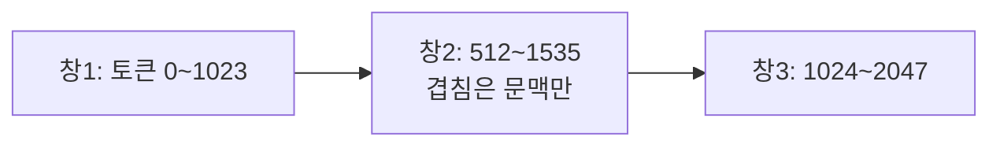
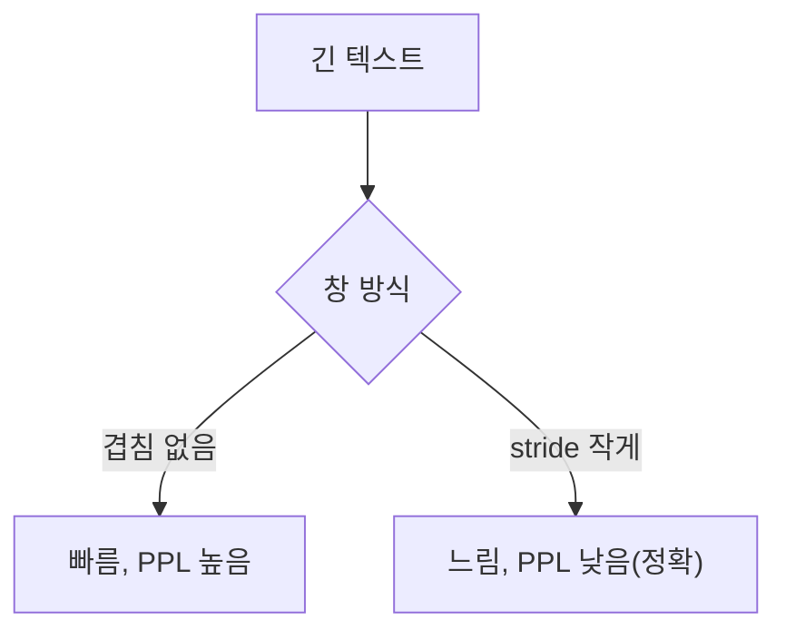

# 슬라이딩 윈도 평가

> 컨텍스트 길이가 고정된 모델로 긴 텍스트의 퍼플렉서티를 잴 때, 창(window)을 겹치게 밀며 계산해 각 토큰이 가능한 한 많은 앞 문맥을 갖게 하는 평가 방식이다.

## 쉽게 말하면
긴 책을 10쪽씩 잘라 따로 시험 보면 각 조각의 첫 줄은 앞 내용을 전혀 모르고 푸는 셈이다. 창을 반쯤 겹쳐 밀면 대부분의 문장이 앞 문맥을 알고 풀게 된다.

## 자세히
Hugging Face 문서(Perplexity of fixed-length models) 기준:
- 퍼플렉서티(PPL)는 시퀀스의 평균 음의 로그우도에 exp를 취한 값(= 교차 엔트로피의 지수). 인과(자기회귀) 모델에 정의되며 BERT 같은 마스크드 모델엔 정의가 불분명하다. 토큰화 방식이 값에 직접 영향을 주므로 모델 간 비교 때 주의.
- GPT-2 large는 고정 길이 1024. 문서를 겹침 없는 조각으로 나눠 합산하는 것은 빠르지만 대부분 토큰이 문맥을 적게 가져 **PPL이 더 나쁘게(높게)** 나오는 부정확한 근사다.
- **슬라이딩 윈도**는 창을 계속 밀어 더 많은 문맥을 준다. 단점은 토큰마다 forward가 필요한 비용 → 타협안이 **stride**(큰 보폭).
- 겹친 부분은 문맥으로만 쓰고 손실에서 제외하도록 라벨을 `-100`으로 가린다.
- 문서 실험(WikiText-2, gpt2-large): stride 1024(겹침 없음) PPL 19.44(GPT-2 논문 19.93과 비슷), stride 512는 16.44. stride가 작을수록 보통 PPL이 좋아진다.
- 따라서 PPL 비교는 **같은 stride·같은 토크나이저**로 해야 공정하다. 양자화 전후를 비교할 때도 설정을 고정한다([양자화 품질 점검](#quantization-quality)).

## 그림으로 보기



## 예시
```python
target_ids = input_ids.clone()
target_ids[:, :-trg_len] = -100      # 문맥 부분은 손실에서 제외
outputs = model(input_ids, labels=target_ids)
```
같은 데이터에서 stride 512로 측정하면 겹침 없는 경우(19.44)보다 16.44로 낮게 나온다(GPT-2 large 문서 실험).

## 헷갈리는 것과 비교
| 개념 | 차이 |
|---|---|
| 겹침 없는 청크 | 빠르지만 PPL 과대 |
| 슬라이딩 윈도 | 문맥 확보, 계산량 증가 |
| stride | 속도·정확도 타협 보폭 |
| [퍼플렉서티](#perplexity) | 평가하려는 지표 자체 |

## 더 읽을거리
- [HF Perplexity of fixed-length models](https://huggingface.co/docs/transformers/perplexity) — 정의, stride 실험, 코드.
