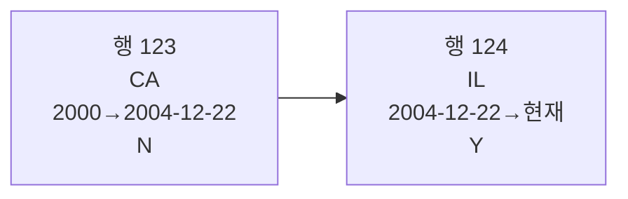
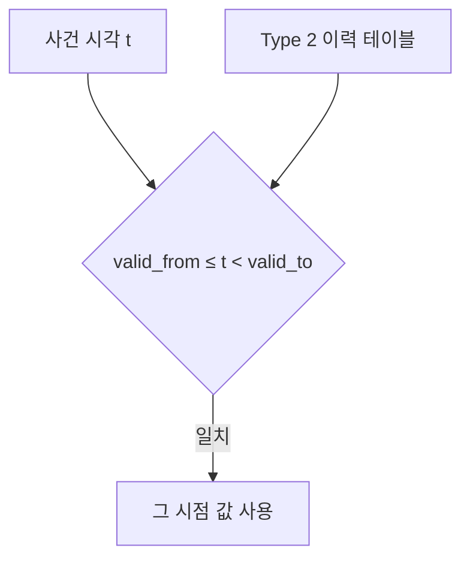

# 느리게 바뀌는 차원

> 고객 등급·주소·소속처럼 **가끔 바뀌는 기준 정보**를 시간이 지나도 정확히 쓰도록 이력과 함께 보관하는 데이터 모델링 방식이다(SCD, Slowly Changing Dimension). AI에서는 학습 데이터에 "그 당시의 값"을 붙이는 데 쓴다.

## 쉽게 말하면
이사 간 친구의 주소록을 생각해 보자. 새 주소로 덮어쓰면 옛 편지의 발송지를 알 수 없다. 옛 줄은 "2020~2023년"이라고 닫고 새 줄을 열어 두면 어느 시점에 어디 살았는지 알 수 있다. 이력을 줄로 쌓는 것이 SCD다.

## 자세히
(Wikipedia "Slowly changing dimension" 직접 확인. 데이터 웨어하우스의 고전적 모델링 개념이며 AI 전용 용어는 아니다.)
- **유형**:
  - **Type 0**: 절대 안 바뀌는 속성(생년월일). 추적 안 함.
  - **Type 1**: 덮어쓰기. 이력 없음, 관리는 쉽지만 집계를 다시 계산해야 할 수 있음.
  - **Type 2**: 변경마다 **새 행**(새 대리 키). 이력 무제한. `valid_from`, `valid_to`(현재 행은 NULL 또는 9999-12-31), `current_flag`(Y/N) 열을 둔다. 소급 변경은 비용이 클 수 있고, 변경이 잦은 모델엔 부적합.
  - **Type 3**: 이전 값을 담는 열 추가. 이력은 한 단계뿐.
  - **Type 4**: 현재 테이블과 변경 이력 테이블 분리(감사 테이블과 유사).
  - **Type 5·6**: 5는 4+1 혼합, 6은 1+2+3 혼합(질의 유연, 구축 복잡).
- **예(문서의 Type 2)**: 공급사 ABC의 주(State)가 2004-12-22에 CA→IL로 바뀌면 행 124가 새로 생기고 옛 행 123은 `valid_to`로 닫힌다.
- **ML과의 연결**: 학습 행에 "예측 시각의 고객 등급"을 붙이려면 Type 2처럼 유효 기간이 있는 이력이 있어야 한다. 현재 값만 있는 테이블(Type 1)과 조인하면 사건 이후 값이 섞여 [시점 누수](#point-in-time-leakage)가 생긴다. 조인 조건은 `event_ts >= valid_from AND (event_ts < valid_to OR valid_to IS NULL)` 형태이며, 사실상 [시점 기준 조인](#point-in-time-join)과 같은 목적이다(이 적용 방식은 일반 원칙이다).
- **무결성 주의**: 자연 키로 참조하려면 유일 제약을 제거해야 해 DBMS의 참조 무결성을 쓸 수 없다(문서).

## 그림으로 보기

## 예시
- 고객 등급(일반→골드): 학습용 주문 데이터에 주문 시점의 등급을 붙여야 "골드라서 구매했다"는 가짜 상관이 생기지 않는다.
- 교육 소재: "이사 간 사람의 옛 주소를 지우면 과거 통계가 틀어진다"를 주소록 비유로.

## 헷갈리는 것과 비교
| 개념 | 차이 |
|---|---|
| 느리게 바뀌는 차원 | 기준 정보의 이력 모델링 |
| [시점 기준 조인](#point-in-time-join) | 이력에서 특정 시각의 값을 고르는 조인 |
| [특징 TTL](#feature-ttl) | 값 유효 기간 상한 |
| 스냅샷 테이블 | 주기적으로 전체를 찍어 두는 방식(행 수가 커짐) |

## 더 읽을거리
- [Slowly changing dimension (Wikipedia)](https://en.wikipedia.org/wiki/Slowly_changing_dimension) — Type 0~6와 Type 2 열 구조.
