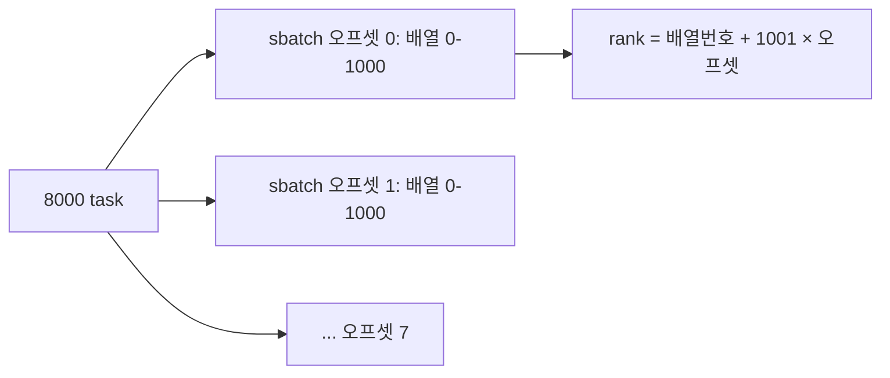
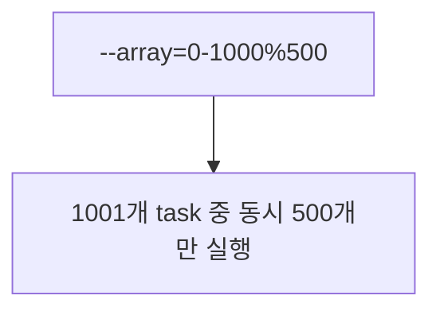

# Slurm 배열 작업

> Slurm의 **배열 작업(job array)**은 같은 스크립트를 번호만 달리해 수백~수천 번 실행하는 제출 방식이다. datatrove는 task 번호를 이 배열 번호로 바꿔 쓰고, 클러스터의 배열 크기 한도(기본 1001)를 넘으면 여러 번 나눠 제출한다.

## 쉽게 말하면
식당 주문서 1,000장을 한 번에 주방에 넣을 수 있는데 주방 규칙이 "한 번에 최대 1,001장"이라면, 8,000장은 8묶음으로 나눠 넣어야 한다. 각 묶음의 주문서에는 1번부터 번호를 새로 붙이고, 묶음 번호(오프셋)를 곱해 전체 번호로 되돌린다.

## 자세히
- **Slurm 문법**(Slurm 문서 확인): `sbatch --array=0-31`처럼 범위를 주면 각 task에 `SLURM_ARRAY_TASK_ID`(배열 번호)가 들어온다. `0-15%4`처럼 `%`를 붙이면 **동시에 돌 개수**를 제한한다. 배열 크기 한도는 `MaxArraySize` 설정으로 정해지며 기본 1001(유효 번호 0~1000).
- **datatrove가 하는 일**(`SlurmPipelineExecutor` 소스 확인): ① 돌릴 rank 목록을 만든다. ② 작업 수 `ceil(rank 수 / tasks_per_job)`를 구한다. ③ 한 번에 제출하는 배열 크기 `max_array = min(작업 수, max_array_size)`. ④ 작업 수가 더 크면 `RUN_OFFSET=0,1,2…`를 환경변수로 넣어 여러 번 `sbatch`한다. ⑤ 각 task 안에서는 `rank = SLURM_ARRAY_TASK_ID + max_array_size × RUN_OFFSET`로 전체 번호를 복원한다. ⑥ `workers`가 -1이 아니면 배열 문자열 끝에 `%workers`를 붙여 동시 실행 수를 제한한다. `tasks_per_job`은 slurm 작업 하나가 datatrove task 여러 개를 맡게 해 제출 수를 줄인다.
- **직접 계산**(위 로직을 그대로 옮긴 계산, sbatch는 없어 실제 제출은 하지 않았다):

| tasks | tasks_per_job | max_array_size | workers | slurm 작업 수 | 배열 문자열 | 제출 횟수(오프셋) |
|---|---|---|---|---|---|---|
| 8,000 | 1 | 1001 | -1 | 8,000 | 0-1000 | 8 (마지막은 7007~7999) |
| 8,000 | 1 | 1001 | 500 | 8,000 | 0-1000%500 | 8 |
| 8,000 | 4 | 1001 | -1 | 2,000 | 0-1000 | 2 |
| 500 | 1 | 1001 | -1 | 500 | 0-499 | 1 |
| 3,000 | 1 | 500 | 200 | 3,000 | 0-499%200 | 6 |

  [FineWeb 예시](#datatrove-fineweb-example)의 8,000 task는 기본 한도에서 **8번 제출**된다. 마지막 제출의 배열 번호가 rank 8,000을 넘는 부분(7007+1000 이후)은 코드가 "rank가 전체 목록 길이 이상이면 바로 종료"로 건너뛴다.
- **선택 지침(제안)**: 클러스터가 배열 한도를 작게 설정했으면 `max_array_size`를 맞추고, 짧은 task가 수천 개면 `tasks_per_job`으로 묶어 스케줄러 부담을 줄이며, 공유 클러스터에서는 `workers`로 동시 실행을 제한한다. 한도 값은 클러스터마다 다르니 관리자에게 확인한다.
- **주의**: `max_array_launch_parallel=True`면 여러 번 제출을 한꺼번에 하고 `stagger_max_array_jobs`로 제출 간격을 둘 수 있다(문서 확인).

## 그림으로 보기



## 예시
```python
SlurmPipelineExecutor(pipeline=[...], tasks=8000, workers=500, time="10:00:00",
                      partition="cpu", logging_dir="logs/job1", max_array_size=1001)
```
- 8,000개 조각 처리를 동시 500개로 제한해 클러스터 몫을 독점하지 않기.
- 교육: 위 계산표를 함수로 짜서 rank와 제출 오프셋의 대응을 검증.

## 헷갈리는 것과 비교
| 개념 | 차이 |
|---|---|
| 배열 번호(SLURM_ARRAY_TASK_ID) | 한 번 제출 안의 0~max 번호 |
| rank | datatrove 전체 조각 번호(오프셋 포함) |
| `workers` | 동시 실행 수 제한(`%`) |
| [실행기 종류](#pipeline-executor-types) | Local·Slurm 등 선택 |

## 더 읽을거리
- [Slurm Job Array Support](https://slurm.schedmd.com/job_array.html) — 배열 문법, `%` 제한, MaxArraySize(열어 확인).
- [huggingface/datatrove](https://github.com/huggingface/datatrove) — SlurmPipelineExecutor 소스와 인자 설명(설치해 소스 확인).
