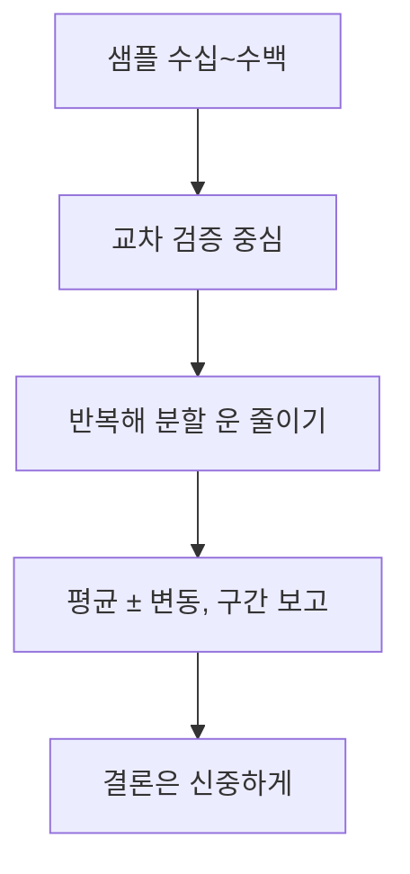
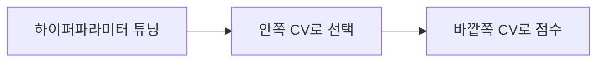

# 소규모 데이터 검증 전략

> 샘플이 수십~수백 개뿐일 때는 고정된 시험 세트 하나 대신 교차 검증을 중심으로 평가하고, 점수 하나가 아니라 불확실성(오차 막대)까지 함께 보고하는 전략이다.

## 쉽게 말하면
학생이 20명뿐인 반에서 4명만 시험 보게 해 학급 실력을 말하면 누가 뽑혔느냐에 따라 결과가 크게 달라진다. 그래서 번갈아 가며 전원이 한 번씩 시험 보게 하고(교차 검증), 그래도 "대략 이 정도 범위"라고만 말해야 한다.

## 자세히
(scikit-learn 교차 검증 문서와 Varoquaux 논문 초록을 직접 열어 확인.)
- **고정 홀드아웃의 문제**: 시험 세트가 작으면 어느 샘플이 들어갔느냐로 점수가 크게 변한다. 교차 검증은 모든 샘플이 한 번씩 시험에 쓰이므로 데이터를 아낀다([k-겹 교차 검증](#k-fold-cross-validation)).
- **오차 막대는 생각보다 크다**: Varoquaux(2017, arXiv 1706.07581)는 교차 검증의 오차 막대가 흔히 과소평가되며, 신경영상의 전형적인 표본 크기에서는 **표본 100개일 때 오차가 약 ±10%**에 이른다고 주장한다. 또한 **폴드 간 표준오차는 이를 크게 과소평가**한다고 쓴다.
- **반복**: `RepeatedKFold`/`RepeatedStratifiedKFold`는 `KFold`를 n번 반복해 매번 다른 분할을 만든다. 문서 예: `RepeatedKFold(n_splits=2, n_repeats=2, random_state=...)`로 4개 분할. 분할 운에 따른 변동을 줄인다([반복 교차 검증](#repeated-cross-validation)).
- **층화의 부작용(문서)**: 층화는 폴드를 균질하게 만들어 폴드 간 지표 편차를 인위적으로 줄일 수 있어, 희귀 클래스에서는 폴드 간 표준편차가 실제 불확실성을 덜 보여 줄 수 있다.
- **보고 방식(문서 예)**: `scores.mean()`과 `scores.std()`를 함께 적는다(예: 0.98 ± 0.02). 단, 위 논문 주장대로 이 표준편차는 낙관적이다(제안: 소표본일수록 부트스트랩 등 별도 구간 병행).
- **튜닝은 중첩 CV로(제안)**: 같은 데이터로 하이퍼파라미터를 고르고 점수를 보고하면 낙관적이다. 문서는 최종 평가용 시험 세트를 떼어 두라는 일반 원칙을 말한다. 데이터가 적으면 [중첩 교차 검증](#nested-cross-validation)이 대안.
- **그룹이 있으면** 폴드도 그룹 단위로([그룹 단위 분할](#group-wise-split)).
- 모델 복잡도를 낮추고(단순 모델), 사전학습 모델·전이학습·데이터 증강(분할 후)을 고려하는 편이 더 낫다(제안).

## 그림으로 보기



## 예시
```python
from sklearn.model_selection import RepeatedStratifiedKFold, cross_val_score
cv = RepeatedStratifiedKFold(n_splits=5, n_repeats=10, random_state=0)
scores = cross_val_score(model, X, y, cv=cv)
print("%.2f ± %.2f" % (scores.mean(), scores.std()))
```
- 설문 120건으로 만든 분류 모델: 한 번의 8:2 분할 점수 대신 5겹×10회 반복을 쓰고 구간으로 보고.

## 헷갈리는 것과 비교
| 개념 | 차이 |
|---|---|
| 고정 홀드아웃 | 단순하지만 소표본에서 변동 큼 |
| k-겹 CV | 모든 샘플이 한 번씩 시험 |
| 반복 CV | CV를 여러 번 반복해 분할 운 완화 |
| [중첩 CV](#nested-cross-validation) | 튜닝과 평가를 분리 |
| [희귀 클래스 기준 시험 크기](#test-set-size-rare-class) | 양성 수에 따른 구간 폭 |

## 더 읽을거리
- [Cross-validation failure: small sample sizes lead to large error bars (arXiv 1706.07581)](https://arxiv.org/abs/1706.07581) — 오차 막대 과소평가(초록 확인).
- [scikit-learn: Cross-validation](https://scikit-learn.org/stable/modules/cross_validation.html) — RepeatedKFold·층화의 변동 축소 주의(열어 확인).
