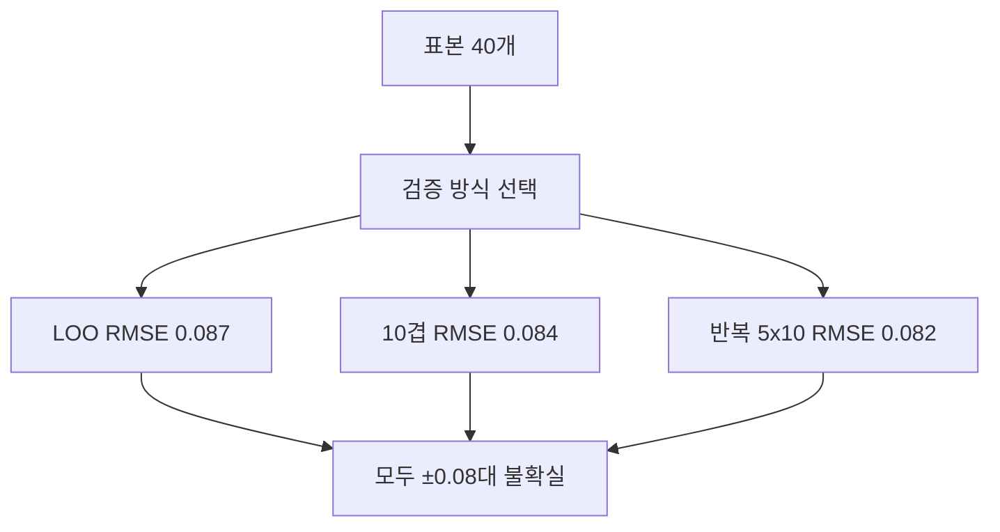
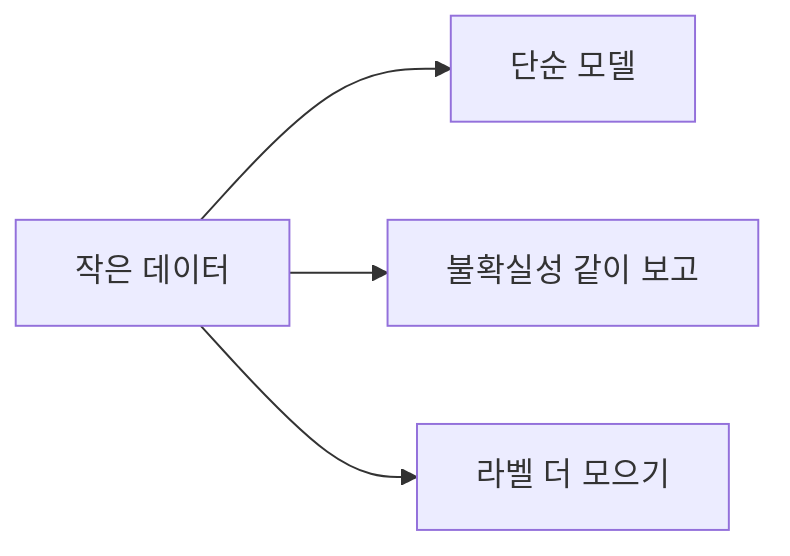

# 아주 작은 데이터의 검증

> 표본이 수십 개뿐이면 어떤 교차검증을 쓰든 점수는 크게 불확실하다. LOO·10겹·반복 교차검증은 평균 편향이 비슷하고, 선택보다 중요한 것은 "점수가 ±0.08쯤 흔들린다"는 사실을 알고 보고하는 것이다.

## 쉽게 말하면
문제가 40개뿐인 시험으로 실력을 재면 어떤 채점 방식을 쓰든 오차가 크다. 채점 방식(LOO냐 5겹이냐)을 바꿔도 오차가 확 줄지 않는다. 문제를 더 늘리는 것이 가장 큰 개선이다.

## 자세히
- **공식 문서의 지침(scikit-learn, 열람)**: LOO는 시험 오차의 추정치로서 분산이 크고 K겹보다 계산 비용이 크다. 대부분의 저자와 경험적 증거는 LOO보다 5겹이나 10겹을 선호한다고 설명한다. 표본이 몇 백 개 미만이면 순열 검정에서도 낙관 편향이 생길 수 있다.
- **직접 해 본 시뮬레이션(합성 분류 데이터에서 40개로 학습, 나머지 2,000개로 진짜 성능 평가, 100번 반복, 로지스틱 회귀)**: 진짜 성능 평균은 0.730. 교차검증 추정은 LOO 0.728(편향 −0.003, 진짜 값과의 RMSE 0.087), 5겹 0.717(−0.013, 0.094), 10겹 0.720(−0.011, 0.084), 5겹×10회 반복 0.714(−0.017, 0.082)였다. 네 방법의 RMSE가 0.082~0.094로 거의 같았다. 이 설정에서는 선택보다 표본 수 자체가 불확실성을 지배했다는 해석이다. 한 가지 데이터 생성 설정의 결과다.
- **선택 지침(해석)**: ① LOO는 계산이 가벼운 선형 모델에서만 매력 있다([LOO 닫힌 형태 계산](#loo-closed-form)) ② 일반적으로는 10겹이나 반복 5겹 ③ 클래스가 불균형하면 층화 ④ 점수와 함께 표본 수·구간을 적는다([부트스트랩](#bootstrap-resampling)) ⑤ 모델은 단순하게(복잡한 모델은 표본에 비해 자유도가 너무 많다).
- **정직한 보고**: "정확도 0.72 (n=40, 오차 약 ±0.08)"처럼 불확실성을 숫자로 적는다. 소수점 두 자리 비교로 모델을 가르지 않는다([동률일 때 고르는 기준](#tie-break-criteria)).
- **대안**: 라벨을 더 모으거나, 사전학습 모델·전이학습·프롬프트 방식으로 학습 표본 수 의존을 줄인다.

## 그림으로 보기

## 예시
- 임상 연구 환자 60명: 10겹 층화 교차검증 5회 반복으로 정확도와 구간을 보고하고, 새 병원 데이터가 생기면 외부 검증한다.
- 교육 활용: 표본 40·400·4,000개로 같은 실험을 해 RMSE가 얼마나 줄어드는지 비교한다.

## 헷갈리는 것과 비교
| 개념 | 차이 |
| --- | --- |
| LOO | 표본 n번 학습, 분산 큼 |
| 10겹 | 학습 90% 사용, 일반적 권장 |
| [RepeatedKFold](#repeated-kfold) | 분할 운 줄임 |
| [홀드아웃 vs 교차검증](#holdout-vs-cv) | 작은 데이터는 교차검증 |

## 더 읽을거리
- [scikit-learn: Cross-validation](https://scikit-learn.org/stable/modules/cross_validation.html) — LOO와 5·10겹 비교 권고
