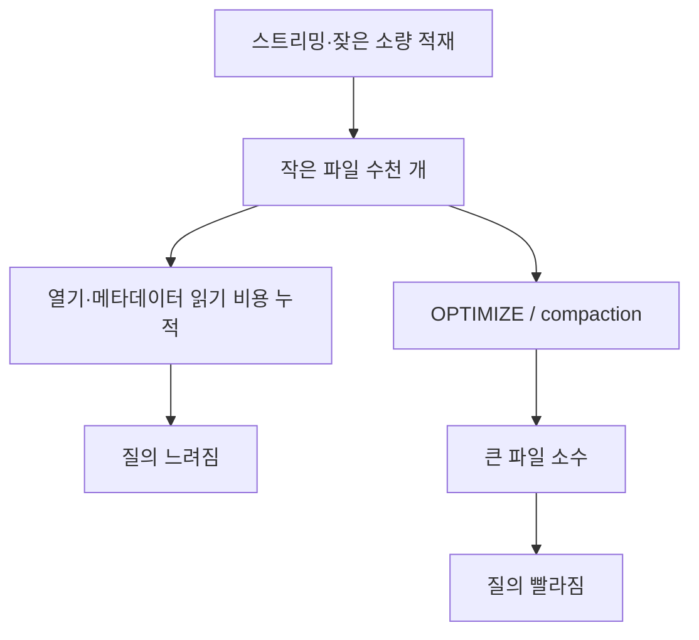
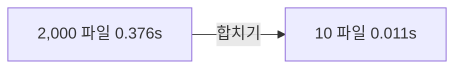

# 작은 파일 문제

> 같은 데이터를 **아주 많은 작은 파일**로 나눠 저장하면 파일을 열고 메타데이터를 읽는 고정 비용이 쌓여 질의가 크게 느려지는 현상이다. 해결은 작은 파일을 큰 파일로 합치는 압축(compaction)이다.

## 쉽게 말하면
같은 책 내용을 2,000장의 낱장 쪽지에 나눠 적어 두면, 한 권짜리 책보다 찾는 데 훨씬 오래 걸린다. 내용은 같아도 쪽지를 집고 펼치는 시간이 쌓이기 때문이다.

## 자세히
- **직접 해 본 실험(이 세션, 가상 데이터, 파이썬 pyarrow·DuckDB)**: 정수 2열과 실수 1열로 된 **100만 행**을 ① **2,000개** Parquet 파일 ② **10개** Parquet 파일로 각각 저장했다. 총 크기는 약 24.9MB vs 18.1MB로 작은 파일이 더 크다(파일마다 메타데이터 중복). 같은 필터(`a < 5`)로 4,895행을 읽는 시간(3회 중 최솟값):
  - pyarrow 데이터셋: 2,000개 약 0.376초 vs 10개 약 0.011초(약 35배)
  - DuckDB: 2,000개 약 0.089초 vs 10개 약 0.0045초(약 20배)
  단일 머신·로컬 디스크·캐시된 상태의 한 번 측정이므로 일반 수치가 아니다. 클라우드 객체 저장소에서는 파일 열기마다 네트워크 왕복이 있어 차이가 더 커질 수 있다(이 글에서 측정하지 않음).
- **해결: compaction(Delta Lake 문서, 직접 확인)**: `OPTIMIZE`가 작은 파일을 큰 파일로 합친다(Delta Lake 1.2.0+). 파티션 조건 지정 가능(`OPTIMIZE events WHERE date = '2021-11-18'`), **멱등**(두 번째 실행은 효과 없음), 데이터를 바꾸지 않아 결과는 같고 스트림 읽기에도 영향이 없다.
- **자동화(같은 문서)**: Auto compaction(3.1.0+)은 쓰기 성공 직후 아직 압축되지 않은 파일만 압축한다. 활성화 시 기본 목표 크기 128MB, 작은 파일이 충분히 쌓였을 때만 동작(`minNumFiles`). **Optimized Write**(3.1.0+, 기본 꺼짐)는 쓰기 시점에 작은 파일 생성을 줄이며 파티션 테이블에 유용하지만 셔플로 쓰기 지연이 늘 수 있다(`binSize` 기본 512MiB). 문서에서 기본 목표 크기 1GB·`delta.targetFileSize`는 확인되지 않았다.
- **원인(해석)**: 스트리밍 마이크로배치, 너무 잘게 나눈 파티션([파티셔닝과 가지치기](#data-partitioning-pruning)), 잦은 소량 적재.
- **주의**: 압축은 쓰기 비용을 쓰며 파일이 너무 커지면 가지치기 효율이 떨어질 수 있다.

## 그림으로 보기

## 예시
- 매 분 수십 KB씩 적재되는 로그 테이블에 야간 `OPTIMIZE` 작업을 걸어 하루치를 큰 파일 몇 개로 병합.
- 교육 소재: 같은 데이터를 파일 개수만 바꿔 저장하고 질의 시간을 재 보는 실습(이 글의 코드 구조와 동일하게 재현 가능).

## 헷갈리는 것과 비교
| 개념 | 차이 |
|---|---|
| 작은 파일 문제 | 파일 수가 비용을 키움 |
| compaction | 작은 파일을 합쳐 해결 |
| [파티셔닝과 가지치기](#data-partitioning-pruning) | 구획 나누기(과하면 작은 파일 유발) |
| [Parquet 열 기반 포맷](#parquet-columnar-format) | 열 단위 저장 포맷 |

## 더 읽을거리
- [Delta Lake: Optimizations](https://docs.delta.io/latest/optimizations-oss.html) — OPTIMIZE·Auto compaction·Optimized Write(직접 확인).
- [DuckDB: Hive partitioning](https://duckdb.org/docs/2.0/data/partitioning/hive_partitioning.html) — 파티션과 파일 읽기(직접 확인).
